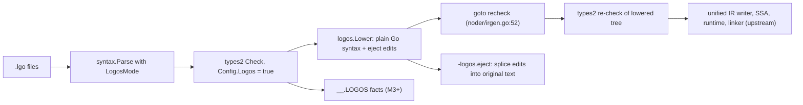

# loGo/s implementation plan

## Context

The user wrote `logos-docs/PLAN.md` (1283 lines): a Go superset named loGo/s, built as a Go 1.27.2 fork at `/home/alpha/compiler/loGos` (remote `origin` = `github.com/gosuda/loGos`). The ask: adversarially review it and plan implementation. The review (spine audit, autoplan CEO/design/DX/engineering registers, 28 concrete defects) found broken mechanisms; the user chose **no cuts**: every PLAN feature stays and is **tailored** so it works. This plan (1) rewrites PLAN.md into the tailored spec, (2) gives decision-complete, test-first steps per milestone, (3) ships an official agent skills plugin and a README, and (4) records the autoplan task ledger.

## Requirements and user decisions

The user's direction of 2026-10-19 makes loGos one toolchain for Go and loGo/s. It is recorded in R-U1 (first-class Go, the plain-`go` rule, lints on Go, cgo for Go, local defaults), R-U2 (two-way interop, nil checks on Go calls into loGo/s code), R-U3 (module and package purity), assumptions A-LGOSEL and A-GOBOUNDARY, and rule G3 (upstream files take hook lines only).

- R-U1 (user, 2026-10-19; replaces the backward-compatibility rule): loGos is one complete toolchain for Go and loGo/s. Go support is first-class, not legacy. Every backend, runtime, GC, stack, SIMD, wasm, cgo, PGO, optimization-level, and tooling improvement applies to Go packages as well as loGo/s packages, under both `logos` and plain `go`. An improvement that changes a Go result or needs loGo/s syntax or types is a loGo/s language rule and stays in `.lgo` (the `make` length overflow check in T-303, the array operators of M14, the collection chains of M6). Plain `go` MAY differ from upstream Go 1.27.2 in performance, code generation, runtime, and tooling. It keeps Go language semantics (every valid Go program keeps its Go meaning, and `run.bash` is the regression floor) and its upstream command text (`go version`, `go help`). A default that changes under plain `go` flips only after `run.bash` passes with it. `logos lint` lints Go packages with the language-neutral rules of M9, at `deny` where the rule's default is `forbid`; `logos build` runs no lints on Go packages. The cgo overhaul covers Go packages (M20): the existing `#cgo noescape` plus `#cgo nocallback` pair is the trigger, and the zig fallback of M0-S5 applies to Go packages. Third-party modules of either kind get no code lints; capabilities apply to every module.
- R-U2 (user, 2026-10-19; replaces the no-interop decision): Go and loGo/s interoperate in both directions, per import. A loGo/s package MAY import any Go package, and a Go package MAY import any loGo/s package, in one workspace or across modules. Go-mode declarations seen from `.lgo` code are platform declarations (platform pointers, M3). loGo/s declarations seen from Go code use their Go-facing signatures, the same ones `logos eject` emits (T-0.3, T-Sec6); a Go package that this toolchain compiles also gets nil checks on its calls into loGo/s code (M3-S7). The diagnostics `correctness::logos_imports_go` and `correctness::go_imports_logos` do not exist. One import has no Go form: a loGo/s union used both as a type constraint and as a value type cannot be expressed in Go, so a Go package that imports it fails (M2-S7). Each module and each package keeps one kind (R-U3). A loGo/s package, and a Go package that imports one, build under `logos`; plain `go` ignores `.lgo` files (A-LGOSEL).
- R-U3 (user, 2026-10-19): a whole module is one kind, Go or loGo/s; a module that holds both kinds fails with `[correctness::mixed_module]`. A package is one kind too; a package that holds both fails with `[correctness::mixed_package]`. Interop is per import, not per package.
- R-U4 (user, 2026-10-19): a struct satisfies an interface with properties only through an explicit `: I` declaration, in any package (T-203.2).
- R-U5 (user, 2026-10-19): `logos-docs/PLAN.md` is renamed to `logos-docs/SPEC.md`; SPEC.md holds the tailored normative spec only, and the original text moves verbatim, by section, to `logos-docs/archive/` (P0-S1 to P0-S3).
- R-U6 (user, 2026-10-19): this plan is committed as `logos-docs/IMPLEMENTATION.md`, with no session-only references (P0-S4).
- R-U7 (user, 2026-10-19): the root `AGENTS.md` gives agents that work on loGos the commands, gotchas, workflow, and references (P0-S8).
- R-SKILLS: ship an official loGo/s agent skills plugin for Claude Code, Codex, AGY (Antigravity), and the Agent Skills standard. User decisions (2026-10-19): skills `logos`, `logos-from-go`, and `logos-review` ship in P1; `logos-concurrency` ships with M8 and `logos-performance` with M13; `plugins/logos/templates/AGENTS.md` ships in P1 for loGo/s repositories; the plugin stays in this repository.
- Q-ARCH = lower then re-check (section Architecture).
- Q-CUTS = no cuts; tailor every feature in PLAN.md.
- Q-NIL = non-nil `*T` in `.lgo`, `T?` options, platform pointers for values from Go-mode declarations.
- Q-CLI = a separate `logos` command.
- Q-DEPTH = every milestone is planned now.
- Q-SEAMS = both: existing Go harnesses and a new `test/logos` harness (PLAN Sec 22).
- R-EXECUTION: after approval, execute P0 through M22 without routine milestone review pauses. Keep all commits local. Do not push branches, open pull requests, publish packages, or create releases.
- R-PERFORMANCE: revise the planned performance milestones, not existing executable code. Optional speed implementations require a stable same-workload baseline, measured candidates, exact behavioral parity, and the G6 keep-or-revert gate. Planning results are not speed measurements.
- R-SIMPLICITY: preserve all requested features and acceptance checks while removing redundant prose and unnecessary implementation layers. No existing Go source cleanup or refactor is authorized by this planning pass.
- Skills invoked by the user that bind execution: offensive-first TDD (tdd), adversarial tests (tests-adversarial), validation-first state machines, spec-driven six-area spec, writing-for-agents (plugin skills), good-readme and github-presence (README), production-go (Go conventions), autoplan (ledger and gate), spine-driven (anchor tags on every step).

## Global rules (apply to every step)

### G1. Test-first protocol (every slice)

1. Write the attack tests named in the slice first, at the named seam. Run them. Each must fail red for the predicted reason (wrong error text, missing behavior), never for a typo. Save the red output in the commit body as one line per test: `RED <test> <reason>`.
2. Implement only what the attacks need. Never edit an attack test in the same repair step as the implementation. If a test was wrong, revert the implementation, fix the test in its own commit with a stated reason, and restart from red.
3. Green: rerun the slice tests plus the slice gate. Diff every test file against its red state; the diff must be empty.
4. Mutation probe: flip one condition or bound in the new implementation, rerun, confirm at least one attack fails, revert the mutation. Record `PROBE <file:line> caught by <test>` in the commit body.
5. One commit per slice. Subject: capitalized imperative, at most 72 characters, no period. Body: what and why, the RED, GREEN, and PROBE lines. No `Co-Authored-By` or agent trailers. Remove any repo-local `user.name`/`user.email` before committing (`git config --local --unset user.name`, same for `user.email`).
6. Adversarial coverage: for every error path a slice adds, write one violation test per documented assumption (inputs, ordering, state, resources, impossible cases), and test every numeric limit at N-1, N, N+1. Every failure path must produce a descriptive error that names the rule and the position.
7. Correction budget: at most three implementation attempts per slice. If the attacks are still red after the third, discard the implementation, save the red attack files as `logos-docs/blocked/<slice id>.patch` (`git diff` of the attack files only), mark the slice's REDTEAM rows `blocked`, commit both as `Record blocked slice <slice id>`, and stop that slice; dependent slices wait.

### G2. Environment and gates
- Go baseline: the tree is go1.27.2 (`VERSION`); `src/go.mod` and `src/cmd/go.mod` declare `go 1.27`, so new code may use every Go 1.27 feature (generic methods, `new(expr)`, `testing/synctest`, `sync.WaitGroup.Go`, `errors.AsType`) and nothing newer.
- Go conventions for new packages (production-go): `ctx context.Context` first; errors wrapped with `%w`, messages lowercase without punctuation; error types named `XxxError`; table-driven tests with subtests; new packages also pass `go test -race -count=1 <pkg>`.

- Toolchain build: `cd /home/alpha/compiler/loGos/src && ./make.bash`. After M0-S1 this installs `bin/go` and `bin/logos`.
- Shell setup for every command below: `export PATH=/home/alpha/compiler/loGos/bin:$PATH` and work from `/home/alpha/compiler/loGos/src` unless a step says otherwise.
- Slice gate (every slice): `./make.bash` succeeds; the slice's named `go test` commands pass when run with `-count=1` (no cached results count as evidence); `gofmt -l` over changed `.go` files prints nothing; `go vet` over changed packages passes.
- Race gate (slices that touch concurrency, runtime, or the go command): the slice's tests also pass with `go test -race -short <pkgs>`.
- Milestone gate: `./run.bash --no-rebuild` passes (this is PLAN Sec 22.1 "upstream regression gate"), then the milestone's acceptance command.
- Lint gate (slices that add a new package): golangci-lint v2 (2.15.0 at `/home/linuxbrew/.linuxbrew/bin/golangci-lint`, built with go1.27.2, so it accepts `go 1.27` modules) with the v2 `standard` linter set, configured by `logos-docs/golangci.yml` (M0-S1 adds it). It runs on new packages only, once per module, with the fork's `go` first on `PATH`: from `src/cmd`, `golangci-lint run --config ../../logos-docs/golangci.yml ./compile/internal/logos/... ./go/internal/logos/...`; from `src`, `golangci-lint run --config ../logos-docs/golangci.yml ./logos/...`. Hook lines in upstream files and `runtime/*_logos.go` stay under `go vet` and `run.bash` only, because the upstream tree is not golangci-clean and G3 forbids unrelated edits there.

#### Release-channel grounding (2026-10-19)
Anchor: Richard Feynman, John Carmack

Repository pins take precedence over newer releases. This is a Go toolchain fork, not a new application: preserve Go 1.27.2 and both modules' `go 1.27` ceilings. The inherited vendored modules stay unchanged. Host tools are not automatically installed or upgraded.

| Choice | Selected version | Release date | Channel and decision |
|---|---|---|---|
| Go | 1.27.2 | 2026-10-08 | [Official releases](https://go.dev/doc/devel/release), [download metadata](https://go.dev/dl/?mode=json): repository baseline wins; no Go LTS track |
| golangci-lint | 2.15.0 | 2026-10-16 | [Release](https://github.com/golangci/golangci-lint/releases/tag/v2.15.0): verified installed baseline; config schema 2 |
| Claude Code | 2.1.303 | 2026-10-18 | [npm channel](https://registry.npmjs.org/@anthropic-ai/claude-code): latest non-prerelease; the schema was inspected in installed 2.1.301, so verify `plugin eval --help` before using the newer CLI |
| Codex | 0.163.0 | 2026-10-15 | [Official release](https://github.com/openai/codex/releases/tag/rust-v0.163.0): current stable, no LTS track |
| AGY | 1.4.0 | 2026-10-16 | [Changelog](https://www.agy.dev/changelog): current stable; check the CLI version directly, not the language-server log |
| skills-ref | 0.1.1 | 2026-01-10 | [PyPI metadata](https://pypi.org/pypi/skills-ref/0.1.1/json): latest published non-prerelease; its wheel declares the `agentskills` console command |
| uv/uvx | 0.13.1 | 2026-10-14 | [PyPI metadata](https://pypi.org/pypi/uv/json): current stable |
| gopls | 0.24.0 | 2026-10-14 | [Module channel](https://proxy.golang.org/golang.org/x/tools/gopls/@latest), [version requirements](https://proxy.golang.org/golang.org/x/tools/gopls/@v/v0.24.0.mod): Go 1.27-compatible |
| Node.js | 24.22.0 LTS | 2026-10-14 | [Release index](https://nodejs.org/dist/index.json): latest stable LTS, not Current 26.12.0 |
| Zig | 0.17.0 | 2026-10-01 | [Release index](https://ziglang.org/download/index.json): stable, not 0.18 development snapshots |
| stringer source | x/tools v0.45.1-0.20260917185718-3dd9077b8066 | 2026-09-17 | [Pinned revision](https://proxy.golang.org/golang.org/x/tools/@v/v0.45.1-0.20260917185718-3dd9077b8066.info): matches `src/cmd/go.mod`; keep this upstream revision rather than latest v0.52.0 |

Go 1.27 support ends when Go 1.29 ships; [support data](https://endoflife.date/api/v1/products/go/) publishes no fixed end date. Node 24 support ends 2028-04-30 ([support data](https://endoflife.date/api/v1/products/nodejs/)). No support-end date was published by the other channels above. The older reference documents' 1.26/1.27-RC descriptions are not evidence of present behavior; the installed source and the pinned release's documentation decide.

Inherited module inventory: `src/go.mod` and `src/cmd/go.mod` pin x/crypto v0.52.1-0.20260526024921-9beb694f9766 (2026-05-26), x/net v0.55.1-0.20260731170536-c1d18010be90 (2026-07-31), x/sys v0.45.0 (2026-05-21), x/text v0.37.0 (2026-05-08), google/pprof v0.0.0-20260507013755-92041b743c96 (2026-05-07), x/arch v0.27.1-0.20260521044007-9c1a596a2c97 (2026-05-21), x/build v0.0.0-20260522210304-d55d0041b921 (2026-05-22), x/mod v0.36.1-0.20260813213634-8569e2639ca1 (2026-08-13), x/sync v0.20.0 (2026-02-23), x/telemetry v0.0.0-20260519152614-eab6ae52b5e2 (2026-05-19), x/term v0.43.0 (2026-05-08), x/tools as above, ianlancetaylor/demangle v0.0.0-20250417193237-f615e6bd150b (2025-04-17), and rsc.io/markdown v0.0.0-20240306144322-0bf8f97ee8ef (2024-03-06). Each pin was checked through `https://proxy.golang.org/<full-module-path>/@v/<version>.info`; x/ names expand to `golang.org/x/`, and GitHub modules to `github.com/<owner>/<name>`. These are upstream source revisions, not new dependency choices. Their support-end dates are not published. The rsc.io/markdown channel has no release within 12 months; changing that vendored dependency is outside this plan.

Before a dependent gate, record the actual output of the tool's version command and compare it with this table. A missing tool or command is a blocked gate, not a reason to install an arbitrary release or silently lower the test. In P1, verify `claude plugin eval --help`, `codex plugin --help`, `agy plugin --help`, and the selected skills-ref distribution's entry points. The skills-ref 0.1.1 wheel was read without installation and its SHA-256 matched PyPI metadata (`d35db5bb8de71ae301daf5ca9cb71f8a555e8c6f83a6d40e46a5bc09f8f461b5`); `entry_points.txt` declares `agentskills = skills_ref.cli:main`. Validation execution is still required at P1. QEMU and the shell utilities remain unpinned host prerequisites; no latest-version claim is made for them.

Production Go scope: retain upstream cmd/go command registration, compiler APIs, and runtime synchronization. Do not introduce Cobra, functional-option constructors, application contexts, third-party goroutine groups, or logging frameworks into those layers merely to match a generic application convention. Use standard-library or existing upstream facilities first; a new dependency or wrapper needs a requirement-specific reason. No Go source changed during planning, and no build, race, vet, or lint pass is claimed for the future implementation.

### G3. Upstream diff rule (rebase economics, PLAN Sec 18)

- In upstream files, add hook lines only: a call into a `*_logos.go` file or a new package, guarded by a logos condition (language behavior) or by the improvement's own flag or experiment (backend, runtime, cgo, tooling). All logic lives in new files: `*_logos.go` beside the hook, or new packages `cmd/compile/internal/logos/...`, `cmd/go/internal/logos/...`, `src/logos/...`, `runtime/*_logos.go`.
- Plain `go` keeps Go language semantics and its upstream command text (`go version`, `go help`); improvements are allowed behind hooks (R-U1). Language behavior (`.lgo` recognition, loGo/s syntax and type rules, loGo/s lints) is selected by the `logos` command (argv[0] mode) or by a `logos` condition. Backend, runtime, cgo, and tooling improvements carry no `logos` guard: they apply to Go packages under `go` and `logos`, and experimental ones stay behind GOEXPERIMENT. Plain `go` reads no `logos.toml` and registers its improvement flags (`-O`, `-gc`, `--wasm-features`) without help text, so `go help` stays upstream. A default that changes under plain `go` flips only after `run.bash` passes with it.

### G4. Lexicon (one name per thing)

| Thing | Name |
|---|---|
| Command | `logos` (GOROOT/bin/logos; same program as `go`, selected by argv[0]) |
| Source files | `.lgo`; aliases: U+1F4DC (scroll), U+26A1 (lightning), U+0295 U+25D4 U+03D6 U+25D4 U+0294 (gopher) |
| Config file | `logos.toml` next to `go.mod` (PLAN's `bettergo.toml`, renamed) |
| Build tag set in logos mode | `logos` |
| Directives | `//logos:allow(<rule>)`, `//logos:cgo_fastcall`, `//logos:wasmexport`, `//logos:wasmimport`, `//logos:zeroalloc` |
| Lint package | `cmd/compile/internal/logos/lint` (PLAN's `betterlint`, renamed); rule IDs `group::name` |
| Lowering package | `cmd/compile/internal/logos` |
| Support packages | `logos/rt` (helpers), `logos/sync` (`Locked[T]`, `Hot[T]`), virtual `comptime` |
| Reserved identifier prefixes in `.lgo` | `_logos_`, `Logos_` |
| Spec | `logos-docs/SPEC.md`, the tailored normative spec; `SPEC Sec N` cites its section N (P0-S2) |
| Original spec | `PLAN`: `logos-docs/PLAN.md` at commit 57475ed, archived by section in `logos-docs/archive/` (P0-S3); `PLAN:<n>` cites its line n and `PLAN Sec N` its section N. SPEC.md keeps the section numbers, so the tailored text of a cited section is `SPEC Sec N`, and where the two differ, SPEC wins |
| Implementation plan | this document, committed as `logos-docs/IMPLEMENTATION.md` (P0-S4) |
| Cross-package facts | archive member `__.LOGOS` |
| Compiler flags | `-logos.eject=DIR`, `-logos.json`, `-logos.mode=next|context`, `-logos.cfg=FILE` |
| Experiments | `GOEXPERIMENT=logosarena`, `logosgcmoving`, `logosgen`, `logosstack`, `logosfastcgo` (default on after the M20 gate; opt-out `nologosfastcgo`) |
| cmd/go build flags | `-O`, `-gc`, `--wasm-features`, `--wasm-loader`: accepted by `logos build` and `go build`; plain `go` registers them without help text; a flag that only changes what cmd/go writes or passes (the loader, the tier, the GC mode) is a flag and never a `GOEXPERIMENT`, because an experiment rebuilds the standard library and changes every cache key |

### G5. Spine anchors

Every milestone and slice carries an `Anchor:` line (anchors from the user's spine skill). Subagent briefs must copy the slice text, its anchors, and these stance limits: offense stays inside the surface the slice names; formal rigor only where a plausible defect breaks an invariant; minimalism keeps every useful part (error paths, tests, needed detail); one shallow abstraction level, extract on the third use.

### G6. Optional speed implementations (no feature cuts)
Anchor: Richard Feynman, John Carmack

- Scope: optional speed implementations in the performance milestones, not removal of features, callers, tests, or diagnostics. Exact behavior is required; no approximation is authorized. T-PERF targets remain report-only.
- Freeze before mutation: record the tracked source set, content hashes, input hashes, revision, caller contract, signatures, errors, and API/configuration boundaries. A boundary change needs user consent.
- Baseline: use the same machine, workload, flags, and `GOMAXPROCS` on both sides. Default `GOMAXPROCS=1`; a concurrency workload records its required level instead. Calibrate an iteration count `N` until a benchmark performs at least one second of useful work, then freeze that count for baseline, every candidate, and integration. If a candidate completes below one second, raise `N` for every side and recapture the baseline. Never compare different work counts.
- Measurement: use compiled test binaries with `hyperfine --warmup 3 --min-runs 10 --export-json`. Warmups are excluded by hyperfine. Require standard deviation at most 20% of the median; otherwise resolve noise before scoring. Record median, standard deviation, minimum, and maximum. Run the CPU profile separately, without profiling timed samples. Corroborate with `go test -run='^$' -bench='<exact-name>' -benchtime="${N}x" -count=10 -benchmem <package>`; `-run` excludes tests and does not select benchmarks.
- Hot-path admission: require at least 5% of measured time in the path, or input-scaled call counts confirmed by instrumentation. Compute the contract's lower bound and `baseline / floor` with a calculator. A path within 2x of its floor needs no candidate rewrite.
- Metrics: pin latency as the speed metric before collecting candidate results. Report `B/op`, `allocs/op`, and binary bytes separately. An allocation or size reduction alone is not a speedup.
- Candidates: dispatch five isolated worktree lanes concurrently, one for algorithm, layout, caching, concurrency, and local boundary/code-generation cost. A single function below 50 lines with one evident concern may use one candidate, with the reason recorded. Each candidate changes one mechanism within the frozen source set. Candidates return edits without running gates or formatters. The parent measures and verifies; serialize benchmark runs on a shared host to prevent contention from corrupting measurements.
- Evidence: append the baseline, fingerprint, calibrated `N`, environment, candidate results, parity verdicts, and decisions to `.outline/optimize/<slice>/log.jsonl`. Reuse a baseline only while source, workload, and environment fingerprints match. Store each baseline, candidate, and integration run in a separate run-ID subdirectory so JSON and profiles cannot overwrite earlier evidence. A changed fingerprint starts a new baseline record; never overwrite earlier evidence.
- Ranking: compute `ratio * safety * (1 - cost * 0.3)`, where `ratio = baseline_median / candidate_median` for identical work, `safety = 1` for exact verified parity and `0` otherwise, and `cost` is the recorded readability/complexity cost in `[0,1]`. Rank the viable candidates before integration.
- Parity: compare outputs, error semantics, nil versus empty, bounds, panic conditions, NaN, cancellation, concurrent sequences, and required floating-point order. The optimization must not change behavior with `-O`. Use the unchanged implementation as oracle where applicable.
- Acceptance: after integration, repeat the same benchmark and require a ratio of at least 1.05. Limit promotion attempts to the viable-candidate count. A 1.02 marginal-gain floor stops further attempts; it never lowers the 1.05 acceptance gate.
- Non-win: restore only the candidate delta, preserving feature implementation and user changes. Keep the measurement record. Classify cold units as fixed, at floor, or left with a reason; do not add a cache, branch, or flag for cold-path microseconds.
- Winner: the parent runs G2 verification and a native/ejected behavior smoke once across the integrated change. Land one local optimization commit with measurements and parity evidence. No push, PR, release, or publication.
- Workload matrix: reuse the benchmarks below after their owning features exist. Run from `src/` with the fork's `bin` first on `PATH`. Set `slice` to the current slice ID and `run` to the unique measurement record ID, then `out="$PWD/../.outline/optimize/$slice/$run"; mkdir -p "$out"`. Each row is a separate campaign with its own frozen `N`; do not compare rows. Missing benchmark, profiler, hyperfine, or wasm runner means that measurement is blocked, not passed.

| Owner | Package | Exact benchmark | Required runtime |
|---|---|---|---|
| M5-S4 | `./logos/rt` | `BenchmarkConstMapLookup` | native |
| M11-S1 | `./logos/rt/json` | `BenchmarkJsonEscapeScan` | native |
| M18-S3 | `runtime` | `BenchmarkLogosArenaBump` | `GOEXPERIMENT=logosarena` |
| M15-S3 | `runtime` | `BenchmarkLogosLoopStride` | js/wasm through `../lib/wasm/go_js_wasm_exec` and Node |
| M20-S1 | `cmd/cgo/internal/testlogos` | `BenchmarkFastcall` | native with cgo; two builds of the same benchmark: candidate with `GOEXPERIMENT=logosfastcgo`, baseline with `GOEXPERIMENT=nologosfastcgo` |

The M20-S1 row runs the block twice, once per experiment setting, because the experiment is a compile-time choice: each build goes to its own run-ID subdirectory, with one frozen `N`, and the ratio is `baseline_median / candidate_median`. The M20-S1 blocking-call delay check uses the same procedure with the ready-goroutine delay as the metric. For each native row, set `pkg` and `bench` from the table and preserve its environment for every command:

```bash
go test -c -o "$out/workload.test" "$pkg"
hyperfine --warmup 3 --min-runs 10 --export-json "$out/timing.json" "\"$out/workload.test\" -test.run='^$' -test.bench='^${bench}$' -test.benchtime=${N}x -test.benchmem"
"$out/workload.test" -test.run='^$' -test.bench="^${bench}$" -test.benchtime="${N}x" -test.cpuprofile="$out/cpu.out"
```

For the wasm row, compile with `GOOS=js GOARCH=wasm` and invoke the built binary through `"$PWD/../lib/wasm/go_js_wasm_exec"` in both timed and profile commands. Retain the experiment/flags established by M15-S3; do not invent a runtime `-d` flag. Record an unavailable profiling capability as a measurement blocker. None of these future workloads has been measured during planning.

## Architecture (Q-ARCH)



Invariants:
- A1. The lowered tree contains no loGo/s node kind. `logos.Lower` ends with a walk that calls `base.FatalfAt(pos, "logos: %T survived lowering", n)` if one remains.
- A2. Native and ejected programs come from the same lowered nodes; eject splices printed lowered snippets into the original source, so comments outside replacement spans survive. Comments inside a rewritten statement need explicit text-level preservation (M1-S5, M1-S6); whole-statement `Edit` printing alone loses them.
- A3. Lowered nodes copy positions from the source node they replace (`SetPos(orig.Pos())`, reusing the same `*PosBase`); errors and stack traces point into `.lgo` files.
- A4. Nodes are never shared between two places in the lowered tree; duplicated subtrees are deep-copied with `logos.clone` (types2 stores types in syntax nodes, `irgen.go:70`).
- A5. The re-check runs with fresh `types2.Info` maps (they are built after `recheck:`) and resets `types.PkgMap()` `Direct` flags and `typecheck.Target.Imports`, copying the midway reset at `noder/irgen.go:193-199`.
- A6. Checked-lowering sequencing: lowering starts only after the first types2 check succeeds; it precedes the existing SIMD midway transformation and range-function rewriting; each transformation has its own once-only state (`didLogos` beside `didMidway`) so a later upstream recheck never repeats loGo/s lowering. First-pass language facts needed after lowering survive as owned package/export information bound to the `__.PKGDEF` fingerprint. The recheck checks the lowered Go representation under Go semantics: the recreated config selects `conf.Logos = originalPackageIsLogos && !didLogos`, so source-only loGo/s rules (reserved `_logos_`/`Logos_` names, non-nil nils, `?` placement, and the like) never rerun on generated code. Source-only checks run on the first pass, before lowering erases their evidence; the original package kind is retained separately for emission and export facts.
- A7. Eject preserves comments inside replacement spans as well as outside them. Valid comments never cause eject or lowering to reject a program. An AST-only `syntax.String` comparison cannot prove comment preservation; M1-S6 carries a text-level oracle.

## Milestone index

| ID | Name | PLAN sections | Depends on |
|---|---|---|---|
| P0 | Spec rename to SPEC.md, tailored spec, archive, IMPLEMENTATION.md, root AGENTS.md, ledgers, todos | all | none |
| M0 | `logos` command, `.lgo` packages, config, harnesses | 0.1, 0.2, RFC-101, Sec 10, Sec 22 harness | P0 |
| M1 | `?`, `defer f()?`, `errdefer`, error traces, eject | RFC-104.1-2, 0.3, Sec 7.1, Sec 8.1 (errTrace) | M0 |
| P1 | Agent skills plugin v1: skills `logos`, `logos-from-go`, `logos-review`, AGENTS.md template, evals | R-SKILLS | M1 |
| P2 | README | good-readme | M1 |
| M2 | Closed unions, switch expressions, inline assertions | RFC-203.1, RFC-203.3, Sec 6.2 | M1 |
| M3 | Facts sidecar, non-nil pointers, `T?`, `?.`, `??`, platform pointers | RFC-202, Sec 6.1 | M2 |
| M4 | Interface properties | RFC-203.2, Sec 6.3 | M3 |
| M5 | Const composites, CTFE, const views, const maps | RFC-201, Sec 9 | M3 |
| M6 | Sugar: `$"..."`, `&expr`, defaults, spread, tuples, lambdas, chains, `yield`, `scope defer` | RFC-104.3-6, RFC-204.1 | M3, M5 |
| M7 | Comptime | RFC-205, Sec 7.2 | M6 |
| M8 | `go group`, `logos/sync` | RFC-206, Sec 20 | M6 |
| M9 | Lints and JSON diagnostics | RFC-102, Sec 16 | M8 |
| M10 | `logos next`, `logos context` | RFC-103 | M9 |
| M11 | Static JSON | Sec 12 | M7 |
| M12 | Capabilities auditor | Sec 13 | M0 |
| M13 | `-O` tiers, synthetic PGO, clone specialization, ICF | RFC-105, RFC-203.4 | M9 |
| M14 | Fixed-array SIMD | RFC-204.2 | M6 |
| M15 | Backend peepholes, long-loop preemption | RFC-303, Sec 15 | M13 |
| M16 | WASM profile | Sec 14 | M3, M15 |
| M17 | Smart stack | RFC-302 | M13 |
| M18 | Tier-0 arena and bump allocator | RFC-301.1, Sec 8.1-8.3 | M17 |
| M19 | GC modes | RFC-301.2, Sec 8.4, Sec 19 | M18 |
| M20 | CGo in loGo/s packages, Fast-CGo for Go and loGo/s | RFC-304, Sec 8.5 | M0 |
| M21 | `logos lsp` | Sec 21 | M9 |
| M22 | Verification suites and end-to-end example | Sec 11, Sec 22 | all |

The skills plugin (P1) and README (P2) are updated after each later milestone with its shipped features (step "Docs" in each milestone).

## P0. Spec, archive, plan, agent instructions, ledgers, todos

Anchor: Christopher Alexander, Tony Hoare, J.R.R. Tolkien

P0 slices are documentation-only. Each carries its named structural Check (counts, `cmp`, file listings); P0 uses no G1 RED/GREEN/PROBE cycle and no `./make.bash` toolchain rebuild. Executable slices retain G1/G2.

- P0-S1 Rename the spec (user decision, 2026-10-19): `git mv logos-docs/PLAN.md logos-docs/SPEC.md` and nothing else, so the commit is a pure rename and `git log --follow logos-docs/SPEC.md` keeps the history.
  Anchor: J.R.R. Tolkien, Tony Hoare
  - Check: `git show --stat --format= HEAD` prints exactly ` logos-docs/{PLAN.md => SPEC.md} | 0` and ` 1 file changed, 0 insertions(+), 0 deletions(-)` (output format confirmed with Git in a scratch repository).
- P0-S2 Rewrite `logos-docs/SPEC.md` as the tailored normative spec, and only that: copy the planning-session draft `logos-docs/SPEC.md` byte for byte (`cp <draft> logos-docs/SPEC.md`; it is approved with this plan). If the draft file is missing, stop P0 and report the missing path; never rewrite the spec from scratch. Rules the draft follows (they also govern every later change to SPEC.md):
  Anchor: Tony Hoare, Richard Feynman
  - Content: what users and tools observe (syntax, meaning, diagnostics, commands, flags, config keys, runtime guarantees, limits, performance targets). Internal mechanisms (internal names, struct fields, file locations, assembly sequences, algorithms without an observable effect) stay out; this plan and the archive (P0-S3) hold them.
  - Structure: a header (`Status: Tailored spec, 2026-10-19, amended for first-class Go support and two-way interop (no features removed except the two import-ban diagnostics)`, `Base: Go 1.27.2`, `Original: logos-docs/PLAN.md at commit 57475ed, archived in logos-docs/archive/`), then `## 0.` to `## 22.` with the original section numbers, then `## 23. Spec areas`. A section whose original content is only implementation detail keeps its heading and one pointer line to its archive file and to the plan milestone that builds it.
  - Sources: table T row by row (each row's tailored rule replaces the text it names), tables T-PERF and N, R-U1 to R-U4, and assumptions A-STD, A-LGOSEL, A-CODEGEN, A-XMOD, A-EXAMPLES, A-MODKIND. Lexicon G4 names everywhere (`bettergo.toml` -> `logos.toml` with one rename note, `betterlint` -> `logos lint`, `go lint`/`go next`/`go context` -> `logos lint`/`logos next`/`logos context`, "Go 1.24-1.26" -> "Go 1.27"). Every performance number is `target: <value>, measured by <benchmark>` from T-PERF, or its T-PERF rejection reason.
  - Register: ASD-STE100; one requirement per sentence; RFC 2119 keywords (MUST, MUST NOT, SHOULD, SHOULD NOT, MAY) replace SHALL; each requirement ends with its trace tags, one ID per bracket and adjacent when several (`[T-104.1]`, `[T-104.1][R-U3]`, `[T-PERF]` for a T-PERF row).
  - Section 23 holds the six spec areas: Objective (product sentence from the review), Commands (G2), Project structure (G3 file layout), Code style (gofmt, Go doc comments on exported API, one real snippet from the M1-S5 lowering), Testing strategy (G1 and the seam table in M0-S6), Boundaries (Always: G1 and G2; Ask first: changes to `.go` package semantics, new exported std API, network access; Never: commit secrets, edit `src/vendor` or `src/cmd/vendor`, weaken a test to reach green).
  - Check: `grep -c '^## ' logos-docs/SPEC.md` prints `24`; `grep -c 'SHALL' logos-docs/SPEC.md` prints `0`; `grep -c 'bettergo' logos-docs/SPEC.md` prints `1`; `grep -c 'Go 1.24-1.26' logos-docs/SPEC.md` prints `0`; every `[T-...]` tag names a row of table T or is `[T-PERF]` (`grep -o '\[T-[^]]*\]' logos-docs/SPEC.md | huniq` lists only those IDs).
- P0-S3 Create `logos-docs/archive/`: the original spec, verbatim, split by section into the files of table A. Each file is a 4-line header followed by its original lines (`git show 57475ed:logos-docs/PLAN.md | sed -n '<first>,<last>p'`). Header: line 1 `# <Title> (archived)`, line 2 empty, line 3 `Historical, non-normative text from logos-docs/PLAN.md lines <first>-<last> at commit 57475ed. The normative spec is logos-docs/SPEC.md; the build plan is logos-docs/IMPLEMENTATION.md.`, line 4 empty. `logos-docs/archive/README.md` lists the files of table A with one line each. The archive holds no other material.
  Anchor: Richard Feynman, David Parnas
  - Check: the bodies in table A order reproduce the original byte for byte: `for f in document-header.md axioms.md tier1-toolchain-linter-sugar.md tier2-type-system.md tier3-runtime-backends.md red-team-summary.md lexer-parser-ast.md types-export-abi.md lowering-templates.md runtime-memory.md const-map-layout.md config-schema.md example-program.md static-serializer.md capabilities-auditor.md wasm-profile.md backend-passes.md json-diagnostics.md red-team-ledger.md file-manifest.md gc-engines.md unwind-tables.md ide-protocol.md verification-suite.md; do tail -n +5 "logos-docs/archive/$f"; done | cmp - <(git show 57475ed:logos-docs/PLAN.md)` exits 0 (bash, from the repository root); `ls logos-docs/archive | wc -l` prints 25.
- P0-S4 Commit this plan as `logos-docs/IMPLEMENTATION.md` (user decision, 2026-10-19), after P0-S1 so the rename stays pure. The committed copy drops every session-only reference (links with the `local` scheme and paths under the agent session directory): the P0-S2 draft path becomes `logos-docs/SPEC.md`, and every other one is removed with its clause (the P1 evidence clause, the `cmp` against the draft in the P0-S2 check).
  Anchor: David Parnas, Tony Hoare
  - Check: `grep -Ec 'loca[l]:/{2}' logos-docs/IMPLEMENTATION.md` prints `0`; `grep -c '/home/alpha/[.]omp/' logos-docs/IMPLEMENTATION.md` prints `0`.
- P0-S5 Create `logos-docs/REDTEAM.md`, the test-status ledger for the 182 attacks (the 2026-10-19 direction appends rows #183 to #189 for the interop, boundary, loader, and cgo attacks it adds; their resolutions are SPEC.md Section 17 entries #183 to #189). The resolutions live only in SPEC.md Section 17, so this file holds no resolution text. Content: line 1 `# Red-team test ledger`, line 2 empty, line 3 `Resolutions: logos-docs/SPEC.md Section 17. Status values: planned, tested, satisfied upstream, blocked.`, line 4 empty, then a table with header `| ID | Milestone | Test | Status |` and one row per attack in ID order: `ID` is `#N`; `Milestone` lists the milestones of every slice whose `Red-team rows` line in this plan names `#N`, comma-separated in plan order (`#80` gets `M22`); `Test` starts empty; `Status` starts `planned`.
  Anchor: Tony Hoare, Edward Tufte
  - Rule for later slices: a slice that lands a test for `#N` sets `Test` to the repository path of that test (for example `test/logos/redteam/attack_042_errdefer_panic.lgo`, or the slice test that covers the attack) and `Status` to `tested` in the same commit. A slice that only pins upstream Go behavior sets `satisfied upstream` and names the upstream test. G1 rule 7 sets `blocked`.
  - Check: `grep -c '^| #' logos-docs/REDTEAM.md` prints `189` (182 original rows plus #183 to #189); `grep -c '| planned |$' logos-docs/REDTEAM.md` prints `189` until a slice lands a test.
- P0-S6 Create `tasks/autoplan-ledger.jsonl` with exactly the lines in section "Autoplan ledger" of this plan (append-only; never rewrite existing lines).
  Anchor: Tony Hoare, Edward Tufte
  - Check: `jaq -c . tasks/autoplan-ledger.jsonl` parses every line; `jaq -r .id tasks/autoplan-ledger.jsonl | huniq -c` shows each ID once.
- P0-S7 Replace the session todo list with one item per milestone slice in dependency order, each tagged with its anchors.
  Anchor: Christopher Alexander, Tony Hoare
- P0-S8 Create the root `AGENTS.md` (user decision, 2026-10-19), read natively by Claude Code, Codex, Cursor, and other agents. Exact content:
  Anchor: David Parnas, Dieter Rams
  ````markdown
  # loGos

  loGos is a fork of Go 1.27.2 that adds the loGo/s language (`.lgo` files) and the `logos` command. It is one toolchain for Go and loGo/s: backend, runtime, cgo, and tooling improvements apply to Go packages too.

  ## Commands

  Run from `src/` with the fork first on PATH: `export PATH="$(cd .. && pwd)/bin:$PATH"`.

  - Build the toolchain: `./make.bash`. Rerun it after every compiler, runtime, or cmd/go change, because tests use the installed binaries.
  - Test one package: `go test -count=1 -short <pkg>`. Cached results are not evidence.
  - Add `-race` for concurrency, runtime, and cmd/go changes.
  - Script tests: `go test -count=1 cmd/go -run 'Script/^logos_<name>$'`.
  - Compiler run and errorcheck tests: `go test -count=1 cmd/internal/testdir -run 'Test/logos/'`.
  - Changed files: `gofmt -l <files>` prints nothing, and `go vet <pkgs>` passes.
  - Milestone gate: `./run.bash --no-rebuild`.

  ## Gotchas

  - Plain `go` keeps Go language semantics and its upstream command text (`go version`, `go help`), and `run.bash` is its regression floor. It may differ from upstream in performance, code generation, runtime, and tooling.
  - Upstream files take hook lines only: one call into a `*_logos.go` file or a new package. Guard language behavior with a logos condition; backend, runtime, and cgo improvements take no logos guard and apply to Go packages too. Put the logic in new files, because every upstream line costs rebase work.
  - Leave `src/vendor` and `src/cmd/vendor` unchanged; they are vendored copies.
  - A module holds only `.go` packages or only `.lgo` packages. Go and loGo/s packages import each other, per import; only `logos` builds `.lgo` files.

  ## Workflow

  - Work slice by slice from `logos-docs/IMPLEMENTATION.md`: write the slice's attack tests, see them fail, build, then pass the slice gate (rules G1 and G2).
  - A changed language rule updates its Table T row in IMPLEMENTATION.md and the matching SPEC.md sentence in the same commit.
  - A slice that stays red after three attempts is recorded as blocked (rule G1, item 7); tests are never weakened to reach green.

  ## References

  - Language spec: `logos-docs/SPEC.md`
  - Build plan, gates, and lexicon: `logos-docs/IMPLEMENTATION.md`
  - Red-team test ledger: `logos-docs/REDTEAM.md`
  - Original spec text (historical, not normative): `logos-docs/archive/`
  ````
  - Check: `wc -l < AGENTS.md` prints at most 60; each referenced path exists (`test -f logos-docs/SPEC.md && test -f logos-docs/IMPLEMENTATION.md && test -f logos-docs/REDTEAM.md && test -d logos-docs/archive && echo OK` prints OK); `grep -Ec 'loca[l]:/{2}' AGENTS.md` prints 0; quote-back: a fresh agent session asked "Which files take hook lines only?" answers with the upstream-files rule.
  - Upkeep: M0-S1 adds, in the same commit as `logos-docs/golangci.yml`, the lint lines (`New packages only: from src, golangci-lint run --config ../logos-docs/golangci.yml ./logos/...; from src/cmd, golangci-lint run --config ../../logos-docs/golangci.yml ./compile/internal/logos/... ./go/internal/logos/...` and the gotcha `golangci-lint reports issues in upstream code; run it on new packages only`) and the `logos` command lines (`logos build ./...`, `logos test ./...`); any later change to the G2 commands updates this file in the same commit.
- Commits, in this order: P0-S1 `Rename the loGo/s spec to SPEC.md`; P0-S2 `Tailor the loGo/s spec without removing features`; P0-S3 `Archive the original loGo/s spec by section`; P0-S4 `Add the loGo/s implementation plan`; P0-S5 `Add the red-team test ledger`; P0-S6 `Add the autoplan task ledger`; P0-S8 `Add agent instructions for the loGos repository`.

### Table A: archive files (P0-S3)

| File | Original lines | Title |
|---|---|---|
| `document-header.md` | 1-9 | Document header |
| `axioms.md` | 10-21 | Section 0: architectural axioms |
| `tier1-toolchain-linter-sugar.md` | 22-107 | Section 1: tier 1 (toolchain, linter, desugaring) |
| `tier2-type-system.md` | 108-178 | Section 2: tier 2 (type system, unions, interfaces, comptime) |
| `tier3-runtime-backends.md` | 179-210 | Section 3: tier 3 (GC, allocator, stack, cgo, backends) |
| `red-team-summary.md` | 211-223 | Section 4: red-team summary |
| `lexer-parser-ast.md` | 224-313 | Section 5: lexer, parser, AST |
| `types-export-abi.md` | 314-373 | Section 6: type checker, export data, ABI layout |
| `lowering-templates.md` | 374-498 | Section 7: eject lowering templates |
| `runtime-memory.md` | 499-601 | Section 8: runtime memory and GC internals |
| `const-map-layout.md` | 602-612 | Section 9: rodata const map layout |
| `config-schema.md` | 613-658 | Section 10: configuration schema |
| `example-program.md` | 659-765 | Section 11: end-to-end example |
| `static-serializer.md` | 766-825 | Section 12: static serializer |
| `capabilities-auditor.md` | 826-864 | Section 13: capabilities auditor |
| `wasm-profile.md` | 865-901 | Section 14: WASM profile |
| `backend-passes.md` | 902-927 | Section 15: backend peephole and SIMD passes |
| `json-diagnostics.md` | 928-960 | Section 16: JSON diagnostics schema |
| `red-team-ledger.md` | 961-1158 | Section 17: red-team ledger |
| `file-manifest.md` | 1159-1177 | Section 18: upstream file manifest |
| `gc-engines.md` | 1178-1231 | Section 19: GC engines |
| `unwind-tables.md` | 1232-1254 | Section 20: unwind tables |
| `ide-protocol.md` | 1255-1269 | Section 21: IDE protocol |
| `verification-suite.md` | 1270-1283 | Section 22: verification suite |

### Table T: tailored rules (normative content of SPEC.md)

| Row | PLAN ref | Tailored rule | Milestone |
|---|---|---|---|
| T-0.1 | Sec 0.1 | Plain `go` keeps Go language semantics: every valid Go program keeps its Go meaning, `run.bash` is the regression floor, and `go version` and `go help` print the upstream text. Plain `go` MAY differ from upstream Go 1.27.2 in performance, code generation, runtime, and tooling, and every backend, runtime, cgo, and tooling improvement applies to Go packages as well as loGo/s packages under both `go` and `logos` (R-U1). The loGo/s language (`.lgo` recognition and loGo/s syntax and type rules) is selected by the `logos` command; plain `go` ignores `.lgo` files (A-LGOSEL). `logos` builds Go packages with Go semantics: no loGo/s typing rules apply to Go. A module is one kind: all its packages are `.lgo` (a loGo/s module) or all are `.go` (a Go module). A package is one kind. A workspace may hold both kinds. Imports cross kinds in both directions, per import (R-U2). | M0, M9 |
| T-0.2 | Sec 0.2 | No new global keywords. Contextual words, valid only in `.lgo`: `errdefer` (statement start, followed by an identifier or `func`), `yield` (statement start inside generator functions), `scope` (immediately before `defer`), `group` (immediately after `go`). `const` gains new positions (`const for/if/switch/func`) that are syntax errors in Go today. Sec 5.1 counts 2 contextual identifiers (errdefer, yield). scope (M6-S10) and group (M8-S2) bring the implemented total to 4. | M1, M6, M7, M8 |
| T-0.3 | Sec 0.3 | `logos eject -o DIR` (alias `logos build --emit-go=DIR`) writes a complete pure-Go copy of the main module to DIR (must not exist or be empty): `.lgo` files become `.go` files and comments are kept. Every non-standard loGo/s dependency module is ejected too, into `DIR/_logos_deps/<module path>@<version>/`, with `replace` lines added to `DIR/go.mod` (a Go package that imports a loGo/s package resolves it to the ejected copy, R-U2; the Go-facing signatures of T-Sec6 are the ones eject emits). The support sources (`logos/rt`, `logos/sync`) become one shared module `github.com/gosuda/loGos/rt` in `DIR/_logos_deps/rt` (one type identity for `Option[T]` and friends across ejected modules), with a `replace` line. `import "comptime"` is removed. No `//go:build !logos` line and no in-place coexistence (R-U3). Ejected code builds with an upstream Go 1.27 toolchain. | M1 |
| T-0.4 | Sec 0.4 | Kept as the design axiom; enforced by types (M2, M3, M5) and lints (M9). | all |
| T-101.1 | RFC-101.1 | Source extensions `.lgo` and the three aliases, recognized only in logos mode. Strip trailing U+FE0E/U+FE0F from the extension before matching. NFC normalization is the identity on all four extension strings (no code point in them decomposes canonically), so no normalizer runs. Two files whose names differ only by alias extension in one package: error `correctness::duplicate_stem_filename`. Alias files cannot be published: module zips reject non-letter symbols (x/mod `zip.go:306-308`); `logos` reports warning `portability::alias_extension` for each alias file when the main module path's first element contains a dot. | M0 |
| T-101.2 | RFC-101.2 | When the main module is a loGo/s module, an absent `logos.toml [build] cgo` key defaults to `forbid` (`CGO_ENABLED` defaults to 0), but an explicitly set `CGO_ENABLED=0\|1` in the environment overrides that absent-key default. Presence wins: explicit `cgo = "forbid"` stays disabled even with `CGO_ENABLED=1`; explicit `cgo = "restricted"` keeps its `cgo_allowlist` check even with `CGO_ENABLED=1`; explicit `cgo = "allow"` stays enabled even with `CGO_ENABLED=0`; each violation is error `restriction::cgo_usage`. `logos.toml [build] cgo = "forbid" \| "restricted" \| "allow"`; `"restricted"` requires every package with `import "C"` to match `cgo_allowlist` globs. When cgo is enabled, `CC` is unset, and the default C compiler is missing, `logos` and plain `go` MUST use `zig cc -target <zig-arch>-<zig-os>[-musl]` for the build target if `zig` is in PATH (`-musl` only for linux), for Go packages and loGo/s packages alike (R-U1). The build target is the GOOS/GOARCH pair of the build, not the host. A Go main module keeps the upstream default and upstream `CGO_ENABLED` handling; a `cgo` key in a Go module's `logos.toml` has no effect (the policy is loGo/s-only). `go` keeps `cfg.go:171-178` behavior for the `CGO_ENABLED` default. Concern stated once: cgo off switches `net` and `os/user` in the standard library to their pure-Go paths. Reversible local default: automatic selection after timeout, not manual approval. | M0 |
| T-102 | RFC-102 | Linter runs inside `cmd/compile` on `.lgo` packages after the first types2 pass (syntax rules) and inside escape analysis (escape rules); overhead target 2% of compile time, measured by `cmd/compile/internal/logos/lint` benchmark `BenchmarkLintOverhead`. `logos lint` also lints the Go packages of the main module with the language-neutral rules (the rules marked in M9-S2); rules defined on loGo/s syntax or types do not apply to Go. `logos build` runs no lints on Go packages, and plain `go` has no lint step. Default severities apply to both kinds, except that a language-neutral rule whose default is `forbid` runs at `deny` on Go packages, so `//logos:allow(<rule>)` can suppress a Go false positive. Rule set, severities, and tailored definitions in M9. Third-party modules of either kind get no code lints; capabilities (M12) apply to every module in the build. | M9 |
| T-103 | RFC-103 | `logos context <pkg>#<Symbol>` and `logos next [--fix | --ai-patch]` are compiler modes (`-logos.mode=context|next`) driven by cmd/go, because cmd/go cannot import `cmd/compile/internal/syntax`. `next` converts a whole Go module to a loGo/s module (R-U3, module purity) with byte-span splicing and keeps every import of a Go package outside the module (R-U2; the imported declarations are platform declarations); complex refactors go to `next_tasks.json`. | M10 |
| T-104.1 | RFC-104.1 | `?` is a postfix operator allowed only as the outermost operator of: the right side of `=` or `:=` with one right-hand call, an expression statement, a `defer` call, an `errdefer` call, or the body of an expression lambda (M6). The operand is a call whose last result type is identical to `error`; the enclosing function's last result type is identical to `error`. Desugaring: the statement runs, then `if err != nil { return zero..., err }`; assignments in the statement happen before the check. `runtime_recordErrPC` becomes `logos/rt.TraceErr(err)` on the error path, backed by runtime fields when built by `logos` (no-op in ejected code). Zero remaining results MUST be allowed only in an expression statement or a defer. | M1 |
| T-104.2 | RFC-104.2 | `defer f()?` joins a non-nil result into the error result (`err = e` if nil, else `errors.Join(err, e)`). `errdefer f()` and `errdefer f()?` run iff, when they pop, the frame is panicking or exiting via Goexit, or the error result is non-nil (state machine FrameExit). Typed-nil errors count as non-nil. The function, receiver, and arguments are evaluated at the statement (Go defer rule). `_retErr.data` and `recover()` are not used. | M1 |
| T-104.3 | RFC-104.3 | `?.` and `??` operate on option types `T?` (M3). Map index in `.lgo` yields `V?`; `v, ok := m[k]` keeps Go meaning. `??` precedence is below `||`; the precedence table shifts by one (`precOrOr` becomes 2). | M3 |
| T-104.4 | RFC-104.4 | `$"..."` interpolation: `{expr}` operands of type string, any integer, bool, float32/float64, `[]byte`, `error` (calls `Error()`), or `fmt.Stringer` (calls `String()`); other types are compile errors. `{{` and `}}` are literal braces. Operands are evaluated once, left to right. Lowering: one `make([]byte, 0, n)` with `n` = literal bytes + `len` of string and byte operands + 20 per integer + 24 per float + 5 per bool, appends via `strconv.Append*`, result via `unsafe.String`. Exact two-pass sizing is replaced by this bound (one allocation, never a regrow). | M6 |
| T-104.5 | RFC-104.5 | `&expr` for a non-addressable operand lowers to Go 1.26 `new(expr)`. Struct field defaults `F T = constExpr` (default before the tag) apply in loGo/s composite literals of the type (a Go struct literal gets zero values, a documented hole); `var x T` and `new(T)` stay zero and trigger `suspicious::unapplied_struct_default`. Defaults must be constant expressions or composite literals of constants. Spread `T{..src}` copies fields with identical names and identical types; same name with different type is error `correctness::spread_type_mismatch`; explicit fields win; `x = T{f: e, ..x}` lowers to one tuple assignment of the explicit fields. | M6 |
| T-104.6 | RFC-104.6 | Lambdas: expression `x => expr` and block `x => { stmts }`, plus `(a, b) => ...`, allowed wherever a function value of known parameter types is expected (target typing); parameter types come from the target. Chain methods on slices: `filter map find any all sortBy first last get take drop sum count`. `find/first/last/get` return `T?`; `take/drop/get` clamp indices; `sortBy` is a stable sort by `cmp.Compare` of keys (`cmp.Ordered`); `.sum()` on floats uses fixed pairwise order, no FMA. Chains fuse into one loop with the receiver evaluated once; lambda parameters are const views. `?` in an expression-lambda body propagates from the enclosing function; when the produced elements implement `io.Closer`, already produced elements are closed in reverse order before returning. Leading-dot continuation: in `.lgo`, a newline followed by spaces or tabs and then `.` plus a letter or `_` inserts no semicolon. | M6 |
| T-104.7 | Sec 20, RFC-206 | `scope defer f()` runs `f` when control leaves the enclosing block: last in, first out with the other scope defers of that block; the function value and arguments are evaluated at the statement; every exit (`return`, `break`, `continue`, labeled `break`, `goto` out of the block, panic) runs it first; inside a loop body it runs once per iteration. Sec 20's unwind table is replaced by a function literal with `defer` around the rest of the block. | M6 |
| T-105 | RFC-105 | `logos build` and `go build` accept `-O=0|1|2|3|s|z`; plain `go` registers the flag without help text, so `go help` stays upstream. Under `logos` the default comes from `logos.toml [build] opt_level` (default `"O2"`). Under `go` the default is `O1` until `run.bash` and the G6 comparison pass with `O2` as the default (the R-U1 flip rule); `-O=1` is the opt-out after the flip. O0 = `-N -l`. O1 = upstream. O2 = inline budget 120, variable-make stack buffer 256 bytes, synthetic PGO standard. O3 = inline budget 400 (80 inside recursive call-graph cycles), clone specialization, variable-make buffer 4096 bytes, synthetic PGO aggressive. Os/Oz = inline budget 15, ICF in the linker. Synthetic PGO marks `?` error blocks (`.lgo` only), `os.Exit` paths, and, at the aggressive level, `panic` paths unlikely: `.lgo` packages use the intrinsic `logos/rt.cold()`, and Go packages get the `os.Exit` and (aggressive) `panic` marks from the compiler with no import added; the compiler guesses no Go error block. `target_cpu = "deterministic"` (default under `logos`: GOAMD64=v3, GOARM64=v8.2), `"baseline"` (v1, v8.0), `"native"` (host level); plain `go` keeps the upstream `GOAMD64` and `GOARM64` defaults and reads no `target_cpu`. Concern stated once: the default `logos` binary does not run on x86 CPUs older than v3. The `0.05%` probability is replaced by `BranchUnlikely` marking: the backend scale is ternary (`ssa/block.go:434-440`), so no numeric probability reaches it. Cold blocks are not outlined to the tail of `.text`: `layout` places the cold successor last inside each function. The `x10^d` loop-weight formula has no backend scale either: loop hotness is `HotPgo` (`ssa/block.go:448`), set from real profiles (`looprotate.go:122-124`), so synthetic PGO only marks cold branches; staying in loops is already preferred upstream (`likelyadjust.go:141-151`). Generic dictionary sharing is upstream behavior, not a new pass: shaped instantiations share code, generic functions carry `Dupok` (`noder/reader.go:829`), and the linker picks one duplicate. `[build] opt_level` takes the spec spellings `"O0"`, `"O1"`, `"O2"`, `"O3"`, `"Os"`, `"Oz"` (default `"O2"`); `-O=<level>` on either command takes the same level without the `O` (`-O=2`, `-O=s`) and under `logos` overrides the file; any other value in the file fails with `logos.toml:<line>:<col>: opt_level must be one of O0, O1, O2, O3, Os, Oz`. | M13 |
| T-201 | RFC-201 | `const` composites (structs, arrays, slices, maps) and calls to `const func` evaluate at compile time by a tree-walking interpreter (step default 100,000 configurable via `max_ctfe_steps`; fixed 1 MB value cap; target integer widths; `max_comptime_ast_nodes` also raisable; validation and boundary tests use the selected limits). Lowering: a package-level `var` with directive `//logos:rodata`; the compiler emits pointer-free data as `RODATA` and pointer-containing data as read-only-after-relocation data. Const views `const []T`, `const *T`, `const map[K]V` are a qualifier checked by the logos pass (no index or field assignment, `append`, `delete`, `clear`, `b[:cap(b)]`, calls to methods with fact `ReceiverMutated`, or passing to non-const parameters of `.lgo` functions; standard-library parameters accepted only with fact `ParamMutated=0`). `string` to `const []byte` is zero-copy; `const []byte` to `string` is zero-copy only when provenance is a string or a const composite, else it copies. | M5 |
| T-202 | RFC-202 | `*T` in `.lgo` is non-nil; `*T?` is optional. Pointers from Go-mode declarations (the standard library, every other Go package that `.lgo` code imports, cgo-generated declarations) and type-parameter values instantiated with a non-nil pointer are platform pointers: dereference and nil comparison are allowed; storing into a non-nil location inserts `logos/rt.MustNonNil(p, "file:line")` (panics with that position). Zero values of non-nil pointers are compile errors (`var p *T`, `[N]*T`, `make([]*T, n)` with n > 0, struct values with non-nil fields lacking initializers). Narrowing: `if x != nil`, early-exit `if x == nil { return|panic|break|continue }`, and `&&` chains narrow local variables and parameters until their next assignment; disabled for variables whose address is taken or that a closure assigns. Error-first guard applies to callees declared in `.lgo` only (standard-library and other Go-package callees such as `io.Reader.Read` keep their own contracts). `T?` lowering: `*T?` where `*T` is non-nil stays the bare pointer with nil as none (zero-overhead; `unsafe.Sizeof` equal); an interface-backed union option with no nil-capable member stays the bare interface with nil as none; an option whose payload kind admits nil as a valid value, other than that union exception (slice, map, func, chan, and interface payloads that can be nil, including a present nil slice versus an absent map key), uses presence-bearing `logos/rt.Option[T]` so present-nil stays distinguishable from absent; every other `T` -> `logos/rt.Option[T]`; `(T?)?` -> `logos/rt.Option[T?]`. `T??` syntax is an error. | M3 |
| T-203.1 | RFC-203.1 | Closed union = interface whose type set is a finite union of non-`~` terms; it may also declare methods every member implements. Allowed in value positions in `.lgo`. A union used both as a type constraint and as a value type has no Go-facing form (T-Sec6): `logos eject` fails on it, and a Go package that imports it fails with the same text. Runtime representation is the upstream interface (the IR reader already folds unions, `noder/reader.go:541-574`); the two-tier tag layout is replaced by this. Membership is checked for assignments, conversions, comparisons with constants, assertions, and case types; `x.(U)` and `case U:` lower to membership-checking code. Exhaustive `switch x.(type)` must cover every member and `nil`, or have `default`. Switch expressions `switch x { case A => e1; case B => e2 }` lower to an immediately invoked function literal; result type is the common type of the arms (identical types, default type of untyped constants, or `T` when other arms are `nil`); mismatches are errors. Reflection and `unsafe` can store non-members; this is documented, not checked. Closed-union JSON is static per member: marshal dispatches on the dynamic member type to that member's generated helper, and unmarshal decodes each member in declaration order into a fresh scratch value, counts successes, assigns the target only on a single success, else returns an ambiguity error naming the union and the members (M11-S4). | M2 |
| T-203.2 | RFC-203.2 | Interface properties `const Name string` (read-only) and `HP int` (read-write). Satisfaction is explicit (user decision, 2026-10-19): a struct type satisfies a property interface `I` only when its declaration lists `I` (`type S struct : I { ... }`, T-203.3), in any package, because the declaring package names `I`. For each property `F T` of `I` the declaring package generates exported accessor methods `Logos_GetF() T` and, for read-write properties, `Logos_SetF(T)`, sourced from an exported field `F T` (Go selector depth rules for embedded fields; getter on a value receiver, setter on a pointer receiver) or from methods `F() T` / `SetF(T)` (the accessor forwards and keeps the method's receiver kind). Property elements lower to these interface methods, so dynamic assertions such as `any(x).(I)` work. Identifiers starting with `Logos_` or `_logos_` are reserved in `.lgo`. Read-write properties need a pointer type. `&c.HP` is an error. Compound updates pin the receiver once and write back. Concern stated once: only declaring types gain the accessor methods and `reflect` counts them (the spec's zero-pollution clause holds for every type without a `: I` list); types without the declaration, and non-struct types, cannot satisfy a property interface. | M4 |
| T-203.3 | RFC-203.3 | `type S struct : I, J { ... }` asserts `*S` implements `I` and `J` at the declaration; lowers to `var _ I = (*S)(nil)`. | M2 |
| T-203.4 | RFC-203.4 | Clone specialization at O2/O3 for same-package call sites: clone a function, retyping an interface parameter to the concrete argument type, only when the parameter is used solely as a method receiver or passed on; `p == nil` folds to `false`; max type depth 4. Clones are named `<f>·logosspec<N>`; the linker strips the suffix in function names written to pclntab. `obj.DUPOK` runs no dedup pass: the flag only lets the linker pick one duplicate by name (`src/cmd/internal/obj/textflag.go:17-19`), and clones carry unique package-local names, so no duplicates arise. | M13 |
| T-204.1 | RFC-204.1 | Tuple types `(a A, b B)` and `(A, B)` in non-result positions lower to `struct{ T_a A; T_b B }` / `struct{ T_0 A; T_1 B }` (exported field names keep types identical across packages). Multi-value calls still unpack in calls and assignments; a tuple-typed variable packs them. Tuples containing non-comparable elements are not comparable. | M6 |
| T-204.2 | RFC-204.2 | Element-wise `+ - * / & | ^` and `.sum() .min() .max() .dot()` on `[N]T` with N a power of two, numeric T, size at most 64 bytes. Lowering: `simd/archsimd` calls when `GOEXPERIMENT=simd` is on for amd64 or arm64, else unrolled scalar code; reductions use the same fixed pairwise order in both forms. | M14 |
| T-205 | RFC-205 | `const if` takes a constant condition; both branches must type-check; only the live branch is lowered. `const for _, f := range comptime.Fields[T]()`, `val.[f]`, `f.Name`, `f.Type`, `f.Tag.Get(k)`, `comptime.IsStruct[T]()`, `comptime.TypeOf[X]()`, `comptime.Error(msg)`: generic functions using them are comptime generics, expanded per instantiation into non-generic copies (`<f>·logosct<N>`) in the instantiating package; exported comptime generics travel as source text in `__.LOGOS`. Fields: exported, plus unexported when T is in the current package, in declaration order. Caps: configurable default of 4096 expanded nodes per function (configuration MAY raise it; selected-limit tests); instantiation cycles are error `comptime::circular_instantiation`. `const switch T` outside comptime generics lowers per PLAN Sec 7.2 (runtime type switch on `any((*T)(nil))` with `unsafe` rebinding for exact cases; interface cases via assertion). `case int` matches `int` only; `case ~int` matches underlying `int`. A comptime generic that marshals through `const for` over `comptime.Fields[T]()` expands once per instantiation, and each instantiation carries its own static JSON helpers (M11-S4). | M7 |
| T-206 | RFC-206 | `go group (ctx, limit = N) { go { ... } }` lowers to `logos/rt.Group` (context cancel on first error or panic, WaitGroup join, semaphore for `limit`). A child `go { }` block has implicit type `func() error`; `?` inside it returns to the group. Plain channel operations written directly inside child blocks lower to `select` with `<-gctx.Done()`; on cancel the child returns. Children blocked in network I/O are woken through the runtime (M8-S4). A child panic becomes `*logos/rt.PanicError` (value and stack) returned by the group. `logos/sync.Locked[T]` (`WithLock(func(*T))` uses `Lock`, `defer Unlock`, then calls the function) and `logos/sync.Hot[T]` (`Load() const *T`, `Update(func(const *T) *T)`, built on `atomic.Pointer[T]`). Sec 20's pclntab unwind table is replaced by open-coded defers; cost measured by `BenchmarkWithLock` against manual `Lock`/`Unlock`. | M8 |
| T-301.1 | RFC-301.1, Sec 8.1-8.3 | `GOEXPERIMENT=logosarena`: per-goroutine lease-on-use chunks (64 KB) with a bottom-up noscan region and a top-down scan region; objects that escape analysis proves do not outlive their frame but cannot go on the stack (dynamic or large size) allocate there; frame exit and loop back-edges restore watermarks; scan region objects carry a type word and are scanned with the goroutine stack; popped regions are zeroed before reuse. The inline noscan bump path is the arena noscan region (no separate per-P heap bump span: heap spans must keep allocation bits for the sweeper). The bump sequence is marked as an async-preemption unsafe point (no RIP rewind needed). Gate: `go test -short std` passes with the experiment on. Panic-path watermark restore needs no cold stub: emitted defers run during unwinding; M18 frame-exit restores cover the entry saves. | M18 |
| T-301.2 | RFC-301.2, Sec 8.4, Sec 19 | `logos build -gc=greentea|zgc|immix|wasm|batch|epsilon` and `go build -gc=...` (logos.toml `[build] gc` under `logos` only); each `logos build:` message uses the prefix `go build:` under plain `go`. Plain `go` keeps the upstream pacing by default until `run.bash` passes with the elastic default (R-U1). greentea: upstream Green Tea plus elastic background workers (PLAN formula) with mark assist kept as backstop when heap use reaches 95% of goal; generational card table under `GOEXPERIMENT=logosgen`. batch: stop-the-world collection only (`gcstoptheworld=1` default), GOGC=off, GC at 90% of GOMEMLIMIT, write barriers removed by the compiler. epsilon: GOGC=off, no limit, write barriers removed; GC code stays linked. wasm: default on GOARCH=wasm under `logos` (plain `go` keeps the upstream collector until `run.bash` passes with a changed default); idle-time mark slices driven by the JS event loop. zgc and immix share `GOEXPERIMENT=logosgcmoving`: phase 1 stop-the-world evacuation with pinning (conservatively referenced objects, cgo-pinned objects, pointer-keyed map keys are pinned); phase 2 concurrent relocation with load barriers (zgc only). Until a phase passes `go test -short std` with the experiment on, selecting that mode is an error naming the missing phase. Concern stated once: Go's runtime states objects never move (`runtime/mgc.go:157-176`), so these two modes are research tracks. Pointer-keyed maps under zgc use a runtime side-table identity hash (32-bit), not an object header: upstream objects carry no identity header (`mheap.go:422-503`). Address-hashed immix blocks set the block pin bit and never evacuate. Per-mode detail rules: M19-S2 (elastic workers), M19-S3 (wasm idle marking; low permanent and high scratch heap regions), M19-S4 (cards, sticky-bit skip of clean mature spans, minor cycle at 50% heap growth, maturity after 2 cycles), M19-S6 (span deck), M19-S7 (zgc colored pointers: color bits 59..56, flag bits 47..42, address bits 41..0), M19-S8 (immix 32 KB blocks and 128 B lines). Finalizer/cleanup attachment excludes the containing span from movement until reuse; the exclusion is not a root. Cleanup argument and closure pointers must participate in moving root fixup. Preserve upstream resurrection and re-registration without a fixed GC-count promise. Concurrent attachment/relocation proof remains a blocking prerequisite of phase 2 (M19-S5, #175). | M19 |
| T-302 | RFC-302 | Stack-first dynamic slices: the variable-size `make` stack buffer (`base.Debug.VariableMakeThreshold`, default 32 bytes) is set by `-O` (256 at O2, 4096 at O3). Adaptive goroutine sizing per `go` statement PC: `GOEXPERIMENT=logosstack`, an EMA of final stack sizes per PC chooses the initial size, falling back to the upstream global average. | M17 |
| T-303 | RFC-303, Sec 15 | x86: masked tails only in loops produced by M14 reductions over slices (fault-suppressing masked loads, so no tail padding); BMI2/CMOV from existing GOAMD64=v3 rules and `branchelim`; overflow-checked `make` lengths: in `.lgo`, `*` inside a `make` length or capacity lowers to `logos/rt.MulLen`; Go packages keep the wrapped result that Go defines (R-U1). ARM64: verify the existing pairing pass against the PLAN safety predicates and add tests; LSE via GOARM64=v8.2 default. Long-loop preemption: back-edge checks every 4096 iterations only where async preemption is absent (GOARCH=wasm), for Go and loGo/s packages under both commands. Pairing stays in the SSA `pair` pass before register allocation (`ssa/compile.go:497` before `:517`); no post-regalloc `ldpstp_logos.go` pass is built. Cache-line spacing keeps the upstream 128-byte constant (`src/internal/cpu/cpu_arm64.go:10`); the plan adds no new padding. Variable-count rotates keep the existing lowering path; immediate (constant-count) rotates may use BMI2 `RORXQ`/`RORXL` at GOAMD64=v3 besides `SARX`/`SHLX`/`SHRX` (`src/cmd/internal/obj/x86/avx_optabs.go:74-77` accepts only immediate counts; both rotate forms use that table at `:1151-1155`). Back-edge checks every 4096 iterations carry target overhead below 0.01%, measured by BenchmarkLogosLoopStride. A call-free loop never starves peers: the M15-S3 test requires the second goroutine to print before the deadline (zero starvation). An explicit `clear` of a slice reaches the runtime memory clear, and dead-store elimination never removes it (#149). | M15 |
| T-304 | RFC-304 | A C function takes the fast call path when it carries the cgo directive pair `#cgo noescape F` and `#cgo nocallback F` (`src/cmd/cgo/doc.go`); Go code gets no new directive or syntax. `//logos:cgo_fastcall` is the `.lgo` spelling of the same pair. The path skips P hand-off but records the call start; sysmon retakes the P from a fast call under the same rule and threshold as from a syscall (the upstream `retake`), with no longer grace period, so existing `noescape` and `nocallback` code never blocks other goroutines longer than it does today. One trampoline (`runtime.logosCgocallFast`) and one cgo pipeline serve Go and loGo/s packages under both `go` and `logos`; no second cgo path exists. `GOEXPERIMENT=logosfastcgo` enables the path until the M20 gate passes. After the gate passes, the G6 acceptance ratio of 1.05 holds (`BenchmarkFastcall` built with `logosfastcgo` against the same benchmark built with `nologosfastcgo`), and the blocking-call delay of M20-S1 stays within 1.05 times the plain cgo median (same `N`, standard deviation at most 20% of each median; a failed noise limit makes the check blocked, not passed), the path becomes the default through a separate commit after the M20 milestone gate, and `GOEXPERIMENT=nologosfastcgo` turns it off; otherwise the default stays off. Gate: cgo tests pass with `-race`. `SIGPROF` during a fast call never crashes the process (#165, #173); Go pointer arguments stay valid under every `-gc` mode (#160); a fast-called C function that blocks does not stop other goroutines (#5). A C function marked `nocallback` that calls into Go panics on the fast path as the directive documents; it never hangs and never corrupts state. A CPU profile attributes the time spent in a fast-called C function to its Go call site. Upstream files in cmd/cgo, runtime, and cmd/go take hook lines only; the cgo file layout, the generated file names, and the action cache key format do not change. | M20 |
| T-Sec6 | Sec 6.1-6.2 | Facts travel in archive member `__.LOGOS`: a text header of the package's exported declarations in loGo/s syntax (nilability, const, unions, tuples, property interfaces), per-function facts (`ReturnsNonNil`, `AlwaysNilError`, `PureConst`, `ReceiverMutated`, `ParamMutated` mask, `MayYield`), and comptime generic sources, bound to the `__.PKGDEF` fingerprint. Go packages emit per-function facts (`MayYield`, `AlwaysNilError`, `ParamMutated`) only under `logos` and on GOARCH=wasm; plain `go` on any other target writes no `__.LOGOS` member (T-Sec14). Go importers of a loGo/s package see the signatures that `logos eject` emits (R-U2): a closed union value type is its methods-only interface with the terms dropped; `*T?` is the bare pointer when `*T` is non-nil, else `logos/rt.Option[T]`; a non-nil `*T` is a plain `*T`; a property interface is its `Logos_GetF` and `Logos_SetF` accessor methods; a const view is its plain type. When this toolchain compiles a Go package, it inserts `logos/rt.MustNonNil` checks for each non-nil pointer parameter of a loGo/s function or method that the Go code calls directly or in a `go` or `defer` statement, using the callee facts from `__.LOGOS` (M3-S7). Calls through function values, method values, or interfaces, const-view mutation, closed-union non-member stores, and loGo/s field defaults in Go struct literals stay documented holes (A-GOBOUNDARY), and code built by an upstream toolchain from eject output has none of these checks. An exported `const` composite keeps the package-level variable shape that eject emits; a Go write into it is outside the loGo/s contract and MAY fault (read-only data), a documented hole. | M2, M3, M4, M5 |
| T-Sec9 | Sec 9 | Const maps lower to generated lookup code: up to 8 keys -> `switch`; more -> bounded bucketed perfect-hash tables in rodata plus a generated lookup function: lookup performs constant-time auxiliary metadata reads plus exactly one final key/value-slot probe with full-key validation (absent keys return none after that probe; no logarithmic fallback); construction tries at most 1,000,000 seed candidates in total per const map, split into 8 deterministic outer rounds (salts `0..7` ascending) of at most 125,000 trials each shared across the round's bucket tables (1000000//8); a round that exhausts its budget discards its tentative layout and the next salt is tried; after 8 exhausted rounds emit `comptime::constmap_seed_not_found`; key equality is Go `==` after M5-S2 canonicalization (`-0.0` to `+0.0` before hash/compare; `NaN` keys are a compile error); success is validated by the 1/8/9/10,000-key acceptance, not by a mathematical guarantee; `range` iterates keys in sorted order; using the map as a `map[K]V` value materializes a regular map once. Reversible local default: automatic selection after timeout, not manual approval. | M5 |
| T-Sec11 | Sec 11 | The end-to-end example becomes `test/logos/example/order_service.lgo`, rewritten to valid syntax: leading-dot chains allowed by T-104.6; `WithLock(m => { ... })` uses a block lambda; `CreateOrderReq` assertion target is `*CreateOrderReq`; "zero-alloc" claim for `receipts` removed. | M22 |
| T-Sec12 | Sec 12 | For each `.lgo` struct type with json tags, defaults, or non-nil pointer fields, the lowering generates `MarshalJSON` (output byte-identical to `encoding/json`, verified against it by fuzzing under both `goexperiment.jsonv2` settings where claimed) and `UnmarshalJSON` (defaults first, required non-nil fields via a seen mask; arrays grow as elements arrive, because JSON has no length header). Decoding through reflection-based decoders other than encoding/json is documented as a hole. No call site is rewritten (tailored: spec interception duplicates `Marshaler` dispatch): the fork baseline is `goexperiment.jsonv2` enabled (`src/internal/buildcfg/exp.go:79-89` sets JSONv2 true); in that default build, `json.Marshal` is `jsonv2.Marshal` (`encoding/json/v2_encode.go:185-186`) and reaches the generated value-receiver `MarshalJSON` by interface dispatch, which compacts, validates, and re-escapes HTML; the generated output is already compact valid HTML-escaped JSON, so it carries the same bytes as the spec's `MarshalStatic` call with one mechanism instead of two. Byte parity is verified under both experiment configurations where M11 claims it. The fast path calls no `reflect`; only unmodeled fields use the reflective `json.Marshal` fallback. Each string field is read once into a local, which narrows the race window; concurrent mutation stays a data race. One `make` serves each marshal; the buffer is returned, so it escapes to the heap, with no size threshold and no caller buffer. Escaping uses portable Go with the `encoding/json` rules and no SIMD requirement. | M11 |
| T-Sec13 | Sec 13 | Linker post-pass after `deadcode`: BFS from `main.main` and init functions with synthetic edges for interface calls and reflection; shortest chain to sinks (`reflect`, `os/exec` and `syscall.ForkExec`, `net` sockets, `runtime.cgocall`, packages importing `unsafe` via compiler fact); policy from `logos.toml [capabilities]`; the audit runs only in `logos` builds (plain `go` reads no policy) and covers modules of both kinds. The PLAN sink `runtime.logosFastCgoCall` names no symbol in this tree; the tailored sink is `runtime.logosCgocallFast`, the M20 fast path. | M12 |
| T-Sec14 | Sec 14 | Go's wasm port uses 8-byte pointers and 24-byte slice headers; the 32-bit pointer model in Sec 14.2 is corrected. Selective resume points: functions with fact `MayYield=0` (no transitive call to blocking runtime functions, no indirect calls) compile without resume-point dispatch. `logos build` emits `<name>.loader.mjs` that re-reads `memory.buffer` after every call into wasm. Reflection and method tables stay: deadcode removes unreachable functions, but typelinks and itablinks remain so reflect and encoding/json keep resolving. The spec gives two loader budgets: 1.5KB in RFC-303 and 1.4KB in Sec 14. The target is 1.4KB, measured by BenchmarkWasmLoaderSize in M16-S2. WASM targets are `GOOS=js GOARCH=wasm` and `GOOS=wasip1 GOARCH=wasm`; the profile activates automatically with no external tool, for Go and loGo/s packages under both commands; `logos build` emits the loader by default for a `.wasm` output, for Go and loGo/s main packages; `go build` emits the same loader, with identical bytes, when `--wasm-loader` is passed (a flag without help text, G4), and plain `go` makes it the default only after `run.bash` passes with it (R-U1, G3; `--wasm-loader=false` is the opt-out after the flip). Alignment needs no forcing code: wasm `StdSizes` already gives 8-byte alignment for 64-bit types, so the slice verifies `alignof` equals 8 and emits naturally aligned atomics. | M16 |
| T-Sec16 | Sec 16 | `--json-diagnostics`: one JSON object per line on stderr for every compiler diagnostic in `.lgo` and `.go` files and every lint diagnostic of either kind, schema version `1.0`, fields as in PLAN Sec 16 (`rule_id` is empty for a compiler diagnostic that carries no rule ID). | M9 |
| T-Sec21 | Sec 21 | `logos lsp` is a proxy: it runs `gopls` on lowered sources in an overlay directory and maps positions back to `.lgo` files; inlay hints, hover expansions, and code actions come from the compiler's JSON diagnostics and eject output. In a mixed workspace the overlay holds lowered `.lgo` files and Go packages stay on disk for `gopls`; a definition request on an import of the other kind resolves through that package's own kind (R-U2), with no disk emission. Allocation tier badges apply to Go packages too. | M21 |
| T-Sec8 | Sec 8.1 | `g` gains `logosErrSite [8]unsafe.Pointer`, `logosErrLen uint8`, `logosErrLast uintptr` (identity only, not a reference). `p` gains fields only in M18 and M20. | M1, M18, M20 |
| T-Sec10 | Sec 10 | `logos.toml` is parsed by a strict TOML subset (tables, `key = value`, basic and literal strings, integers, booleans, string arrays, `#` comments; 1 MB cap). Unknown tables or keys are errors. Plain `go` reads no `logos.toml` (R-U1). Each key ships in the milestone that reads it. `[project] name` is informational and MUST NOT be empty; `edition` takes only "2026"; `strict_files` lists the enabled loGo/s extensions (default: all four), and a source file with an unlisted extension fails with `correctness::extension_not_enabled` (M0-S4). | M0 and each milestone |
| T-Sec18 | Sec 18 | Replaced by G3 and the per-slice file lists in this plan. | all |
| T-Sec22 | Sec 22 | Suites under `test/logos/` (harness in M0-S6): upstream regression at O1/O2/O3; eject round-trip fuzzing (stdout, stderr without stack frames, exit code); red-team suite (one file per attack); codegen checks; reproducibility (two builds produce identical binaries). The `< 45KB` WASM figure becomes a tracked size metric with a no-regression gate. Upstream regression runs the full unmodified `std` and `cmd` suites without `-short` at O1, O2, and O3, under `logos` and under plain `go`. Runtime attack tests run under `-race` and under each `-gc` mode whose gate has passed; a mode without a passed gate is recorded as blocked for that attack (M22-S3). | M22 |
| T-Sec12.1 | Sec 12 | Binary encoding implements `encoding.BinaryMarshaler`, `encoding.BinaryUnmarshaler`, and `encoding.BinaryAppender` (`encoding/encoding.go:16-47`) per JSON-eligible struct with layout: version byte `0x01`, then fields in declaration order (all integer kinds little-endian 8 bytes of the 64-bit value, float32 as 4 bytes of `Float32bits`, float64 as 8 bytes of `Float64bits`, bool as one byte, string and `[]byte` as uvarint length plus raw bytes, slice and array as uvarint count plus elements, map with string keys as uvarint count plus sorted entries, nested struct inline, optional as presence byte plus payload; `portability::serialized_unsized_int` warns on `int` and `uint`; tag options change nothing); `UnmarshalBinary` rejects truncation, bad presence bytes, version mismatch, and trailing bytes with errors naming the field and offset; for a count header it pre-allocates at most `min(len(rest)/2, 1 MB / sizeof(elem))` elements (spec Resolution 139) and grows past that only as input bytes arrive; round-trip fuzzed with the JSON corpus. | M11 |

### Table T-PERF: performance claims

Each row turns one PLAN performance number into a measured target or a stated rejection (P0-S2). G6 governs optional speed implementations; these numerical targets remain report-only even when G6 applies. Treatment `target`: the benchmark runs in the slice gate and the commit body reports its result; it is never a pass condition. Treatment `rejected: <reason>`: the claim is false or not measurable, and the reason replaces the number in the tailored spec.

| Claim | PLAN ref | Benchmark | Slice | Treatment |
|---|---|---|---|---|
| lookup about 2.5ns versus about 14ns | PLAN:609 | src/logos/rt/constmap_bench_test.go BenchmarkConstMapLookup | M5-S4 | target |
| Context extraction latency | PLAN:58 | cmd/compile/internal/logos BenchmarkContext | M10-S2 | target: 50 ms; reported, not a pass condition |
| generified c.HP -= 10 emits SUBQ $10, 16(AX) at 0ns | PLAN:370 | - | M4-S2 | rejected: 0ns is unmeasurable; the backend chooses instructions and timing depends on CPU |
| const-map 0ns init, 0% GC scan | PLAN:687 | - | M5-S3 | rejected: 0ns is not measurable; M5-S3 checks instead that the table symbol is in rodata and that package init adds no heap bytes |
| Hot[T] 0ns RCU read | PLAN:724 | src/logos/sync/sync_test.go BenchmarkHotLoad | M8-S5 | rejected: 0ns is not measurable; BenchmarkHotLoad reports the cost of one atomic pointer load |
| PASS 1 length calculation costs 4 CPU clocks | PLAN:788 | src/logos/rt/json BenchmarkJsonMarshalBound | M11-S1 | rejected: clock counts vary by CPU and input; the benchmark reports the cost |
| Int64StringLen at 1.2ns via BSR/LZCNT | PLAN:789 | src/logos/rt/json BenchmarkJsonIntLen | M11-S1 | rejected: single-nanosecond figures vary by CPU; replaced by a digit-table helper plus BenchmarkJsonIntLen report |
| No-escape strings take a single-copy fast path (99.9 percent of corpus in PLAN) | PLAN:812 | src/logos/rt/json BenchmarkJsonEscapeScan | M11-S1 | target |
| <0.01% back-edge check overhead | PLAN:203 | src/runtime/logos_loopstride_test.go BenchmarkLogosLoopStride | M15-S3 | target |
| Binary size inflated 3x by Asyncify | PLAN:870 | `src/cmd/compile/internal/logos/wasm_test.go BenchmarkWasmAsyncifySize` | M16-S1 | target |
| Execution slowed 4x by Asyncify | PLAN:870 | `src/cmd/compile/internal/logos/wasm_test.go BenchmarkWasmAsyncifySpeed` | M16-S1 | target |
| About 90 percent of functions are SyncPure | PLAN:872 | `src/cmd/compile/internal/logos/wasm_test.go BenchmarkWasmSyncPureShare` | M16-S1 | target |
| About 10 percent of functions may yield | PLAN:874 | `src/cmd/compile/internal/logos/wasm_test.go BenchmarkWasmSyncPureShare` | M16-S1 | target |
| Generated loader is 1.4 KB | PLAN:882 | `src/cmd/go/internal/logos/wasmloader_test.go BenchmarkWasmLoaderSize` | M16-S2 | target |
| pin DI to p_cgoPinnedPtrs+0 in 0.3ns | PLAN:576 | BenchmarkFastcall in src/cmd/cgo/internal/testlogos | M20-S1 | rejected: single-store latency is not measurable in isolation; pin cost is reported through BenchmarkFastcall, never a pass condition |
| AVX2 VPCMPEQB hole scan, 3ns | PLAN:1225 | src/runtime/logos_immix_test.go BenchmarkLogosImmixHoleScan | M19-S8 | target |
| ANDQ unmask, 1 clock | PLAN:1208 | src/runtime/logos_zgc_test.go BenchmarkLogosZgcUnmask | M19-S7 | target |
| 0ns plain load (greentea) | PLAN:562 | - | M19-S6 | rejected: a zero-cycle load is not measurable; the M19-S6 codegen check asserts one MOVQ with no barrier instructions |
| 0 barriers store (batch/epsilon) | PLAN:566 | - | M19-S1 | rejected: a zero-cost store is not measurable; the M19-S1 gate asserts plain MOVQ stores under -wb=false |
| Stack-first interpolation buffer up to 4 KB | PLAN:88 | - | M6-S1 | rejected: the stack bound is the variable-make threshold (256 bytes at O2, 4096 bytes at O3, T-302), not a separate 4 KB rule |
| 0.05% probability for error, panic, and exit branches | PLAN:102 | - | M13-S2 | rejected: the backend has no numeric branch probability; these branches get `BranchUnlikely` (T-105) |
| Aggressive PGO loop weights x10^d | PLAN:103 | - | M13-S2 | rejected: loop hotness comes from real profiles (`HotPgo`); synthetic PGO marks cold branches only (T-105) |
| Escape analysis budget 4x at O3 | PLAN:103 | - | M13-S1 | rejected: escape analysis has no work budget in Go 1.27 (M13-S1) |
| Prove pass domain limit 5x at O3 | PLAN:103 | - | M13-S1 | rejected: the prove pass has no work budget in Go 1.27 (M13-S1) |
| O(1) worst-case one-probe const-map lookup | PLAN:116 | src/logos/rt/constmap_bench_test.go BenchmarkConstMapLookup | M5-S4 | target |
| 0ns string to const []byte conversion | PLAN:120 | - | M5-S5 | rejected: 0ns is not measurable; M5-S5 asserts the conversion allocates nothing (`testing.AllocsPerRun` is 0) |
| 0 B overhead for pointer-like options | PLAN:127 | - | M3-S2 | target: `unsafe.Sizeof` of `*T?` equals `unsafe.Sizeof` of `*T` (exact, asserted by `option_size.lgo`) |
| Zero-cost unwind table and 0ns happy path for WithLock | PLAN:174 | src/logos/sync/sync_test.go BenchmarkWithLock | M8-S5 | rejected: WithLock uses a plain deferred unlock, not an unwind table; the benchmark reports the overhead (target within 2 ns/op of manual Lock with defer Unlock) |
| 100% panic-safe unlock | PLAN:174 | - | M8-S5 | rejected: not a performance number; M8-S5 tests that WithLock unlocks when f panics (#176) |
| Zero retire-list memory overhead for Hot | PLAN:175 | - | M8-S5 | target: no memory growth under 1M updates per second (M8-S5 test, #153); Hot keeps no retire list because the GC frees old values |
| 1.5ns inline noscan bump allocation | PLAN:185 | src/runtime/logos_arena_test.go BenchmarkLogosArenaBump | M18-S3 | target |
| 0.5ns noscan region pop | PLAN:213 | src/runtime/logos_arena_test.go BenchmarkLogosArenaBump | M18-S3 | rejected: one register store is not measurable in isolation; the benchmark reports allocation plus restore |
| O(1) separate compilation without re-parsing imported bodies | PLAN:315 | - | M3-S1 | rejected: not a timing claim; imports read the `__.LOGOS` facts header, never imported bodies (M3-S1) |
| Branchless two-word union equality | PLAN:340 | - | M2-S1 | rejected: unions use the upstream interface representation (T-203.1), so equality is upstream interface comparison |
| 6-instruction inline const-map lookup | PLAN:609 | - | M5-S4 | rejected: the backend decides inlining; M5-S4 asserts no instruction count |
| 0ns virtual call in the example | PLAN:729 | - | M13-S3 | rejected: 0ns is not measurable; clone specialization removes the dynamic call where it applies (T-203.4) |
| < 45 KB stripped WASM output | PLAN:1283 | test/logos/size/wasm_size.txt | M22-S5 | target: tracked size metric with a no-growth gate (T-Sec22) |
| zgc unmask adds no RSS | PLAN:1208 | src/runtime/logos_zgc_test.go BenchmarkLogosZgcUnmask (RSS from /proc/self/statm) | M19-S7 | target |

### Table N: spec names

PLAN.md names internal compiler and runtime entities (AST nodes, parser helpers, struct fields, variables, files). These names are not normative. The plan names below replace them in the tailored spec (P0-S2); `none: <mechanism>` names the mechanism that makes the entity unnecessary.

| PLAN name | Plan name | Slice |
|---|---|---|
| types2/interface.go | none: Logos-gated `: I` property-conformance gate in types2/property_logos.go (extends M2-S6 `: I` check); interface.go keeps upstream behavior | M4-S1 |
| OptSelectorExpr.X | none: receiver expression in M3-S2 ?. lowering; no dedicated node field | M3-S2 |
| OptSelectorExpr.Sel | none: selector name in M3-S2 ?. lowering; no dedicated node field | M3-S2 |
| OptSelectorExpr.expr | none: plain syntax node embedding in M3-S2 ?. lowering; no OptSelectorExpr node | M3-S2 |
| ConstCaseClause | none: const-switch case list handled inline in ConstSwitchStmt; no separate clause node in logos lowering | M7-S4 |
| OptSelectorExpr | none: ?. and ?? lowering via pexpr loop and generated func wrappers in M3-S2 | M3-S2 |
| types2/interface.go union unseal | none: Logos-gated closed-union value gate in types2/union_logos.go (M2-S1); interface.go keeps upstream behavior | M2-S1 |
| p.exprOrType | none: parse the '(' element list once, then branch on ':' ',' ')' | M6-S5 |
| ArrowFuncLit | LambdaExpr | M6-S6 |
| ParenExpr | ParenExpr | M6-S6 |
| subst_logos.go | cmd/compile/internal/types2/subst_logos.go | M7-S4 |
| noder/stencil.go | none: lowering-time comptime copies in the instantiating package | M7-S3 |
| obj.DUPOK | none: unique package-local clone names, no linker dedup pass | M13-S3 |
| MarshalStatic_User | none: generated MarshalJSON method plus per-type helper | M11-S1 |
| MarshalStatic[T] | none: per-type generated helper reached by interface dispatch | M11-S1 |
| UnmarshalStatic[T] | UnmarshalJSON | M11-S2 |
| runtime_logos | logos/rt/json | M11-S1 |
| src/cmd/compile/internal/noder/izer.go | cmd/compile/internal/logos | M11-S1 |
| _name | none: single-read local per string field | M11-S1 |
| _role | none: single-read local per optional field | M11-S1 |
| _exactLen | none: exact-length local | M11-S1 |
| _buf | none: cursor-filled buffer local | M11-S1 |
| runtime.Int64StringLen | logos/rt/json.IntLen | M11-S1 |
| runtime.JsonEscapedLen | logos/rt/json.EscapedLen | M11-S1 |
| runtime.AppendJsonEscaped | logos/rt/json.AppendEscaped | M11-S1 |
| _seenMask | _logos_seen | M11-S2 |
| _requiredMask | none: required-mask constant | M11-S2 |
| capabilitySinks | capabilitySinks | M12-S2 |
| CapabilityKind | CapabilityKind | M12-S2 |
| CapReflect | CapReflect | M12-S2 |
| CapExec | CapExec | M12-S2 |
| CapNet | CapNet | M12-S2 |
| CapCgo | CapCgo | M12-S2 |
| parentSym | parentSym | M12-S2 |
| runtime.logosFastCgoCall | runtime.logosCgocallFast | M12-S2 |
| ldpstp_logos.go | none: SSA pair pass in src/cmd/compile/internal/ssa/pair.go | M15-S1 |
| `runtime.gopark` | `runtime.gopark` | M16-S1 |
| `types/size.go` | `none: StdSizes MaxAlign verification` | M16-S2 |
| cancelChan | none: logos/rt.Group cancellation channel | M18-S4 |
| cgoPinnedPtrs / p_cgoPinnedPtrs | cgoPinnedPtrs | M20-S1 |
| fastCallEnterNano / p_fastCallEnterNano | fastCallEnterNano | M20-S1 |
| inFastCall / m_inFastCall | inFastCall | M20-S1 |
| spanWorkBitmap | logosSpanDeck | M19-S6 |
| hasGreyObjects | logosSpanDirty | M19-S6 |
| lineMark | logosLineMark | M19-S8 |
| Object Header Identity Hash | none: side-table identity hash | M19-S7 |

## M0. `logos` command, `.lgo` packages, config, harnesses

Anchor: David Parnas, J.R.R. Tolkien, John Carmack

Seams (Q-SEAMS = both): cmd/go script tests `src/cmd/go/testdata/script/logos_*.txt` (runner `src/cmd/go/script_test.go:39-40`, run one with `go test cmd/go -run 'Script/^logos_name$'`); syntax tests `src/cmd/compile/internal/syntax/testdata/logos/`; types2 tests `src/internal/types/testdata/logos/`; compiler run/errorcheck tests `test/logos/`; unit tests beside new packages.

### M0-S1 The `logos` command
Anchor: J.R.R. Tolkien, John Carmack
- Attack: `src/cmd/go/testdata/script/logos_command.txt`: `logos version` stdout matches `^logos version go1\.27\.2`; `go version` stdout matches `^go version go1\.27\.2`; `logos help` stdout contains `logos <command> [arguments]`; `env GOTOOLCHAIN=go1.99.0` then `logos version` still prints `go1.27.2` (logos mode never switches toolchains).
- Attack: `src/cmd/go/testdata/script/logos_toolchain.txt`: a current-version main module imports a local replacement module that requires Go 1.99. With `GOTOOLCHAIN=auto` and `GOPROXY=off`, `logos mod tidy` reports the required version without attempting a switch. Plain `go mod tidy` still attempts the upstream switch. A too-new main module alone does not exercise this dependency-loading path.
- Build:
  - cmd/dist: right after `goInstall(toolenv(), goBootstrap, toolsToInstall...)` (`src/cmd/dist/build.go:1645`, and the cross-build call at `:1629`), copy `$GOROOT/bin/go` to `$GOROOT/bin/logos` (same `copyfile(..., writeExec)` helper the debug path uses at `build.go:1567`/`:1594`; `.exe` suffix on Windows). Add `logos` to the allowed `$GOROOT/bin` names checked at `build.go:1673`, and to `binExes` in `src/cmd/distpack/pack.go:185-188`. A separate `cmd/logos` main package is not used: it cannot import `cmd/go` (package main), and dist's `install()` path rejects other main packages (`build.go:1164`, applied at `:826`).
  - `src/cmd/go/internal/cfg/logos.go` (new): `var Logos bool` set in `init()` when `strings.TrimSuffix(filepath.Base(os.Args[0]), ".exe") == "logos"`.
  - `src/cmd/go/main.go`: one hook line before `toolchain.Select()` (`main.go:106`): `if cfg.Logos { logos.ConfigureCommand(base.Go) }` where `cmd/go/internal/logos.ConfigureCommand` sets `UsageLine = "logos"` (upstream value at `base/base.go:57`), `Long` = `Logos is a tool for managing loGo/s source code.` plus the upstream list, and registers logos-only subcommands as they land (M1 `eject`, M9 `lint`, M10 `next`, `context`, M21 `lsp`).
  - Toolchain switching: `toolchain.Select` (`toolchain/select.go:98`) returns at entry when `cfg.Logos`. `toolchain.Switcher.NeedSwitch` also returns false in logos mode, so newer dependencies cannot trigger a later switch during module loading. The ordinary Go path retains both switching mechanisms.
  - Help: logos mode uses the logos verb in root and subcommand usage, help references, and unknown-command guidance. The root retains additional help topics. Plain `go` help and version output stay upstream (R-U1). Mode-specific logic lives in the new logos, base, and help files.
  - Version output: `src/cmd/go/internal/version/version.go` (output near `:91`): when `cfg.Logos`, the `version` command prints `logos version go1.27.2`; otherwise it keeps the upstream `go version go1.27.2` text. This hook owns the `logos version` expectation in the Attack above.
  - Script harness: in `src/cmd/go/go_test.go` `TestMain`, after `testGo` is built, create `testLogos = filepath.Join(testBin, "logos"+exeSuffix)` as a hard link (copy on failure); in `scriptcmds_test.go` `scriptCommands` add `add("logos", scriptGoNamed(testLogos, cancel, waitDelay))` (same body as `scriptGo`, parameterized by path).
  - `logos-docs/golangci.yml` (the G2 lint gate config, verified against golangci-lint 2.15.0 with `golangci-lint config verify`): `version: "2"`, `linters.default: standard`, `linters.exclusions.presets: [std-error-handling]`. No formatter section: `gofmt -l` in the slice gate already covers formatting. The same commit adds the lint and `logos` command lines to the root `AGENTS.md` (P0-S8 upkeep).
- Gate: `go test cmd/go -run 'Script/^logos_(command|toolchain)$'`; `go test -short cmd/dist`; `golangci-lint config verify --config ../logos-docs/golangci.yml`. The installed-command smoke checks version, root/subcommand help, and the ignored `GOTOOLCHAIN` value, then compares plain-`go` version and help output with its pre-change baseline (command identity text stays upstream, R-U1).

### M0-S2 Package classification in cmd/go and go/build
Anchor: David Parnas, Christopher Alexander
- Attack (script tests):
  - `logos_package.txt`: module with `main.lgo` (plain Go syntax, prints `hello`) -> `logos run .` prints `hello`; `logos build` succeeds; `go build .` fails with the upstream `no Go files` message.
  - `logos_nomix.txt`: `a.go` and `b.lgo` in one package -> `logos build` fails with stderr matching `\[correctness::mixed_package\] cannot mix \.go files \(a\.go\) and \.lgo files \(b\.lgo\) in one package`.
  - `logos_no_interop.txt` (landed as f92d53e38b under the no-interop rule, which R-U2 replaced): the cross-kind import cases and the edge checks behind them are replaced by M0-S8, which renames this script to `logos_interop.txt`. The `fmt` and `context` case (the `logos/rt` import case is owned by M1-S4, which ships `logos/rt`; M0-S2 must not assume it), the `mixed_module` case, and the workspace case carry over unchanged into M0-S8.
  - `logos_alias.txt`: files with each alias extension build and run; an alias written with trailing U+FE0F builds; `x.lgo` beside the scroll alias with stem `x` fails with `\[correctness::duplicate_stem_filename\]`; a module path `example.com/m` prints warning `\[portability::alias_extension\]` per alias file.
  - `logos_test_files.txt`: `p.lgo` plus `p_test.lgo` -> `logos test` runs the test; `p_test.go` beside `p.lgo` fails with `mixed_package`.
  - `logos_cmdline_files.txt`: `logos run main.lgo` works; `logos run a.go b.lgo` fails with `mixed_package`.
- Build:
  - `logos` mode appends tool tag `logos` to `cfg.BuildContext.ToolTags` (in `cmd/go/internal/cfg/logos.go`, called where `cfg.go:126-134` rebuilds tool tags).
  - go/build (`src/go/build/build.go`): in `matchFile` (`:1450`, extension gate `:1462-1465`) and `Import` dispatch (`:898-912`), when `ctxt.ToolTags` contains `logos`, treat `.lgo` and alias extensions (after stripping U+FE0E/U+FE0F) as Go-family sources: they go to `GoFiles`, `TestGoFiles`, or `XTestGoFiles` by the same rules as `.go` (test suffix `_test.lgo`), and are header-scanned by `readGoInfo` (`read.go:272`). Classification helpers live in new `src/go/build/logos.go`: `isLogosExt(name) bool`, `logosStem(name) string`. After the file loop, `Import` returns the mixed-package error (text above) when both classes exist, and the duplicate-stem error. No exported API changes.
  - modindex: bump `indexVersion` to `"go index v3"` (`modindex/write.go:14`); stop returning `errNonSource` for logos files (`modindex/build.go:245`); parse their headers (`scan.go:244`); extend `.go` checks at `read.go:494`, `:712`, `:737` with the same helpers (copied into `cmd/go/internal/modindex/logos.go`, because modindex mirrors go/build).
  - load (`cmd/go/internal/load/pkg.go`): `hasGoFiles` (`:1443`) and `PackagesAndErrors` file arguments (`:2945`) and `GoFilesPackage` (`:3285-3291`) accept logos files in logos mode; add `func (p *Package) IsLogos() bool` (true when its first GoFile has a logos extension) in new `load/logos.go`; after imports resolve, `checkLogosModules` reports `mixed_module` once per module that has packages of both kinds among the loaded packages; the alias warning is printed once per file by `checkLogosImports` (landed there together with the cross-kind import edge checks, which M0-S8 removes).
  - work: `work/exec.go:1169`, `:1237` and `work/gc.go:301` treat logos files like `.go` files (overlay and file-list paths).
- Gate: the six scripts above; `go test -short go/build cmd/go/internal/modindex cmd/go/internal/load`.

### M0-S8 Go and loGo/s interop (follow-up to M0-S2; runs after M0-S2 and before M0-S3)
Anchor: David Parnas, Christopher Alexander
- Context: M0-S2 landed as f92d53e38b with the import-edge rejection that R-U2 now removes. This slice changes only that rejection. Module purity (`mixed_module`), package purity (`mixed_package`), the alias warning, and `checkLogosModules` stay as landed (R-U3).
- Attack (script test): `git mv src/cmd/go/testdata/script/logos_no_interop.txt src/cmd/go/testdata/script/logos_interop.txt` keeps the history, then the script holds five cases, each with its own fixture so an earlier diagnostic cannot mask a later one. Run the renamed script against f92d53e38b before any code change (G1 rule 1; the old rejection text is gone from the script, so cases 1 and 2 fail red because the old `logos_imports_go` and `go_imports_logos` errors still fire; cases 3 to 5 already pass at f92d53e38b and stay as regression pins; the commit body records `RED` lines for cases 1 and 2 only):
  1. A loGo/s package imports a Go package from another workspace module: `logos build ./...` succeeds and the binary runs and prints a string from the Go package; `logos test ./...` runs a `_test.lgo` that imports the same Go package.
  2. A Go package imports a loGo/s package from another workspace module: `logos build ./...` succeeds and the binary runs and prints a string from the loGo/s package; `logos test ./...` runs a `_test.go` that imports the loGo/s package; plain `go build ./...` of that Go module fails with stderr matching `no required module provides package example\.com/l/p` (observed with the installed `go` in a scratch `go.work`), because plain `go` ignores `.lgo` files (A-LGOSEL).
  3. A loGo/s package imports `fmt` and `context` and runs.
  4. `mixed_module` with its exact current text: a module with one `.go` package and one `.lgo` package fails with stderr matching `\[correctness::mixed_module\] module example\.com/m has Go packages \(example\.com/m/a\) and loGo/s packages \(example\.com/m/b\)`.
  5. A `go.work` workspace root: `logos build ./...` builds a Go module and a loGo/s module, and each binary runs.
- Build: remove the import-edge rejection and nothing else. In `cmd/go/internal/load/logos.go` delete `checkLogosImportEdge`, `logosImportEdgeError`, `logosImportViolation`, `logosImportsGoError`, `goImportsLogosError`, and `logosSupportImport`; remove the `loadImport` hook line that calls `checkLogosImportEdge` (`load/pkg.go:816`), so `pkg.go` has one hook line fewer; at the other hook (`load/pkg.go:2096`, `checkLogosImports(p)`) cut the cross-kind loop and keep a call that still reaches `emitLogosAliasWarnings` under `cfg.Logos` (the wrapper is renamed `checkLogosAliases`; `logos_alias.txt` stays green). `IsLogos`, `checkLogosModules`, `emitLogosAliasWarnings`, and `warnLogosAliasFile` stay unchanged. No other upstream file changes.
- Gate: `go test cmd/go -run 'Script/^logos_(interop|package|nomix|alias|test_files|cmdline_files)$'`; `go test -short cmd/go/internal/load`.
- Red-team rows: #183 (a loGo/s package imports a Go package from another module: case 1), #184 (a Go package imports a loGo/s package from another module: case 2). Cases 3 to 5 are regression pins and own no row.
- Docs: none here; the interop rows of Table T, SPEC.md (Section 17 resolutions #183 to #189), REDTEAM.md (rows #183 to #189), AGENTS.md, README text, and plugin text change in the one documentation commit that precedes this slice.

### M0-S3 Compiler accepts `.lgo` files
Anchor: David Parnas, Tony Hoare
- Attack: `src/cmd/compile/internal/syntax/logos_test.go` `TestLogosModeParsesGo`: every `.go` file in `syntax/testdata` parses to an identical `Fdump` under `LogosMode` and plain mode. `test/logos/compile/plain.lgo` (`// run`, plain Go syntax, prints `ok`) is defined here; its testdir execution is owned by M0-S6, which ships the `test/logos` harness (prerequisite: M0-S6).
- Build: `syntax/syntax.go:18`: add `LogosMode` (`1 << 1`). `noder/noder.go:58`: pass `syntax.CheckBranches | logosMode(filename)` where `logosMode` (new `noder/logos.go`) returns `syntax.LogosMode` for logos extensions; `noder.LoadPackage` fails with `[correctness::mixed_package]` if files of both classes arrive (`base.ErrorfAt`), except cgo outputs (names starting with `_cgo_` or ending in `.cgo1.go`), which M20-S0 compiles beside `.lgo` files. `irgen.go:59` config gets `Logos: allLogos(noders)`; `types2.Config` (`types2/api.go:117-221`) gains field `Logos bool // package sources are .lgo files`.
- Gate: `go test -short cmd/compile/internal/syntax cmd/compile/internal/types2` (testdir execution of `test/logos/compile` is gated in M0-S6).

### M0-S4 `logos.toml`
Anchor: Tony Hoare, Dieter Rams
- Attack: `src/cmd/go/internal/logos/config/config_test.go`: table tests for valid documents (each value kind, comments, CRLF, trailing commas in arrays) and one violation test per rule: duplicate key, duplicate table, unknown table, unknown key, wrong value type, unterminated string, invalid escape, non-UTF-8 byte, input larger than 1 MB (at 1 MB-1, 1 MB, 1 MB+1), inline table, float, date. Errors read `logos.toml:<line>:<col>: <message>`. `FuzzParse`: never panics; a parsed document re-serialized and re-parsed yields an equal value.
- Build: package `cmd/go/internal/logos/config`: `type File struct{ Project Project; Build Build; ... }`, `func Load(modRoot string) (*File, error)` (absent file -> defaults), `func Parse(name string, data []byte) (*File, error)`. M0 schema: `[project] name (string), edition (string, "2026"), strict_files (string array, subset of the four extensions)`; `name` is informational and changes no build output; `edition` selects the language rules of SPEC.md, and only `"2026"` is valid; `strict_files` lists the loGo/s extensions enabled in the module (default: all four), and cmd/go load rejects a source file whose loGo/s extension is not listed; `[build] cgo (string: forbid|restricted|allow, presence-tracked), cgo_allowlist (string array of path globs, `**` matches any suffix)`. `Parse` records whether the `cgo` key was present (`Build.CgoSet`); `Load` with an absent file, table, or key returns default `forbid` with `CgoSet=false`, while an explicit key sets `CgoSet=true`, so M0-S5 lets an explicit policy win over `CGO_ENABLED` and lets explicit env override only the absent-key default. Location: `filepath.Join(modRoot, "logos.toml")` where `modRoot` is the root of the main module containing the current directory (`modload` `MainModules.ModRoot`, `modload/init.go:170-175`; in workspace mode pick the main module whose root contains the current directory; with no main module, in GOPATH mode, or for `command-line-arguments`, `ModRoot` is empty (`init.go:171-173`, `:985`) and defaults apply). Code that runs before `modload.Init` uses `modload.FindGoMod(cwd)` (`init.go:633-634`).
- Attack (project keys): `src/cmd/go/testdata/script/logos_project_keys.txt`: `edition = "2027"` fails with `logos.toml:2:11: unsupported edition "2027" (want "2026")`; `[project]` followed by `name = ""` fails with `logos.toml:2:8: project name must not be empty` (a root-level `name` outside `[project]` is an unknown key); two builds that differ only in `name` produce identical binaries (`cmp`); with `strict_files = [".lgo"]` a file `x.⚡` fails with `[correctness::extension_not_enabled] x.⚡: extension .⚡ is not enabled by logos.toml strict_files`, and with the key absent the same file builds.
- Gate: `go test -short cmd/go/internal/logos/config`; `go test -fuzz=FuzzParse -fuzztime=60s cmd/go/internal/logos/config`; `go test cmd/go -run 'Script/^logos_project_keys$'`.

### M0-S5 CGo policy
Anchor: Tony Hoare, John Carmack
- Attack (script tests, `[cgo]` condition): `logos_cgo_default.txt` (package with `import "C"`, no logos.toml -> stderr matches `\[restriction::cgo_usage\] cgo is disabled`); `logos_cgo_restricted.txt` (cgo = "restricted", allowlist `example.com/m/ok/**`: `ok/` builds, `bad/` fails with `\[restriction::cgo_usage\] package example\.com/m/bad uses cgo and is not in cgo_allowlist`); `logos_cgo_zig.txt` (CC unset, default compiler hidden from PATH, fake `zig` script on PATH that logs its arguments -> log contains `cc -target x86_64-linux-musl` on linux/amd64; the same fixture as a Go module (a `.go` cgo package, no `logos.toml`, `CGO_ENABLED=1`) logs the same `cc -target` under `logos build` and under plain `go build`, so the fallback covers Go packages under both commands; the same Go fixture with `CGO_ENABLED` unset, `CC` unset, and the default compiler hidden stays cgo-off under both commands even with the fake `zig` on PATH, as upstream does (`cfg.go:173-179`), and the `zig` log stays empty, because the fallback picks a compiler only for a build where cgo is already on and a default change waits for `run.bash` (T-0.1)); `logos_cgo_env.txt` (`env CGO_ENABLED=1` with no logos.toml -> explicit env wins and the build proceeds); `logos_cgo_env_policy.txt` (mixed presence, `[cgo]` condition): loGo/s with `cgo = "forbid"` plus `env CGO_ENABLED=1` still fails with `\[restriction::cgo_usage\]`; loGo/s with `cgo = "restricted"` (allowlist `example.com/m/ok/**`) plus `env CGO_ENABLED=1` still builds `ok/` and still fails `bad/`; the same `restricted` module plus `env CGO_ENABLED=0` still builds `ok/` and still fails `bad/` (explicit wins in the other direction); loGo/s with `cgo = "allow"` plus `env CGO_ENABLED=0` still builds (explicit wins); loGo/s with no `cgo` key plus `env CGO_ENABLED=0` stays disabled; a Go module with no logos.toml keeps upstream `CGO_ENABLED` handling (`logos build` and `go build` agree); a Go module whose `logos.toml` sets `cgo = "forbid"` is unaffected, so `env CGO_ENABLED=1` still builds its cgo package under `logos build`.
- Build: `cmd/go/internal/logos/cgo.go`: `ApplyCgoPolicy(cfg *config.File)` called from cfg setup in logos mode (anchor `cmd/go/internal/cfg/cfg.go:145-149`, `:171-178`); precedence: when `cfg.Build.CgoSet` is true the file policy wins over `CGO_ENABLED` (forbid/restricted/allow per T-101.2), else an explicitly set `CGO_ENABLED=0\|1` overrides the absent-key default, else the loGo/s default `forbid` (0) or the upstream Go default applies; allowlist check where `p.UsesCgo()` is evaluated in `load` (`pkg.go:1957-1965` region); zig mapping table `{amd64:x86_64, arm64:aarch64, 386:x86, arm:arm, riscv64:riscv64}` x `{linux:linux-musl, darwin:macos, windows:windows-gnu, freebsd:freebsd}`. The zig fallback is its own function `ApplyZigFallback()` in the same file, called from cfg setup in both modes because it carries no loGo/s policy, with its hook line where cmd/go resolves the C compiler for a build with cgo on (an explicit `CGO_ENABLED=1`, or a loGo/s policy of `allow` or `restricted`): when `CC` is unset and `LookPath(DefaultCC)` fails and `zig` is on PATH, it sets the compiler to the zig command. It never changes `defaultCgoEnabled`, so the upstream default at `cfg.go:173-179` stays. Go packages get it under `go` and `logos` (R-U1); `ApplyCgoPolicy` stays `logos`-only and skips Go main modules even when `CgoSet` is true, so a Go module keeps the upstream `CGO_ENABLED` default. M0-S5 owns routing: cmd/go passes logos files that import `"C"` to cmd/cgo (cmd/cgo accepts the `.lgo` name); M20-S0 keeps the Go-syntax-only rule and Go-mode file decisions.
- Gate: `go test cmd/go -run 'Script/^logos_cgo_'` (all cgo scripts including `logos_cgo_env_policy.txt`); race gate on `cmd/go`.

### M0-S6 Test harnesses
Anchor: Edsger W. Dijkstra, Edward Tufte
- Build:
  - syntax: `syntax/logos_test.go` `TestLogosErrors` runs `testdata/logos/*.lgo` through the same ERROR-comment matcher as `error_test.go`, with `LogosMode`.
  - types2: `check_test.go` gains `TestLogos` that runs `src/internal/types/testdata/logos` with `LogosMode` parsing and `Config.Logos = true` (copy `TestLocal` at `:397`; the harness filter `:440-462` must accept `.lgo` names).
  - testdir: `src/cmd/internal/testdir` runs `test/logos/**` files ending in `.lgo` with the same directives (`// run`, `// errorcheck`, `// compile`, `// runoutput`) using `logos` (`bin/logos`) instead of `go`, and runs files ending in `.go` under `test/logos/**` with the same directives using `go` (the Go-package twins of the backend checks in M13-M20, R-U1). Directory map, stated once: `.lgo` files run with `logos`; `.go` files run with `go` except under `test/logos/lint/`, where they run with `logos lint` (M9-S2). A `.go` twin that needs an optimization tier builds through `go build -O=<level>` (a `// run -O=<level>` style directive read by the harness), never through `go tool compile`, because `-O` belongs to cmd/go; M13-S1 owns the twin whose assertion differs between `-O=1` and `-O=3`; register directory `logos` beside the existing list (confirm the list with `grep -n '"fixedbugs"' src/cmd/internal/testdir/testdir_test.go`).
  - Directories: `test/logos/compile/`, `test/logos/run/`, `test/logos/redteam/`, `test/logos/eject/`, `test/logos/codegen/`, `test/logos/example/`.
- Attack (harness self-test): temporary intentional-red proof only, never a committed broken tree. Write `test/logos/compile/harness_selftest.lgo` once with a non-matching ERROR comment, run the harness, confirm it fails, record that output as RED in the commit body; then replace it with the matching ERROR comment before committing. The single G1 commit contains only the green harness plus the passing self-test file.
- Gate: `go test cmd/internal/testdir -run 'Test/logos/'` (exact test-name form: confirm in testdir_test.go).
- Red-team rows: #122, #133.
- Milestone gate: `./run.bash --no-rebuild`, then `go test cmd/go -run 'Script/^logos_'`.
### M0-S7 Pedantic opt-in flag
Anchor: Tony Hoare, Dieter Rams
- Attack: `src/cmd/go/testdata/script/logos_pedantic.txt` owned here: `logos build --pedantic` accepts the flag, and `--pedantic=false` stays silent at the flag layer. This slice asserts the build flag leg only, not lint semantics. Later slices extend pedantic coverage without blocking this one.
- Build: `cmd/go/internal/logos` defines bool flag `--pedantic` (default false) for `logos build` here. It overrides `logos.toml`. Wiring lives in `cmd/go/internal/cfg/logos.go`.
- Gate: `go test cmd/go -run 'Script/^logos_pedantic$'`.

## M1. `?`, `defer f()?`, `errdefer`, error traces, eject

Anchor: Tony Hoare, Christopher Alexander, Edsger W. Dijkstra

Contract (FrameExit state machine in the review; normative text T-104.1, T-104.2, T-0.3):
- C1 `?` operand: a call; its last result type is identical to `error`; the enclosing function (or function literal) has last result type identical to `error`.
- C2 `?` positions: outermost operator of (a) the single right-hand side of `=` or `:=`, (b) an expression statement, (c) the call of `defer` or `errdefer`. A `?` in a for-statement post statement is misplaced. Anywhere else: `[correctness::misplaced_try] ? must end an assignment, expression statement, defer, or errdefer`.
- C3 Result arity: `x := f()?` binds the call's results minus the error; zero remaining results are allowed only in an expression statement, a defer, or an errdefer.
- C4 On error, every non-error result is its zero value; the returned error is the call's error value unchanged.
- C5 `errdefer` is allowed only in functions whose last result is `error`; else `[correctness::errdefer_needs_error_result]`.
- C6 Identifiers starting with `_logos_` or `Logos_` are rejected in `.lgo`: `[correctness::reserved_identifier]`.

### M1-S1 Token and scanner
Anchor: Tony Hoare, J.R.R. Tolkien
- Attack: `syntax/scanner_logos_test.go`: in `LogosMode`, `x?` scans `_Name _Question`, `f()?\n` inserts `;` after `?`; in plain mode `?` still reports `invalid character U+003F '?'` (`scanner.go:351-354`).
- Build: `tokens.go`: append `_Question // ?` after `_Var` and before `tokenCount` (keeps keyword range `_Break.._Var` intact; total stays under 64, `tokens.go` assert). Regenerate `token_string.go` with `go run golang.org/x/tools/cmd/stringer@v0.45.1-0.20260917185718-3dd9077b8066 -type token -linecomment tokens.go` in `src/cmd/compile/internal/syntax` (the x/tools version vendored in `src/cmd/vendor/modules.txt:76`; needs network); if offline, hand-edit: add `_ = x[_Question-47]`, change `_ = x[tokenCount-47]` to `_ = x[tokenCount-48]`, append `?` to the end of `_token_name`, and change the trailing `171, 171}` of `_token_index` to `171, 172, 172}`. The same procedure (append before `tokenCount`, regenerate or hand-edit) applies to every later token (`_FatArrow`, `_QuestionDot`, `_Coalesce`). `scanner.go`: `case '?':` returns `_Question` and sets `s.nlsemi = true` only when `s.mode&LogosMode != 0`; otherwise falls to the existing error. The scanner gets the mode bit through `scanner.init` (new `mode uint` field set from the parser).
- Gate: `go test -short cmd/compile/internal/syntax`.

### M1-S2 Parser and nodes
Anchor: David Parnas, J.R.R. Tolkien
- Attack: `syntax/testdata/logos/try_parse.lgo` with ERROR comments: valid `x := f()?`, `f()?`, `defer f()?`, `errdefer f()`, `errdefer tx.Rollback()?`, `errdefer func() { g() }()`; Go meaning kept for `errdefer := 1`, `errdefer = 2`, `errdefer(x)`, `errdefer.f()`; `errdefer 1` -> `syntax error: errdefer requires a function call`; `go f()?` parses as a go statement whose call is a `TryExpr` (types2 rejects it with `misplaced_try`, SPEC §1.4).
- Build: new `syntax/nodes_logos.go`: `TryExpr struct { X Expr; expr }` and `ErrdeferStmt struct { Call Expr; stmt }` (`Call` is `*CallExpr` or `*TryExpr` wrapping one). Parser hooks (each a one-line call into `syntax/parser_logos.go`):
  - `pexpr` (`parser.go:1104`) postfix loop: in LogosMode, `case _Question:` wraps the current operand in `TryExpr` and continues.
  - `stmtOrNil` (`parser.go:2610`): after `lhs := p.exprList()` in the `_Name` branch, if LogosMode, `lhs` is `*Name` with value `errdefer`, and `p.tok` is `_Name` or `_Func`, return `p.errdeferStmt(lhs.Pos())`, which parses `p.pexpr(nil, false)` and requires a call or a `TryExpr` of a call.
  - `callStmt` (`parser.go:985`): in LogosMode, when `s.Tok == _Go`, check parenthesized operands behind `?` and keep the `TryExpr` in the go statement; types2 reports `misplaced_try` for `go f()?` (SPEC §1.4).
  - `walk.go` (`node` switch at `:55`), `positions.go` (`StartPos` `:10`, `EndPos` `:124`), `printer.go` (before the default panic at `:723`): hook lines calling `walkLogos`, `startPosLogos`, `endPosLogos`, `printLogos` in `*_logos.go` files; printer prints `X?` and `errdefer <call>`.
- Gate: `go test -short cmd/compile/internal/syntax -run 'Logos'`.

### M1-S3 Type checking
Anchor: Tony Hoare, Edsger W. Dijkstra
- Attack: `src/internal/types/testdata/logos/try.lgo` with `/* ERROR */` comments covering C1-C6: operand not a call; last result `int`; last result a named type whose underlying is `error` (rejected: identical-to-`error` rule); enclosing function without error result; `?` inside `a + f()?`, inside `g(f()?)`, inside `return f()?`, inside `go f()?`; `x := f()?` where `f` returns only `error`; `x := f()?` where `x` already exists in the scope (no new variables); `errdefer` in a function returning `int`; `_logos_x := 1`; `x, y := f()?` with three results plus error (count mismatch text). Valid cases type the result as the call results minus the error.
- Build: new `types2/logos.go`: `func (check *Checker) tryExpr(x *operand, e *syntax.TryExpr)` (types the call, strips the error, records the type of `e` as the remaining result or tuple); `stmt.go`: hooks in the statement switch (`:410`) for `*syntax.ErrdeferStmt` and before `suspendedCall` (`:166-176`) to unwrap a `TryExpr` around the call in `defer`; `expr.go` `exprInternal` (`:1036`): hook `case *syntax.TryExpr` that errors with `misplaced_try` unless the enclosing statement registered `e` in `check.logosTryOK` (a set filled by the statement hooks for the allowed shapes C2); identifier hook for C6 in `declare`. All new behavior runs only when `check.conf.Logos`.
- Gate: `go test -short cmd/compile/internal/types2 -run 'TestLogos'`.

### M1-S4 Support package `logos/rt` and runtime error traces
Anchor: David Parnas, Dieter Rams
- Attack: `src/logos/rt/errtrace_test.go`: direct `TraceErr`/`ErrorTrace` behavior without `?` syntax (this slice owns the runtime unit): recording three sites by direct calls returns them in order with correct file:line; a different error resets the trace; a goroutine's trace is independent of another's; more than 8 sites keeps the last 8; `testing.AllocsPerRun` of `TraceErr` is 0. The three-function `?` propagation chain is owned by M1-S5 (prerequisite: M1-S5 lowering); the `logos/rt` import acceptance moved from M0-S2 is proved here by a loGo/s package importing `logos/rt` and building. No stub commands or passing placeholders.
- Build:
  - `src/logos/rt/rt.go`: `type Site struct{ File string; Line int }`; `func Cold()` (empty, used by M13). `rt.go` holds no `TraceErr`/`ErrorTrace` definition.
  - `src/logos/rt/errtrace_runtime.go` (`//go:build !logosejected`): native `func TraceErr(err error, s *Site)` and `func ErrorTrace() []Site`, plus `//go:linkname` pulls of `runtime.logosTraceRecord(site unsafe.Pointer, errData uintptr)` and `runtime.logosTraceRead(buf []unsafe.Pointer) int`; the runtime side declares both with push-style `//go:linkname logosTraceRecord` and `//go:linkname logosTraceRead` so the linker's linkname checks accept the pull. Mutually exclusive with the ejected file below: exactly one definition is compiled in any build.
  - `src/logos/rt/rt.go` also holds every helper the lowering calls, so lowered code imports only `logos/rt` (plus `unsafe`): `Join(a, b error) error` (`errors.Join`), `type Context = context.Context`, and, as later milestones need them, small inlinable wrappers (`AppendInt`, `AppendFloat`, `SortStableFunc`, and so on) over standard-library functions.
  - `src/logos/rt/errtrace_ejected.go` (`//go:build logosejected`): no-op `TraceErr`, empty `ErrorTrace`. Mutually exclusive with the native file above.
  - `src/runtime/logos_errtrace.go`: the two functions using `getg()` and the `g` fields from T-Sec8 (`runtime2.go` `g` struct: three field lines). Reset rule: if `errData != gp.logosErrLast`, set `logosErrLen = 0` and `logosErrLast = errData`, then append (ring of 8).
  - `src/go/build/deps_test.go`: add `logos/rt` to the dependency rules with exactly the standard-library packages it imports (start: `context`, `errors`, `reflect`, `runtime`, `unsafe`).
  - cmd/go: every logos package gets the implicit import `logos/rt` through `addImport("logos/rt", true)` (`load/pkg.go:1935-1946`), placed right after the cgo implicit imports (`:1955-1967`) and guarded by `p.IsLogos()`; later milestones append, in this fixed order, `logos/rt/json` (M11) and `simd/archsimd` (M14, only when GOEXPERIMENT=simd) (fixed order keeps `CompiledImports` aligned with `go list` indexing at `list/list.go:887`). They reach `-importcfg` through `p.Internal.Imports` and the compile action's deps (`load/pkg.go:2090`, `work/action.go:656-657`, `work/exec.go:873-887`). The linker includes only packages the lowered code actually imports.
- Gate: `go test -short -race logos/rt runtime -run 'Logos'`; `go test -short go/build -run TestDependencies`.

### M1-S5 Lowering
Anchor: Tony Hoare, Edsger W. Dijkstra, David Parnas
- Attack:
  - `test/logos/run/try_*.lgo` (`// run` with expected output files): success path; error path returns zero results (C4), including struct, array, pointer, type-parameter results; `x = f()?` assigns before the check; named results keep user names; unnamed results get synthetic names only when `defer?` or `errdefer` is present.
  - `test/logos/run/defer_try.lgo`: `defer f()?` with nil result leaves err nil and 0 allocations (`testing.AllocsPerRun` in a `_test.lgo`); with error after success return yields that error; with error after an error return yields `errors.Join(first, second)` (checked by `errors.Is` for both).
  - `test/logos/run/errdefer_*.lgo`: runs on error return; skipped on success return; runs on panic (recovered by the test harness caller) and on `runtime.Goexit`; runs when a later-registered `defer?` turns success into error; arguments and receiver evaluated at the statement (mutate them afterwards); typed-nil error triggers it; LIFO order across `defer`, `defer?`, `errdefer` (record order in a slice).
  - `test/logos/run/try_chain.lgo` (ownership moved from M1-S4, prerequisite: M1-S4 `logos/rt`): three functions propagate one error with `?`; `ErrorTrace()` returns three sites in propagation order with correct file:line.
  - `test/logos/run/try_comment.lgo` (interior-comment preservation, A7): a `?` assignment, a `defer?` call, and an `errdefer` call each containing interior comments (line and block comments inside the rewritten statement span) lower without rejecting the program and preserve every interior comment in the eject output; comments alone never cause `misplaced_try` or a lowering failure.
  - Red-team rows tested here: #18, #32, #42, #55, #66, #79, #85, #87, #90, #96, #125, #135 (files `test/logos/redteam/attack_NNN_*.lgo`; #79: a user variable named `errors` or `strconv` does not collide with the `_logos_` import aliases). #112 (eject never writes into the source tree) is owned by M1-S6 (prerequisite: M1-S6).
  - `cmd/compile/internal/logos/lower_test.go` `TestNoLogosNodesSurvive`: lowering every file in `test/logos/run` leaves no `TryExpr` or `ErrdeferStmt` (A1).
- Build: package `cmd/compile/internal/logos`:
  - `func Lower(pkg *types2.Package, info *types2.Info, files []*syntax.File, src map[*syntax.File][]byte) (changed bool, edits map[*syntax.File][]Edit)`; `type Edit struct{ Start, End syntax.Pos; Text string }`.
  - Hook in `noder/irgen.go` after `:178` `base.ExitIfErrors()` and before `:184` (SIMD midway): `if conf.Logos && !didLogos { didLogos = true; if changed, edits := logos.Lower(pkg, info, files, srcOf(noders)); changed { logosEdits = edits; for _, p := range types.PkgMap() { p.Direct = false }; typecheck.Target.Imports = nil; goto recheck } }` (declare `didLogos` beside `didMidway` at `:50`). The package kind at entry is retained separately as `originalPackageIsLogos` for emission and export-fact paths; the config recreated at recheck selects `conf.Logos = originalPackageIsLogos && !didLogos`, so the second pass checks generated `_logos_` names, inserted nils, and other lowered constructs as ordinary Go instead of rerunning source-only loGo/s rules.
  - Templates (names `_logos_eN` and `_logos_fN`/`_logos_aN` use a per-function counter; positions per A3):
    - `lhs := call?` -> `lhs..., _logos_eN := call` then `if _logos_eN != nil { <exit> }`.
    - `lhs = call?` -> `{ var _logos_eN error; lhs..., _logos_eN = call; if _logos_eN != nil { <exit> } }`.
    - `call?` (expression statement) -> results only error: `if _logos_eN := call; _logos_eN != nil { <exit> }`; else `_, ..., _logos_eN := call` then the same `if`.
    - `<exit>` = `_logos_rt.TraceErr(_logos_eN, &_logos_siteK)` then `return Z1, ..., Zk, _logos_eN`; in functions with `errdefer`: assign the named results, set `_logos_ok = true`, bare `return`. `_logos_siteK` is a package-level `var _logos_siteK = _logos_rt.Site{File: "<base name>", Line: <line>}`.
    - Zero values `Zi` by underlying type: numeric -> `0`; string -> `""`; bool -> `false`; pointer, slice, map, chan, func, interface -> `nil`; struct, array -> `T{}` with `T` cloned from the signature's result type expression; type parameter -> `*new(T)`.
    - `defer call?` -> `_logos_fN, _logos_aN... := <fun>, <args>...` (method values bind the receiver now; `xs...` stays a slice) then `defer func() { if _logos_e := _logos_fN(_logos_aN...); _logos_e != nil { if <err> == nil { <err> = _logos_e } else { <err> = _logos_rt.Join(<err>, _logos_e) } } }()`.
    - `errdefer call` / `errdefer call?` -> same capture, body wrapped in `if !_logos_ok || <err> != nil { ... }`; `_logos_ok := false` is the first statement of the function body.
    - Functions containing `defer?` or `errdefer` get named results: unnamed -> `_logos_r0..`, `_logos_err`; a user result named `_` gets a synthetic name. In functions with `errdefer`, every `return E1..Ek` (not inside nested function literals) becomes `<named results> = E1..Ek; _logos_ok = true; return`, so a panic while evaluating `E` leaves `_logos_ok` false.
    - Import added to the file when used: `_logos_rt "logos/rt"` (and `_logos_unsafe "unsafe"` in later milestones).
    - No `_logos_strconv` and no `_logos_errors` imports are emitted. The lowering needs `Join`, `AppendInt`, `AppendFloat`, and `SortStableFunc`. Wrappers for each live in `logos/rt`. Lowered files import only `_logos_rt "logos/rt"`, plus `_logos_unsafe "unsafe"` where the milestone needs it. The `_logos_` prefix keeps collisions out. Attack #79 pins this.
  - Each rewrite also appends an `Edit` replacing the original statement span (or the result list, or inserting the import). Whole-statement `syntax.String` printing alone loses interior comments (A7); the lowering carries interior comments at the text level so `try_comment.lgo` preserves them, and valid comment-bearing programs are never rejected. Sequencing follows A6 (after first check, before midway/rangefunc, once-only `didLogos`, fresh `types2.Info` plus import reset on recheck).
- Gate: `go test cmd/internal/testdir -run 'Test/logos/'`; `go test -short cmd/compile/internal/logos`.

### M1-S6 `logos eject`
Anchor: Christopher Alexander, Kenya Hara
- Attack:
  - `src/cmd/go/testdata/script/logos_eject.txt`: module with `main.lgo` (uses `?`, `defer?`, `errdefer`, comments, a doc comment, plus interior comments inside a rewritten statement from `try_comment.lgo`) and a dependency on a second loGo/s module (local `replace`) -> `logos run .` output equals the output of `go run .` inside the ejected dir (`logos eject -o out`, then `cd out`, then `go run .`); `out/main.go` contains the original comments verbatim, including interior comments (text-level oracle for A7; AST equality alone cannot prove this); `go vet ./...` and `gofmt -l .` are clean in `out`; `out/_logos_deps/rt/go.mod` declares `module github.com/gosuda/loGos/rt`; `out/go.mod` has `require` lines as well as `replace` lines for the dependency and for the support module; a second `logos eject -o out` fails with `logos eject: out: directory is not empty`; `logos build --emit-go=out2` produces the same tree as `logos eject -o out2`. Ownership moved from M1-S5: the script also proves #112 by checksumming the source tree before and after eject (eject never writes into the source tree).
  - `src/cmd/go/testdata/script/logos_eject_interop.txt` (R-U2): a loGo/s main module that imports a Go module through a local `replace` ejects to a tree whose `go.mod` keeps the `require` and `replace` lines for that Go module; a Go main module that imports a loGo/s module ejects that module into `_logos_deps/<module path>@<version>/` with `require` and `replace` lines; both ejected trees build and run with plain `go` and print the same output as `logos run`.
  - `cmd/compile/internal/logos/eject_test.go` `TestEjectMatchesLowering` (A2 oracle): for every file in `test/logos/run`, `syntax.String(lowered file)` equals `syntax.String(parse(ejected text))`, plus a text-level check that every interior comment in `try_comment.lgo` appears verbatim in the ejected text.
  - Red-team rows tested here: #112 (eject never writes into the source tree; ownership moved from M1-S5).
- Build:
  - compile flag `-logos.eject=DIR` (`base/flag.go`): after `checkFiles` succeeds, write `DIR/<base without extension>.go` for each logos file by applying its edits to the original bytes (byte offsets from line and column via the file's line starts); `noder.LoadPackage` keeps each logos file's bytes (read fully before parsing).
  - `cmd/go/internal/logos/eject` (new, shape of `cmd/go/internal/bug/bug.go:29-49`): `CmdEject` with `-o DIR` (required); loads `all` packages of the main module and every loGo/s package they depend on; adds `-logos.eject=$WORK/eject/<import path>` to the per-package gcflags of those packages (`load/pkg.go:3269-3274`, which changes the action ID through `work/exec.go:367`) and makes their compile actions skip the cache (one hook in `(*Builder).useCache`, `work/buildid.go:436`, next to the `cfg.BuildA` check at `:458`, keyed on a new `p.Internal.LogosEject` flag); writes the main module to DIR (all non-`.lgo` files copied except `logos.toml` and `.git`, emitted files formatted with `go/format`); writes each non-standard loGo/s dependency module to `DIR/_logos_deps/<module path>@<version>/` the same way; writes the support module `DIR/_logos_deps/rt` (`go.mod` with `module github.com/gosuda/loGos/rt` and the main module's `go` line; packages from `src/logos/rt` at the root, each subdirectory of `src/logos/rt` (for example `json/`) under the same relative path, and `src/logos/sync` as `sync/`, without `*_runtime.go` files and with the `//go:build logosejected` line removed); adds `require` lines as well as `replace` lines for every written module to `DIR/go.mod` and to each ejected dependency's `go.mod`; rewrites imports `logos/rt` and `logos/sync` to `github.com/gosuda/loGos/rt` and `github.com/gosuda/loGos/rt/sync` with `go/ast` and `go/format`.
  - `--emit-go=DIR` on `logos build` calls the same code.
  - Register `eject` in `logos.ConfigureCommand` (M0-S1).
- Gate: `go test cmd/go -run 'Script/^logos_eject(_interop)?$'`; `go test -short cmd/compile/internal/logos -run Eject`.
- Milestone gate: G2 milestone gate; then P1 and P2.

## P1. Official agent skills plugin (R-SKILLS)

Anchor: Otl Aicher, Kenya Hara, Richard Feynman

Disclosure record (skill-authoring rules applied; mode skill; every skill model-invoked with a distinct trigger word):

| Skill | Trigger words | Ships | Why then |
|---|---|---|---|
| `logos` | `.lgo` files, `logos.toml`, `logos` command, `?`, `errdefer`, eject | P1 | Owns writing, building, testing, ejecting with M1 forms |
| `logos-from-go` | migrate, convert, port Go to loGo/s | P1 | Owns the hand migration procedure with M1 mapping rows |
| `logos-review` | review, audit, check `.lgo` code or a loGo/s diff | P1 | Owns the review checklist; each item states its rule |
| `logos-concurrency` | `go group`, goroutine groups, cancellation, `Locked`, `Hot`, data races in `.lgo` | M8 Docs step | Shipped-features-only rule: its forms (`go group`, `Locked`, `Hot`) ship at M8; a P1 skill would claim unshipped features |
| `logos-performance` | optimize, speed up, `-O` levels, PGO, binary size, allocation, arena, GC mode, SIMD, zero-alloc | M13 Docs step | Shipped-features-only rule: its flags (`-O` tiers, `-gc=`, arena) ship at M13 and later; a P1 skill would claim unshipped features |

- `logos` SKILL.md inlines the M1 syntax and diagnostics tables (every write and eject run needs them; a reference loaded in over 80% of runs is inlined). `references/lowering.md` stays a reference (sharp load condition: only runs that read ejected code or explain run-time behavior reach it). The diagnostics table intentionally lives in both `logos` and `logos-review` (each skill is self-contained; table T is the single upstream source).
- `logos-from-go` stays a monolith with no `references/` (one ordered job, small enough to inline; no branch-specific bulk).
- Growth rule: each later milestone extends the per-milestone `Syntax (M<n>)` tables, the review checklist, and the mapping table in place; a new `references/` file needs a sharp load condition with expected load under 80% of runs; SKILL.md files stay below 500 lines (P1-S3).

- P1-S1 Files (exact content):
  Anchor: Otl Aicher, Kenya Hara
  - `.claude-plugin/marketplace.json` (repository root):
    ```json
    {
      "name": "logos",
      "owner": { "name": "gosuda" },
      "description": "Official agent skills for the loGo/s language: write loGo/s and migrate Go to loGo/s.",
      "plugins": [
        {
          "name": "logos",
          "source": "./plugins/logos",
          "description": "Write, migrate, build, test, and eject loGo/s (.lgo) code with the logos toolchain.",
          "version": "0.1.0"
        }
      ]
    }
    ```
  - `plugins/logos/.claude-plugin/plugin.json`:
    ```json
    {
      "name": "logos",
      "displayName": "loGo/s",
      "version": "0.1.0",
      "description": "Write, migrate, build, test, and eject loGo/s (.lgo) code with the logos toolchain.",
      "author": { "name": "gosuda" },
      "homepage": "https://github.com/gosuda/loGos",
      "repository": "https://github.com/gosuda/loGos",
      "license": "BSD-3-Clause",
      "keywords": ["go", "logos", "lgo", "compiler"]
    }
    ```
  - `plugins/logos/.codex-plugin/plugin.json`:
    ```json
    {
      "name": "logos",
      "version": "0.1.0",
      "description": "Write, migrate, build, test, and eject loGo/s (.lgo) code with the logos toolchain.",
      "author": { "name": "gosuda" },
      "keywords": ["go", "logos", "lgo"],
      "skills": "./skills/",
      "interface": {
        "displayName": "loGo/s",
        "shortDescription": "Skills to write loGo/s and migrate Go to loGo/s.",
        "category": "Productivity"
      }
    }
    ```
  - `plugins/logos/plugin.json` (AGY; no `$schema`, no other keys):
    ```json
    {
      "name": "logos",
      "displayName": "loGo/s",
      "description": "Write, migrate, build, test, and eject loGo/s (.lgo) code with the logos toolchain.",
      "version": "0.1.0"
    }
    ```
  - No `.agents/plugins/marketplace.json`: AGY treats `.agents/plugins/` as plugin directories, and Codex already reads the Claude catalog.
  - `plugins/logos/skills/logos/SKILL.md` (portable frontmatter keys only; body under 500 lines):
````markdown
---
name: logos
description: Write, read, build, test, and eject loGo/s code. Use when files end in .lgo, a logos.toml exists, the user names the logos command, or the user asks about loGo/s syntax, ? error propagation, errdefer, or eject to plain Go.
license: BSD-3-Clause
compatibility: Needs the logos command from github.com/gosuda/loGos on PATH.
metadata:
  version: "0.1.0"
  milestone: "M1"
---

# loGo/s

loGo/s is Go with checked error propagation. You write `.lgo` files. The `logos` command checks them, lowers them to plain Go, and builds them with the Go 1.27 backend.

## Procedure

1. Confirm the toolchain: run `logos version`. Done when it prints `logos version go1.27`. If the command is missing, stop and tell the user to build github.com/gosuda/loGos (`cd src && ./make.bash`) and put its `bin` directory on PATH.
2. Classify every module you touch (see "Module rules"). Done when each module holds one kind and each package holds one kind.
3. Write new code with the "Syntax" tables. Done when each error path uses a shipped form and no hand-written `if err != nil { return ..., err }` remains where `?` applies.
4. Apply "Best practices". Done when each practice holds.
5. Build and test: run `logos build ./...` and `logos test ./...`. Done when both exit 0. Fix each diagnostic by its rule ID in the "Diagnostics" table.
6. When the user needs plain Go, eject (see "Eject"). Done when `go build ./...` and `go test ./...` both exit 0 inside the ejected directory.

## Module rules

- One kind per module: a loGo/s module holds only `.lgo` packages (tests are `_test.lgo`); a Go module holds only `.go` packages. A package holds one kind. A workspace may hold both kinds.
- Imports cross kinds in both directions, per import: a `.lgo` package may import any Go package, and a Go package may import any loGo/s package. A Go package sees a loGo/s package through its plain-Go form, the one `logos eject` writes.
- Build with `logos`. Plain `go` ignores `.lgo` files, so it cannot build a loGo/s package or a Go package that imports one.
- `logos.toml` sits at the module root. It uses a strict TOML subset (tables, `key = value`, basic and literal strings, integers, booleans, string arrays, `#` comments; 1 MB cap). Unknown tables or keys are errors, reported as `logos.toml:<line>:<col>: <message>`. Keys shipped so far: `[project] name`, `edition`, `strict_files`; `[build] cgo`, `cgo_allowlist`.
- cgo is off by default in loGo/s modules (`[build] cgo = "forbid"`). Set `"restricted"` with `cgo_allowlist` globs, or `"allow"`, to use it.

## Syntax (M1)

Each row shows the loGo/s form and the plain Go it replaces.

| loGo/s | Plain Go |
|---|---|
| `v := f()?` | `v, err := f()` then `if err != nil { return zero, err }` |
| `f()?` | `if err := f(); err != nil { return err }` |
| `defer f()?` | `defer` that joins a non-nil cleanup error into the result with `errors.Join` |
| `errdefer f()` | cleanup that runs only on error return or panic |
| `errdefer f()?` | cleanup that runs only on error return or panic, and joins its error |

Rules for `?`:

- The operand is a call whose last result is exactly `error`. The enclosing function returns `error` last.
- `?` ends an assignment, an expression statement, a `defer`, or an `errdefer`. Anywhere else is an error.
- On error, each other result is its zero value, and the returned error is the call's error unchanged. Assignments in the statement run before the check.
- `defer f()?` leaves a nil result alone. `errdefer` also fires on panic and on `runtime.Goexit`. Deferred calls run last in, first out. Each call's function value, receiver, and arguments are fixed where written.
- `errdefer` needs a function whose last result is `error`. A name that starts with `_logos_` or `Logos_` is an error.

## Best practices

- Prefer `?` over hand-written error checks. Keep the happy path flat.
- Use `errdefer` for cleanup that matters only on failure (rollback, remove temp files). Use plain `defer` for cleanup that always runs.
- Use `defer f()?` when a cleanup failure must reach the caller. Ignore a cleanup error only with a comment that says why.
- Keep functions short enough that each `?` maps to one review step.

## Diagnostics

| Rule | Fix |
|---|---|
| `correctness::mixed_package` | Move the `.go` or the `.lgo` files to their own package. |
| `correctness::mixed_module` | Split the module so each module holds one kind. |
| `correctness::misplaced_try` | Split the expression so `?` ends its own statement. |
| `correctness::errdefer_needs_error_result` | Add a final `error` result, or use `defer`. |
| `correctness::reserved_identifier` | Rename identifiers that start with `_logos_` or `Logos_`. |
| `correctness::duplicate_stem_filename` | Rename one of the two files that share a stem. |
| `restriction::cgo_usage` | Turn on cgo in `logos.toml`, or drop the `import "C"`. |
| `portability::alias_extension` (warning) | Rename the alias-extension file to `.lgo` before publish. |

## Eject

1. Run `logos eject -o DIR` (or `logos build --emit-go=DIR`). DIR must not exist or must be empty. Done when the command exits 0.
2. Inside DIR, run `go build ./...` and `go test ./...` with an upstream Go 1.27 toolchain. Done when both exit 0.
3. Ejected files are plain Go with your comments kept. Read them with `references/lowering.md` when a line needs explanation.

## References

| File | Load when |
|---|---|
| `references/lowering.md` | Reading ejected code, or explaining what `?`, `defer f()?`, or `errdefer` do at run time |
````
  - `plugins/logos/skills/logos/references/lowering.md`:
````markdown
# Lowering of M1 forms

Each block shows `.lgo` input, then the ejected `.go` output. Compiler-made names (`_logos_e0`, `_logos_site0`) vary by position.

## `v := f()?`

Input (enclosing function returns `(int, error)`):

```go
v := parse(s)?
```

Output:

```go
v, _logos_e0 := parse(s)
if _logos_e0 != nil {
	_logos_rt.TraceErr(_logos_e0, &_logos_site0)
	return 0, _logos_e0
}
```

The zero value matches the result type: `0`, `""`, `false`, `nil`, `T{}`, or `*new(T)` for a type parameter.

## `f()?` as a statement

Input:

```go
f()?
```

Output:

```go
if _logos_e0 := f(); _logos_e0 != nil {
	_logos_rt.TraceErr(_logos_e0, &_logos_site0)
	return _logos_e0
}
```

## `defer f()?`

Input:

```go
defer closeAll()?
```

Output:

```go
_logos_f0 := closeAll
defer func() {
	if _logos_e := _logos_f0(); _logos_e != nil {
		if _logos_err == nil {
			_logos_err = _logos_e
		} else {
			_logos_err = _logos_rt.Join(_logos_err, _logos_e)
		}
	}
}()
```

The function value and arguments are fixed where written. The function gets named results when it lacks them.

## `errdefer f()` and `errdefer f()?`

Input:

```go
errdefer tx.Rollback()?
```

Output (same capture as `defer f()?`, body guarded):

```go
_logos_f0 := tx.Rollback
defer func() {
	if !_logos_ok || _logos_err != nil {
		if _logos_e := _logos_f0(); _logos_e != nil {
			if _logos_err == nil {
				_logos_err = _logos_e
			} else {
				_logos_err = _logos_rt.Join(_logos_err, _logos_e)
			}
		}
	}
}()
```

`_logos_ok` starts false and turns true only on a clean `return`. It stays false on panic, so the cleanup still runs.

## Error traces

`_logos_rt.TraceErr` records the call site for the current goroutine. `logos/rt.ErrorTrace()` returns the sites in propagation order (at most the last 8). A new error value starts a new trace. In ejected code tracing is a no-op.
````
  - `plugins/logos/skills/logos-from-go/SKILL.md` (portable frontmatter keys only; body under 500 lines):
````markdown
---
name: logos-from-go
description: Migrate a Go module or package to loGo/s. Use when the user says migrate, convert, or port Go code to loGo/s or .lgo files.
license: BSD-3-Clause
compatibility: Needs the logos command from github.com/gosuda/loGos on PATH, plus the Go toolchain for the baseline.
metadata:
  version: "0.1.0"
  milestone: "M1"
---

# Migrate Go to loGo/s

Move one Go module to loGo/s in order: inventory, baseline, convert, fix, verify. No converter ships yet; each step below is done by hand. Fall back to eject when migration stalls.

## Procedure

1. Inventory. List each non-standard Go dependency with `logos list -deps`. Done when the list is written down and each entry has a verdict: keep (the `.lgo` package imports it as a Go package), replace with a loGo/s module, or replace with the standard library. A module holds one kind (all `.go` or all `.lgo`), and Go and loGo/s packages import each other per import, so a dependency never blocks migration.
2. Baseline. Run `go test ./...` in the Go module and save the full output to a file. Done when the log file exists and the exit code is recorded.
3. Convert. Rename every `.go` file to `.lgo` with `git mv`, including `_test.go` to `_test.lgo`. Then rewrite each `if err != nil { return ..., err }` pattern to `?` with the mapping table below. Done when no `.go` file remains and no convertible error check remains.
4. Fix. Run `logos build ./...`. Fix each diagnostic by its rule ID in the table below. Repeat until the build exits 0.
5. Verify. Run `logos build ./...` and `logos test ./...`. Done when both exit 0 and the same tests that passed in the baseline log still pass.
6. Fallback. When migration stalls, or the user needs plain Go, run `logos eject -o DIR` on the loGo/s module: eject writes a complete pure-Go copy of the module to DIR, and that plain-Go output works alongside the remaining Go code. Done when `go build ./...` and `go test ./...` both exit 0 inside DIR.

## Go to loGo/s mapping (M1)

| Go | loGo/s |
|---|---|
| `v, err := f()` then `if err != nil { return ..., err }` | `v := f()?` |
| `if err := f(); err != nil { return err }` | `f()?` |
| `defer` cleanup whose error must reach the caller | `defer f()?` |
| `if err != nil { cleanup() }` before return | `errdefer cleanup()` |
| `x_test.go` test file | `x_test.lgo` test file |

Rules for `?`: the call returns `error` last; the enclosing function returns `error` last; `?` ends an assignment, an expression statement, a `defer`, or an `errdefer`.

## Diagnostics

| Rule | Fix |
|---|---|
| `correctness::mixed_package` | Finish the rename: no package holds both `.go` and `.lgo`. |
| `correctness::misplaced_try` | Split the expression so `?` ends its own statement. |
| `correctness::errdefer_needs_error_result` | Add a final `error` result, or use `defer`. |
| `correctness::reserved_identifier` | Rename identifiers that start with `_logos_` or `Logos_`. |
| `correctness::duplicate_stem_filename` | Rename one of the two files that share a stem. |
````
  - `plugins/logos/skills/logos-review/SKILL.md` (portable frontmatter keys only; body under 500 lines):
````markdown
---
name: logos-review
description: Review, audit, or check .lgo code or a loGo/s diff for rule violations. Use when the user says review, audit, or check loGo/s code, or asks whether .lgo code follows the compiler rules.
license: BSD-3-Clause
compatibility: Needs the logos command from github.com/gosuda/loGos on PATH.
metadata:
  version: "0.1.0"
  milestone: "M1"
---

# Review loGo/s code

Check `.lgo` code against the compiler rules. Each checklist item states the rule it checks. Report each finding with its rule ID, fix it, and end with a green build and test.

## Procedure

1. Confirm the toolchain: run `logos version`. Done when it prints `logos version go1.27`. If the command is missing, stop and tell the user to build github.com/gosuda/loGos (`cd src && ./make.bash`) and put its `bin` directory on PATH.
2. Read every changed `.lgo` file fully. Done when each file has one verdict per checklist item below.
3. Run each checklist item. Done when each finding carries its rule ID.
4. Fix every finding, then run `logos build ./...` and `logos test ./...`. Done when both exit 0.

## Checklist (M1)

1. Module kind: each module holds only `.lgo` or only `.go` packages, and no package mixes the two; imports may cross kinds in both directions. Findings: `correctness::mixed_package`, `correctness::mixed_module`.
2. `?` placement: `?` ends an assignment, an expression statement, a `defer`, or an `errdefer`, and nowhere else (no `a + f()?`, no `g(f()?)`, no `return f()?`, no `go f()?`). Finding: `correctness::misplaced_try`.
3. `?` types: the operand is a call whose last result is exactly `error`; the enclosing function returns `error` last; on error the other results are their zero values. No finding beyond items 2 and 4 when these hold.
4. `errdefer` only in functions whose last result is `error`; it also fires on panic and on `runtime.Goexit`. Finding: `correctness::errdefer_needs_error_result`.
5. Names and files: no identifier starts with `_logos_` or `Logos_`; no two files share a stem. Findings: `correctness::reserved_identifier`, `correctness::duplicate_stem_filename`.
6. cgo and publishing: cgo needs `[build] cgo` set in `logos.toml`; alias-extension files are renamed to `.lgo` before publish. Findings: `restriction::cgo_usage`, `portability::alias_extension` (warning).

## Diagnostics

| Rule | Fix |
|---|---|
| `correctness::mixed_package` | Move the `.go` or the `.lgo` files to their own package. |
| `correctness::mixed_module` | Split the module so each module holds one kind. |
| `correctness::misplaced_try` | Split the expression so `?` ends its own statement. |
| `correctness::errdefer_needs_error_result` | Add a final `error` result, or use `defer`. |
| `correctness::reserved_identifier` | Rename identifiers that start with `_logos_` or `Logos_`. |
| `correctness::duplicate_stem_filename` | Rename one of the two files that share a stem. |
| `restriction::cgo_usage` | Turn on cgo in `logos.toml`, or drop the `import "C"`. |
| `portability::alias_extension` (warning) | Rename the alias-extension file to `.lgo` before publish. |
````
  - `plugins/logos/templates/AGENTS.md` (plain markdown, under 60 lines, no session-only links):
    ```markdown
    # AGENTS.md for a loGo/s repository

    This repository holds loGo/s code (`.lgo` files) built with the `logos` toolchain.

    ## Module rules

    - One kind per module: all `.go` or all `.lgo`. A workspace may hold both kinds.
    - Imports cross kinds in both directions: a `.lgo` package may import any Go package, and a Go package may import any loGo/s package.
    - Build with `logos`; plain `go` ignores `.lgo` files.
    - `logos.toml` sits at the module root; unknown tables or keys are errors.

    ## Commands

    - `logos build ./...`: build. Done when it exits 0.
    - `logos test ./...`: test. Done when it exits 0.
    - `logos eject -o DIR`: plain-Go copy in DIR; then `go build ./...` and `go test ./...` in DIR.

    ## Error propagation (M1)

    | Form | Meaning |
    |---|---|
    | `x := f()?` | Return zero values and the error when the call's final `error` is non-nil. |
    | `f()?` | Same, as a statement. |
    | `defer f()?` | Join a non-nil cleanup error into the result. |
    | `errdefer f()` | Run only on error return or panic. |
    | `errdefer f()?` | As above, and join its error. |

    `?` ends an assignment, an expression statement, a `defer`, or an `errdefer`. The call returns `error` last; the function returns `error` last.

    ## Agent skills

    Install the official plugin: `claude plugin marketplace add gosuda/loGos`.
    ```
  - Eval cases are authored directly as `case.yaml` per the verified case schema (schema_version `1.1`; keys `name`, `description`, `tags`, `context` {`scaffold_script`, `add_dirs`}, `execution` {`prompt`, `max_turns`, `timeout_seconds`, `allowed_tools`}, `runs`, `graders`, `expected_outcome`); no other keys. Every grader carries `type` (`tool_used` for Skill-fired graders, `llm` for criteria graders). `input_match` values below are provisional until the P1-S2 calibration step confirms the Skill input format.
  - `plugins/logos/evals/write-errprop/case.yaml`:
    ```yaml
    schema_version: "1.1"
    name: write-errprop
    description: Write a small loGo/s module using ? and reach green build and test.
    tags: [logos, write]
    context:
      add_dirs: []
    execution:
      prompt: |
        In a new subdirectory ./ferry of the working directory, create a loGo/s module example.com/ferry with one package: read a named file and return its first line. Use ? for each error path. Add a _test.lgo test that covers the missing-file error. Then run logos build ./... and logos test ./... . Both commands must exit 0.
      max_turns: 15
      timeout_seconds: 300
      allowed_tools: [Bash, Skill]
    runs: 3
    graders:
      - name: logos-skill-fired
        type: tool_used
        tool: Skill
        arm: with-only
        input_match: "logos:logos"
        min: 1
      - name: module-uses-try-and-is-green
        type: llm
        criteria: The module holds only .lgo sources with a _test.lgo test; each error path uses ? with no convertible hand-written if err != nil remaining; logos build ./... and logos test ./... exit 0.
        focus: last_message
    expected_outcome: Green loGo/s module using ? throughout.
    ```
  - `plugins/logos/evals/review-errdefer/case.yaml` (owned by `logos-review`):
    ```yaml
    schema_version: "1.1"
    name: review-errdefer
    description: Review buggy loGo/s, name each rule ID, fix to a green build.
    tags: [logos, review]
    context:
      add_dirs: []
    execution:
      prompt: |
        Write the following file as reviewme.lgo in a scratch loGo/s module, then review it for loGo/s rule violations, fix each finding, and reach logos build ./... exit 0. Report each finding with its rule ID before the fix.
        package ferry
        var _logos_cache = map[string]string{}
        func load(path string) (string, error) {
          errdefer removeTemp(path)
          text := string(mustRead(path)?)
          return text, nil
        }
        func mustRead(path string) ([]byte, error) {
          return nil, nil
        }
        func removeTemp(path string) {}
      max_turns: 15
      timeout_seconds: 300
      allowed_tools: [Bash, Skill]
    runs: 3
    graders:
      - name: review-skill-fired
        type: tool_used
        tool: Skill
        arm: with-only
        input_match: "logos:logos-review"
        min: 1
      - name: both-findings-named-and-fixed
        type: llm
        criteria: The review names correctness::reserved_identifier for _logos_cache and correctness::misplaced_try for string(mustRead(path)?); the fixed module reaches logos build ./... exit 0.
        focus: last_message
    expected_outcome: Both rule IDs named and the module builds.
    ```
  - `plugins/logos/evals/eject-roundtrip/case.yaml`:
    ```yaml
    schema_version: "1.1"
    name: eject-roundtrip
    description: Eject a loGo/s module to plain Go and build and test the result.
    tags: [logos, eject]
    context:
      add_dirs: []
    execution:
      prompt: |
        In a new subdirectory ./ejectme of the working directory, create a loGo/s module with one package that uses ? and errdefer (at least one of each), with a _test.lgo test. Run logos build ./... and logos test ./... (both must exit 0), then run logos eject -o ./ejected. Inside ./ejected, run go build ./... and go test ./... with the upstream Go toolchain. Both must exit 0.
      max_turns: 15
      timeout_seconds: 300
      allowed_tools: [Bash, Skill]
    runs: 3
    graders:
      - name: logos-skill-fired
        type: tool_used
        tool: Skill
        arm: with-only
        input_match: "logos:logos"
        min: 1
      - name: ejected-tree-builds-and-tests
        type: llm
        criteria: The source module holds only .lgo sources using both ? and errdefer with green logos build and test; ./ejected holds .go files with no .lgo files and a rewritten go.mod, with green go build ./... and go test ./... inside it.
        focus: last_message
    expected_outcome: Ejected plain-Go tree builds and tests green.
    ```
  - `plugins/logos/evals/migrate-small-module/scaffold.sh` (executable; runs as `context.scaffold_script`, only with `--scaffold`; the `.scaffolded` marker tells a repeat run that `./migrateme` is scaffold output, not user data):
```bash
#!/bin/bash
set -euo pipefail
if [ -e ./migrateme ] && [ ! -f ./migrateme/.scaffolded ]; then
  echo "scaffold: ./migrateme exists and was not created by this scaffold; refusing to overwrite" >&2
  exit 1
fi
rm -rf ./migrateme
mkdir -p ./migrateme
touch ./migrateme/.scaffolded
cat > ./migrateme/go.mod <<'EOF'
module example.com/migrateme

go 1.27
EOF
cat > ./migrateme/main.go <<'EOF'
package main

import (
	"fmt"
	"os"
)

func readFirst(path string) (string, error) {
	data, err := os.ReadFile(path)
	if err != nil {
		return "", err
	}
	return string(data), nil
}

func main() {
	line, err := readFirst("data.txt")
	if err != nil {
		fmt.Fprintln(os.Stderr, err)
		os.Exit(1)
	}
	fmt.Print(line)
}
EOF
cat > ./migrateme/main_test.go <<'EOF'
package main

import (
	"os"
	"path/filepath"
	"testing"
)

func TestReadFirstMissing(t *testing.T) {
	if _, err := readFirst(filepath.Join(t.TempDir(), "nope.txt")); err == nil {
		t.Fatal("want error for missing file")
	}
}

func TestReadFirstOK(t *testing.T) {
	p := filepath.Join(t.TempDir(), "ok.txt")
	if err := os.WriteFile(p, []byte("hi"), 0o644); err != nil {
		t.Fatal(err)
	}
	got, err := readFirst(p)
	if err != nil {
		t.Fatal(err)
	}
	if got != "hi" {
		t.Fatalf("got %q", got)
	}
}
EOF
```
  - `plugins/logos/evals/migrate-small-module/case.yaml`:
    ```yaml
    schema_version: "1.1"
    name: migrate-small-module
    description: Migrate a small scaffolded Go module to loGo/s through all six steps.
    tags: [logos, migrate]
    context:
      scaffold_script: scaffold.sh
      add_dirs: []
    execution:
      prompt: |
        The scaffold created ./migrateme, a small Go module with go test ./... passing. Migrate it to loGo/s with the inventory, baseline, convert, fix, and verify steps: save the Go baseline first, rename all .go files to .lgo, rewrite convertible error checks to ?, and reach logos build ./... and logos test ./... exit 0 with the same tests passing.
      max_turns: 20
      timeout_seconds: 600
      allowed_tools: [Bash, Skill]
    runs: 3
    graders:
      - name: migrate-skill-fired
        type: tool_used
        tool: Skill
        arm: with-only
        input_match: "logos-from-go"
        min: 1
      - name: migrated-module-matches-baseline
        type: llm
        criteria: A baseline go test ./... log exists from before conversion; no .go file remains with tests as _test.lgo; convertible if err != nil checks became ?; logos build ./... and logos test ./... exit 0 with the same tests passing as the baseline.
        focus: last_message
    expected_outcome: Migrated loGo/s module matching the Go baseline.
    ```
  - `plugins/logos/evals/off-topic-no-fire/case.yaml` (Skill allowed so a misfire is observable; prompt carries no loGo/s trigger words):
    ```yaml
    schema_version: "1.1"
    name: off-topic-no-fire
    description: Standard-toolchain-only task that must not fire any loGo/s skill.
    tags: [logos, off-topic]
    context:
      add_dirs: []
    execution:
      prompt: |
        In a new subdirectory ./fib of the working directory, write a program using only the standard Go toolchain: print the first 10 Fibonacci numbers, with a test in a _test.go file. Use only files the standard toolchain already understands, with no new languages, config files, or wrapper commands. go build ./... and go test ./... must exit 0.
      max_turns: 10
      timeout_seconds: 300
      allowed_tools: [Bash, Skill]
    runs: 3
    graders:
      - name: no-logos-skill-fired
        type: tool_used
        tool: Skill
        arm: both
        input_match: "logos"
        min: 0
        max: 0
      - name: pure-go-solution
        type: llm
        criteria: The solution uses only the standard Go toolchain with no new languages, config files, or wrapper commands; go build ./... and go test ./... exit 0; the answer makes no claim that other tooling applies.
        focus: last_message
    expected_outcome: Standard-Go solution with no loGo/s skill fired.
    ```
  - M8 Docs step creates `plugins/logos/skills/logos-concurrency/` with exactly this frontmatter (description carries the trigger words; body under 500 lines):
    ```yaml
    ---
    name: logos-concurrency
    description: Structure goroutine groups and shared state in loGo/s. Use when the user says go group, goroutine groups, cancellation, Locked, Hot, or data races in .lgo code.
    license: BSD-3-Clause
    compatibility: Needs the logos command from github.com/gosuda/loGos on PATH.
    metadata:
      version: "0.8.0"
      milestone: "M8"
    ---
    ```
    Content rules: sections Procedure; `go group` syntax table (only the shipped M8 form `go group (ctx, limit = N) { go { ... } }` with its plain-Go equivalent); `logos/rt.Group` semantics (cancel on first error or panic, join, limit semaphore; child block type `func() error`; `?` returns to the group; direct channel operations select on cancel; child panic becomes `*logos/rt.PanicError`); `logos/sync` rules (`Locked[T].WithLock`, `Hot[T]` Load, Store, Update); Diagnostics (rows only for rule IDs the milestone ships); no `references/` unless a section meets the P1 growth rule. M9 appends its concurrency lint rows to Diagnostics. Self-contained: no pointer to another skill, AGENTS.md, or this plan.
  - M8 Docs step creates `plugins/logos/evals/group-fanout/case.yaml` with exactly this content:
    ```yaml
    schema_version: "1.1"
    name: group-fanout
    description: Fan out fallible work over a go group with a limit and reach green test.
    tags: [logos, concurrency]
    context:
      add_dirs: []
    execution:
      prompt: |
        In a new subdirectory ./fanout of the working directory, create a loGo/s module with one package that fetches a list of files with a go group limited to 4 workers, joining a worker error into the result, with a _test.lgo test covering the failing-worker path. Run logos build ./... and logos test ./... . Both commands must exit 0.
      max_turns: 15
      timeout_seconds: 300
      allowed_tools: [Bash, Skill]
    runs: 3
    graders:
      - name: concurrency-skill-fired
        type: tool_used
        tool: Skill
        arm: with-only
        input_match: "logos:logos-concurrency"
        min: 1
      - name: group-limited-and-green
        type: llm
        criteria: The module uses a go group with a worker limit and propagates a worker error; logos build ./... and logos test ./... exit 0.
        focus: last_message
    expected_outcome: Limited go group with propagated worker error, green test.
    ```
  - M13 Docs step creates `plugins/logos/skills/logos-performance/` with exactly this frontmatter (description carries the trigger words; body under 500 lines):
    ```yaml
    ---
    name: logos-performance
    description: Optimize build and run-time performance with the logos toolchain, for .lgo code and for Go code built by it. Use when a logos.toml exists, the files are .lgo, or the user names the logos command, and the user says optimize, speed up, -O levels, PGO, binary size, allocation, arena, GC mode, SIMD, or zero-alloc.
    license: BSD-3-Clause
    compatibility: Needs the logos command from github.com/gosuda/loGos on PATH.
    metadata:
      version: "0.13.0"
      milestone: "M13"
    ---
    ```
    Content rules: sections Procedure (measure first: save the baseline benchmark; change one tier or flag; verify against the baseline); one subsection per shipped item, added only by the milestone that ships it (M13 `-O` tiers, `[build] opt_level`, `synthetic_pgo`, `target_cpu`; M14 fixed-array SIMD; M16 wasm profile flags; M17 stack sizing; M18 `GOEXPERIMENT=logosarena` and `[build] arena`; M19 `-gc=` modes; M20 fast cgo (`#cgo noescape` plus `#cgo nocallback`, `//logos:cgo_fastcall`); M22 `//logos:zeroalloc`); each item states its exact flag or key, its measured effect, its gate benchmark, and whether it applies to Go packages and to plain `go` (R-U1); Diagnostics rows only for rule IDs the milestone ships; self-contained with no pointer to another skill, AGENTS.md, or this plan.
  - M13 Docs step creates `plugins/logos/evals/tune-opt-level/case.yaml` with exactly this content:
    ```yaml
    schema_version: "1.1"
    name: tune-opt-level
    description: Pick an -O tier for size and report measured binaries.
    tags: [logos, performance]
    context:
      add_dirs: []
    execution:
      prompt: |
        In a new subdirectory ./tinybin of the working directory, create a loGo/s module that prints a short line. Build it at the default tier and at Os, record both binary sizes with ls -l, and set [build] opt_level in logos.toml to the smaller result. Then run logos build ./... and logos test ./... . Both commands must exit 0.
      max_turns: 15
      timeout_seconds: 300
      allowed_tools: [Bash, Skill]
    runs: 3
    graders:
      - name: performance-skill-fired
        type: tool_used
        tool: Skill
        arm: with-only
        input_match: "logos:logos-performance"
        min: 1
      - name: tier-picked-by-measurement
        type: llm
        criteria: Both binary sizes are recorded from ls -l output; logos.toml sets the tier that measured smaller; logos build ./... and logos test ./... exit 0.
        focus: last_message
    expected_outcome: Smaller tier picked by measurement, green build and test.
    ```
- P1-S2 Checks (all must pass; a missing CLI is reported as blocked, never skipped silently):
  Anchor: Richard Feynman, Tony Hoare
  - `claude plugin validate ./plugins/logos --strict` and `claude plugin validate .` exit 0.
  - `agy plugin validate ./plugins/logos` exits 0. If it rejects `displayName` or `version`, remove only the rejected key from `plugins/logos/plugin.json`, rerun, and record the removal in the commit body.
  - Codex: `codex plugin marketplace add "$PWD"`, then `codex plugin list --available --json` output contains `"logos"`; `codex plugin marketplace remove logos` runs even when the list step fails (restores the user's Codex config).
  - Agent Skills rules, for each `D` in `plugins/logos/skills/logos`, `plugins/logos/skills/logos-from-go`, and `plugins/logos/skills/logos-review`: `uvx --from skills-ref==0.1.1 agentskills validate "$D"` exits 0; if `uvx` cannot fetch `skills-ref`, record its validation as blocked; the four checks below are diagnostic only and cannot substitute for it. With `N` = basename of `D`: `grep -c "^name: $N$" D/SKILL.md` prints 1; `awk '/^description:/{print length($0)}' D/SKILL.md` prints at most 1037; `sed -n '2,/^---$/p' D/SKILL.md | grep -Ev '^(name|description|license|compatibility|metadata):|^  [a-z-]+: |^---$'` prints nothing; `wc -l < D/SKILL.md` prints below 500.
  - Template check (no cost): `test -f plugins/logos/templates/AGENTS.md && echo OK` prints OK; `grep -c '^#' plugins/logos/templates/AGENTS.md` prints 5; `wc -l < plugins/logos/templates/AGENTS.md` prints below 60; `grep -Ec 'loca[l]:/{2}' plugins/logos/templates/AGENTS.md` prints 0.
  - Eval structure (no cost): `(for D in plugins/logos/evals/*/; do test -f "${D}case.yaml" || exit 1; done) && echo OK` prints OK; `test -x plugins/logos/evals/migrate-small-module/scaffold.sh && bash -n plugins/logos/evals/migrate-small-module/scaffold.sh && echo OK` prints OK.
  - Environment check (no cost, before the consent ask): `command -v logos && command -v go` exits 0 and prints both paths; if either is missing, mark the two eval-run bullets blocked (all other checks still run).
  - Paid eval runs: before the first `claude plugin eval` command below, ask the user once for approval to spend their Claude credit (state the command, the 5 cases, and that `--no-publish` keeps the HTML report local). On refusal, mark the eval-run bullets blocked and run the rest.
  - Skill-input calibration (one run per case to bound cost; its exit code is not a gate, only the JSON is read): run `claude plugin eval ./plugins/logos --trust-plugin --scaffold --allow-tools Bash --no-publish --runs 1 --max-cost-usd 25 --json /tmp/logos-eval-cal.json`; read the recorded Skill tool inputs in `/tmp/logos-eval-cal.json` and confirm the skill-name format; if it differs from the provisional `input_match` values in the case files, adjust every `input_match` to the recorded format and rerun. Done when the recorded format matches the case files.
  - Gate run: `claude plugin eval ./plugins/logos --trust-plugin --scaffold --allow-tools Bash --no-publish --threshold 0.67 --max-cost-usd 25 --json /tmp/logos-eval.json` exits 0 (3 runs per case; the off-topic case fires no loGo/s skill).
  - Version agreement: `jaq -r .version plugins/logos/.claude-plugin/plugin.json plugins/logos/.codex-plugin/plugin.json plugins/logos/plugin.json | huniq | wc -l` prints 1, and it equals `jaq -r '.plugins[0].version' .claude-plugin/marketplace.json`; `grep -h 'version:' plugins/logos/skills/logos/SKILL.md plugins/logos/skills/logos-from-go/SKILL.md plugins/logos/skills/logos-review/SKILL.md | sort -u` prints `  version: "0.1.0"` (two leading spaces from the `metadata:` block), which equals the manifest version.
- P1-S3 Every later milestone ends with step "Docs", which updates the plugin files per this table, then reruns P1-S2. Version rule: milestone M<n> sets `0.<n>.0` in all four JSON files and every shipped skill's `metadata.version` (new skills start at their creation milestone: `logos-concurrency` at `0.8.0`, `logos-performance` at `0.13.0`). Both P1 SKILL.md files and the template stay within their line caps (500 for skills, 60 for the template); a new `references/` file needs a sharp load condition with expected load under 80% of runs; a new eval case is a `case.yaml` file per the P1-S1 schema.
  Anchor: Christopher Alexander, Otl Aicher

| Milestone | `logos` SKILL.md | `logos-review` checklist | `logos-from-go` mapping | `templates/AGENTS.md` | New skill / evals |
|---|---|---|---|---|---|
| M2 | New `Syntax (M2)` table; new Diagnostics rows for M2 rule IDs; Module rules: a Go importer sees a closed union as its methods-only interface | Checklist and Diagnostics plus M2 rules and IDs | No mapping change | Rule IDs only | none |
| M3 | New `Syntax (M3)` table (`T?`, `?.`, `??`, non-nil `*T`, narrowing); Module rules: Go declarations are platform declarations for `.lgo` code, and a Go importer sees `*T?` as a bare pointer or `logos/rt.Option[T]` | Plus M3 rules and IDs | New row: nil-able pointer to `T?`; `v, ok := m[k]` keeps Go meaning | Rule IDs only | New options eval case |
| M4 | New `Syntax (M4)` table (properties, `: I`, `Logos_` reservation); Module rules: a Go importer sees property elements as `Logos_Get`/`Logos_Set` methods | Plus M4 rules and IDs | No mapping change | Rule IDs only | Extend review case with one property finding |
| M5 | New `Syntax (M5)` table (const composites, `const func`, const views); Module rules: a Go importer sees a const view as its plain type | Plus M5 rules and IDs | No mapping change | None | New const eval case |
| M6 | New `Syntax (M6)` table (`$"..."`, defaults, spread, lambdas, chains, leading-dot, tuples) | Plus M6 rules and IDs | New rows: `fmt.Sprintf` to `$"..."`, filter/map loops to chains | None | New interpolation-plus-chains eval case |
| M7 | New `Syntax (M7)` table (`const if`, `const for`, comptime caps) | Plus M7 rules and IDs | No mapping change | None | No new case unless a user-visible diagnostic ships |
| M8 | No change (concurrency lives in its own skill; no cross-skill pointers) | Plus M8 checklist rows (group misuse, blocking children) | No mapping change | None | Create `logos-concurrency` per P1-S1 frontmatter plus M8 content rules; create `group-fanout` case |
| M9 | Procedure: `logos lint` gate row; Diagnostics: lint rule IDs; `--json-diagnostics` note; Module rules: `logos lint` also lints Go packages with the language-neutral rules | Plus lint rows | Diagnostics: same lint rows | Commands: `logos lint` | `logos-concurrency` Diagnostics plus M9 concurrency lint rows; extend review case with one lint finding |
| M10 | Procedure: `logos context` row | No change | Convert step: `logos next` dry run, then `logos next --fix`; hand conversion stays as fallback | Commands: `logos next`, `logos context` | Extend migration case with `logos next` output check |
| M11 | No change | Checklist row: generated `MarshalJSON`/`UnmarshalJSON` (never hand-written) | No mapping change | None | none |
| M12 | Module rules: `logos.toml [capabilities]` rows | Checklist row for sinks | No mapping change | Rule IDs for capabilities | none |
| M13 | Procedure: `-O` build flag (accepted by `logos build` and `go build`) and `target_cpu` key (`logos` only) | No change | No mapping change | None | Create `logos-performance` per P1-S1 frontmatter plus M13 content rules; create `tune-opt-level` case |
| M14 | No change | No change | New mapping row only for a shipped Go equivalent | None | `logos-performance` plus fixed-array SIMD subsection; extend performance case only when user-visible syntax ships |
| M15 | No change; record "no change" | No change | No change | None | none |
| M16 | No change | No change | No change | None | `logos-performance` plus wasm profile flags subsection |
| M17 | No change | No change | No change | None | `logos-performance` plus stack sizing subsection |
| M18 | No change | No change | No change | None | `logos-performance` plus arena subsection (`GOEXPERIMENT=logosarena`, `[build] arena`) |
| M19 | No change | No change | No change | None | `logos-performance` plus `-gc=` modes subsection |
| M20 | No change | No change | No change | None | `logos-performance` plus fast-cgo subsection (`#cgo noescape` plus `#cgo nocallback` in Go, `//logos:cgo_fastcall` in `.lgo`) |
| M21 | Procedure: `logos lsp` row | No change | No change | Commands: `logos lsp` | none |
| M22 | No change | No change | No change | None | `logos-performance` plus `//logos:zeroalloc` subsection |
- Commit: `Add the loGo/s agent skills plugin (logos, logos-from-go, logos-review, AGENTS.md template)`.

## P2. README

Anchor: Kenya Hara, Edward Tufte, Richard Feynman

- P2-S1 Replace `README.md` (the upstream Go README; keep it as `README.go.md` because the tree is still the Go distribution) with this structure, in this order: title and one-line tagline; opening paragraph; facts list; `## What is this` (example); `## Install`; `## Quick start`; `## Language` (forms shipped so far, one table); `## Agent skills` (install commands); `## Development`; `## License`.
  Anchor: Kenya Hara, Edward Tufte
  - Tagline: `Go whose errors the compiler checks, with an exit to plain Go.` (extend with "and closed variants" when M2 ships).
  - Opening paragraph: loGos is one toolchain for Go and loGo/s. loGo/s adds `?` error propagation and `errdefer` to Go. You write `.lgo` files; the `logos` command checks them, lowers them to plain Go, and compiles them with the Go 1.27 backend. Plain `go` keeps Go semantics and its upstream command text. Go packages and loGo/s packages import each other, per import, and `logos eject` turns a loGo/s module back into plain Go with its comments.
  - Facts list (each backed by a test named in the bullet): **Plain Go underneath** (`TestEjectMatchesLowering`); **Go keeps its meaning** (`run.bash` passes with plain `go`); **Go and loGo/s import each other, one kind per module** (`logos_interop.txt`). No performance numbers (none is measured yet).
  - Example (shown with output in comments; it must compile and its output must match when run):
    ```go
    package main

    import (
        "fmt"
        "os"
        "strconv"
    )

    func double(s string) (int, error) {
        n := strconv.Atoi(s)?
        return 2 * n, nil
    }

    func main() { fmt.Println(double(os.Args[1])) } // logos run . 21 -> 42 <nil>
    ```
  - Install: `git clone https://github.com/gosuda/loGos`, `cd loGos/src`, `./make.bash`, `export PATH="$PWD/../bin:$PATH"`, `logos version`; state the bootstrap Go version exactly as `src/make.bash` requires (read it from `make.bash` at execution).
  - Quick start: `mkdir hello && cd hello`, `logos mod init example.com/hello`, write `main.lgo` (the example), `logos run . 21`, `logos eject -o ../hello-go`, `cd ../hello-go && go run . 21`.
  - Agent skills: `claude plugin marketplace add gosuda/loGos` and `claude plugin install logos@logos` (this clones the whole Go fork); `codex plugin marketplace add gosuda/loGos --sparse plugins/logos` and `codex plugin add logos@logos`; `agy plugin install ./plugins/logos` from a clone. The skills shipped so far are named with one line each, and `plugins/logos/templates/AGENTS.md` is named as the file to copy into a loGo/s repository.
  - Development: `cd src && ./make.bash`; `go test cmd/go -run 'Script/^logos_'`; `go test cmd/internal/testdir -run 'Test/logos/'`; `./run.bash --no-rebuild`.
  - License: BSD-style, see `LICENSE` (The Go Authors); loGo/s changes are under the same license.
- P2-S2 Gates (good-readme house gates): (1) every Install and Quick start command runs on a clean checkout (`rip -f` any scratch dir afterwards); (2) the example compiles and prints the shown output; (3) every relative link resolves and `https://github.com/gosuda/loGos` returns HTTP 200 (`curl -sI` read-only); (4) no version string contradicts `VERSION` (`go1.27.2`); (5) section order matches P2-S1. No badges (none is backed by CI in this repository yet).
  Anchor: Richard Feynman, Kenya Hara
- Repository topics for the user to set on GitHub (outward write, not executed here): `go`, `golang`, `compiler`, `programming-language`, `error-handling`, `sum-types`, `transpiler`.
- Commit: `Describe loGo/s in the README`. Every later milestone's "Docs" step updates the Language table and tagline.

## M2. Closed unions, switch expressions, inline assertions

Anchor: Tony Hoare, Claude Shannon, Edsger W. Dijkstra

Contract (UnionValue state machine; T-203.1, T-203.3): closed union `U` = interface whose type set is finite with no `~` terms (methods allowed, implemented by every member). Members are the union's terms.

### M2-S1 Union values in value positions
Anchor: Tony Hoare, David Parnas
- Attack: `src/internal/types/testdata/logos/union_positions.lgo`: closed unions allowed as variable, parameter, result, field, element, map key and value, `make` and `new` operand types; `interface{ ~int | string }` and `interface{ comparable }` stay errors with `[correctness::open_union_value] U has ~ terms or an unbounded type set`; conversion `U(x)` allowed when `x`'s type is a member or a closed union whose members are all members of `U`, else `[correctness::union_nonmember] float64 is not a member of U`; the same files compile as errors in plain Go mode (`.go` testdata copy) to prove `.go` is unchanged.
- Build: `types2/union_logos.go`: `func isClosedUnion(t Type) bool` (from `_TypeSet` `typeset.go:26-30`: `hasTerms()` and no term with `tilde`); hook in `validVarType` (`typexpr.go:155-176`) returning early for closed unions when `check.conf.Logos`; hook in the conversion gate (`call.go:213-216`) with the membership rule.
- Gate: `go test -short cmd/compile/internal/types2 -run TestLogos`.

### M2-S2 Membership in comparisons, assertions, cases
Anchor: Tony Hoare, Claude Shannon
- Attack: `testdata/logos/union_members.lgo`: `u == 1` allowed when `int` is a member (constant converted to its default type), error otherwise; `u == "a"` likewise; `u == nil` allowed; `u.(float64)` and `case float64:` on `U = interface{int | string}` -> `union_nonmember`; `u.(int)` allowed; type switch case that is itself a union of members allowed.
- Build: hooks in `expr.go` `matchTypes` path (`:811`, `:900-901`, `:907-908`) and `implicitTypeAndValue` (`:413`, `:483-484`) under `check.conf.Logos`: for a closed-union operand and an untyped constant, convert the constant to its default type and require membership; hooks in `typeAssertion` (`expr.go:1296-1305`) and `caseTypes` (`stmt.go:306-354`) checking membership when the operand is a closed union.
- Gate: as S1.

### M2-S3 Exhaustive type switches
Anchor: Edsger W. Dijkstra, Tony Hoare
- Attack: `testdata/logos/union_exhaustive.lgo`: missing member -> `[correctness::nonexhaustive_switch] switch on U misses: B` (members listed in declaration order); missing nil -> `misses: nil`; `default` satisfies; a case naming a sub-union covers its members; duplicate case reported by the existing duplicate check.
- Build: hook after the clause loop in `typeSwitchStmt` (after `stmt.go:823`, before `:826`) using the `seen` map (`:802`).
- Gate: as S1.

### M2-S4 Lowering of assertions to unions
Anchor: Tony Hoare, John Carmack
- Attack: `test/logos/run/union_assert.lgo`: `var a any = 1.5; _, ok := a.(U)` gives `ok == false`; `a.(U)` panics with message `interface conversion: float64 is not a member of main.U`; `switch v := a.(type) { case U: ... }` does not take the `U` branch for `1.5`, takes it for `1`, and `v` has type `U` there; `nil` goes to `case nil`.
- Build: `cmd/compile/internal/logos/union.go`: per union used this way, generate `func _logos_is_U(v any) bool { switch v.(type) { case <members>: return true }; return false }`; lower `x.(U)` to `_logos_assert_U(x)` (`if !_logos_is_U(x) { panic(&_logos_rt.UnionAssertionError{Value: x, Union: "<pkg>.U"}) }; return x.(U)`), comma-ok to `_logos_assert2_U(x)`, and `case U:` to `case <members>:` followed by `v := v.(U)` as the first statement of the clause. `logos/rt.UnionAssertionError` (`type UnionAssertionError struct{ Value any; Union string }`; its `Error()` formats with `reflect.TypeOf(Value)`).
- Gate: testdir `Test/logos/`.

### M2-S5 Switch expressions
Anchor: Edsger W. Dijkstra, J.R.R. Tolkien
- Attack: `syntax/testdata/logos/switch_expr.lgo` (parse): `r := switch x.(type) { case A => 1; case B => 2; case nil => 0 }`, value form `switch n { case 1 => "one"; default => "many" }`, arms on separate lines; `=>` in plain mode stays `=` followed by `>`. `testdata/logos/switch_expr_types.lgo`: arm types identical -> that type; untyped constants -> default type; `*T` and `nil` arms -> `*T`; `int` and `string` arms -> `[correctness::switch_arm_mismatch] arms have types int and string`; non-exhaustive type switch expression -> `nonexhaustive_switch`; value switch expression without `default` -> `[correctness::switch_expr_needs_default]`. `test/logos/run/switch_expr.lgo`: evaluation order (operand evaluated once, arms evaluated only when chosen).
- Build: token `_FatArrow // =>` (scanner: `=` followed by `>` in LogosMode; procedure of M1-S1); node `SwitchExpr { Init SimpleStmt; Tag Expr; Arms []*ArmClause }`, `ArmClause { Cases Expr; Body Expr }` in `nodes_logos.go`; parser hook in `operand` (`parser.go:1010`) for `_Switch` in LogosMode; types2 `switchExpr` in `types2/logos.go`; lowering to `func() T { switch <tag> { case ...: return <body> }; panic(_logos_rt.Unreachable("<file>:<line>")) }()`.
- Gate: syntax, types2, testdir tests.

### M2-S6 Inline interface assertions
Anchor: Tony Hoare, Dieter Rams
- Attack: `testdata/logos/struct_assert.lgo`: `type S struct : io.Reader { ... }` with pointer-receiver `Read` passes; missing method -> `[correctness::assertion_failed] *S does not implement io.Reader (missing method Read)`; assertion list on a non-struct type -> syntax error.
- Build: parser hook in `structType` (`parser.go:1542`): in LogosMode, after `struct`, `:` starts a type list ended by `{`; node `AssertedStruct { Asserts []Expr; Struct *StructType }` used as the `TypeDecl` type; types2 checks `*S` implements each; lowering emits the `StructType` and one `var _ I = (*S)(nil)` per assertion.
- Gate: types2 and testdir tests.

### M2-S7 Eject for unions
Anchor: Christopher Alexander, Richard Feynman
- Attack: `logos_eject_union.txt`: module using union values, an exhaustive switch, assertions, and a switch expression -> ejected module builds with `go build` and prints the same output; a union type used both as a constraint and as a value type -> `logos eject` fails with `logos eject: union U is used as a type constraint and as a value type; Go cannot express both`.
- Build: eject edits rewrite each value-used union declaration `type U interface{ A | B; M() }` to `type U interface{ M() }` (methods kept, terms dropped) followed by the comment `// loGo/s union: A | B`; generated membership functions stay in the output.
- Attack (Go-facing export, R-U2): `src/cmd/go/testdata/script/logos_interop_union.txt`: a loGo/s package exports `type U interface{ A | B; M() }` used as a parameter, a result, and a struct field; a Go package in another workspace module imports it, calls the functions, and type-switches on the result; `logos build ./...` builds and runs both, and the Go side sees `U` as the methods-only interface that eject writes; a Go caller that assigns a non-member value to a `U` parameter compiles and runs (documented hole, not checked, T-203.1), while loGo/s code still rejects the non-member and `x.(U)` still checks membership at run time; a union used both as a constraint and as a value type fails at the Go import with the eject text prefixed by the command (`logos build: union U is used as a type constraint and as a value type; Go cannot express both`).
- Build (Go-facing export): the `__.PKGDEF` that Go importers read declares each value-used union as its methods-only interface, the declaration eject writes; `.lgo` importers recover the closed union from `__.LOGOS` (T-Sec6).
- Red-team rows: #1, #36, #40, #43, #57, #75, #82, #89, #97 (tailored rows in REDTEAM.md), #185 (a union used as constraint and as value type has no Go form).
- Gate (Go-facing export): `go test cmd/go -run 'Script/^logos_interop_union$'`.
- Docs: P1-S3 and P2 updates (version 0.2.0; tagline adds "and closed variants").
- Milestone gate: G2.

## M3. Facts sidecar, non-nil pointers, `T?`, `?.`, `??`, platform pointers

Anchor: Tony Hoare, Claude Shannon, John Carmack

Contract (T-202, T-Sec6). Representation decisions:
- `T?` is a new types2 type `*Option{elem Type}` (file `types2/option_logos.go`); `String()` is `T?`; `Underlying()` is itself; `nil` is assignable to every `Option`; `T` is assignable to `T?`; `T?` is not assignable to `T`.
- Non-nil `*T` is the plain `*types2.Pointer` in `.lgo` code. Platform-ness is operand provenance, not a type: `operand` gains `logosPlatform bool` and `Var` gains `logosPlatform bool` (one field line each in `operand.go` and `object.go`, logic in `types2/platform_logos.go`).
- Facts: archive member `__.LOGOS`, text, sorted lines:
  ```
  logos-facts 1
  fingerprint <hex of the __.PKGDEF fingerprint>
  opt <object> <path>
  const <object> <path>
  fn <object> <flag>[,<flag>...]
  prop <interface> <accessor-function-prefix>
  comptime <object> <byte length>
  <source bytes>
  ```
  `<object>` is `Name`, `Type.Field`, or `(*Type).Method` / `Type.Method`; `<path>` is dot-separated steps `R<i>` result, `P<i>` parameter, `F<name>` field, `E` element, `K` map key, `M<name>` interface method, `T<i>` tuple element. Flags: `ReturnsNonNil`, `AlwaysNilError`, `PureConst`, `ReceiverMutated`, `ParamMutated=<hex mask>`, `MayYield=0|1`.

### M3-S1 Facts sidecar
Anchor: David Parnas, Tony Hoare
- Attack: `cmd/compile/internal/logos/facts/facts_test.go`: encode/decode round trip for every line kind; decoder rejects a wrong version, unsorted lines, a path step outside the grammar, and a truncated comptime body, each with a message naming the line number. `src/cmd/go/testdata/script/logos_facts.txt`: package `a` (`.lgo`) exporting `func F() *User?`; package `b` imports it; after editing `a` and rebuilding only `a` through `go tool compile` into a stale archive, `b` fails with `logos: stale facts for example.com/m/a (fingerprint mismatch)`; `go tool pack t a.a` lists `__.PKGDEF`, `__.LOGOS`, `_go_.o`; linking a binary that imports `a` succeeds (linker skips the member, `ld/lib.go:1154-1158`); `go/importer.ForCompiler(fset, "gc", nil)` imports `a` (it reads only `__.PKGDEF`).
- Build: package `cmd/compile/internal/logos/facts` (`Encode`, `Decode`, `type Facts struct{...}`); writer: in `gc/obj.go` `dumpobj1` (`:53-79`), after the `__.PKGDEF` entry (`:63-66`) in compiler-object mode, one hook `if data := logos.Facts(); data != nil { writeArchiveMember(bout, "__.LOGOS", data) }`; reader: in `noder/import.go` after `readExportData` (`:236-252`), scan the following archive headers for `__.LOGOS` and hand its bytes to the importer overlay; fingerprint taken from the export data tail (`addFingerprint`, `import.go`). Go packages emit `fn` lines only (`AlwaysNilError`, `ParamMutated`, `MayYield`), and only when the build needs them (T-Sec6).
- Gate: `go test -short cmd/compile/internal/logos/facts`; `go test cmd/go -run 'Script/^logos_facts$'`.

### M3-S2 Option types, `nil`, `??`, `?.`
Anchor: Claude Shannon, J.R.R. Tolkien
- Attack: syntax `testdata/logos/option_parse.lgo`: `*User?`, `[]int?` (option of slice), `[]int?` vs `[](int?)` (parenthesized form required for an element option), `T??` -> `syntax error: T?? is not allowed; use (T?)?`, `a ?? b ?? c` right-associative, `a || b ?? c` parses as `(a || b) ?? c`, `x?.y?.z`. types2 `testdata/logos/option_types.lgo`: assignability table above; `?.` on a non-option -> `[correctness::not_an_option]`; `??` left side non-option -> same; `?.` result type flattens `F?` when the field is already an option; method call on `T?` without narrowing -> `[correctness::nil_deref_unproven] cannot call method on *User? without proving != nil` (#99). `test/logos/run/option_*.lgo`; `test/logos/run/option_size.lgo`: `unsafe.Sizeof` of a `*User?` value equals `unsafe.Sizeof` of a `*User` value (no overhead for pointer-like options, PLAN:127): `??` evaluates its right side only when the left is none; `?.` evaluates the receiver once (count calls).
- Build: tokens `_QuestionDot // ?.` and `_Coalesce // ??` (scanner, LogosMode: `?` then `.` not followed by a digit, and `?` then `?`); precedence table (`tokens.go` end): insert `precCoalesce = 1`, shifting `precOrOr` and the rest up by one; parser: postfix `?` in type context (`typeOrNil`, `parser.go:1352`) builds `OptionType{Elem Expr}`; binary `??` in `binaryExpr` (`:873`); `?.` in the `pexpr` loop. Lowering per T-202: `*T?` where `*T` is non-nil stays the bare pointer (zero-overhead); an option whose payload admits nil as a valid value, other than an interface-backed union option with no nil-capable member (which stays the bare interface with nil as none per the T-202 exception), uses presence-bearing `_logos_rt.Option[T]` (`type Option[T any] struct{ Value T; Present bool }` in `logos/rt`) so present-nil stays distinguishable from absent; every other `T` -> `_logos_rt.Option[T]`; `a ?? b` -> `func() T { if v := a; <present v> { return <value v> }; return b }()`; `a?.f` -> `func() F? { if v := a; <present v> { return <wrap> v.f }; return <none> }()`.
- Attack (nlsemi): `src/cmd/compile/internal/syntax/scanner_logos_test.go` asserts `a?.\n b` scans with no `;` after `?.`. `x?\n y` scans with `;` after `?`.
- Build (nlsemi): this is a planned Logos rule. `src/cmd/compile/internal/syntax/scanner.go` leaves `s.nlsemi` false after `_QuestionDot`, like `_Dot`. `_Question` sets `s.nlsemi` true, like `)` (M1-S1). A newline becomes `_Semi` only when the prior token set `nlsemi`. This differs from M6-S8, which skips `;` before `.` when `nlsemi` stays true.
- Gate: syntax, types2, testdir tests.

### M3-S3 Non-nil zero-value rules
Anchor: Tony Hoare, Edsger W. Dijkstra
- Attack: `testdata/logos/nonnil_zero.lgo`, one ERROR per rule (#7, #60): `var p *T`; `var a [3]*T`; `make([]*T, n)` with non-constant `n` or constant `n > 0`; `make([]*T, 0, n)` allowed; `new(S)` and `var s S` where `S` has a non-nil pointer field; `S{}` missing that field -> `[correctness::nonnil_uninitialized] field S.p (type *T) needs a value`; `*p = S{}` (zero-clearing) -> same error; `var t T` for a type parameter allowed; `p = nil` -> `[correctness::nil_to_nonnil]`.
- Build: hooks in `types2/platform_logos.go` called from variable declarations (`decl.go:362` region), composite literals (`literals.go:120` region), `make`/`new` builtins (`builtins.go:527`, `:646-674`), and assignment (`assignments.go`).
- Gate: types2 tests.

### M3-S4 Narrowing and the error-first guard
Anchor: Edsger W. Dijkstra, Tony Hoare
- Attack: `testdata/logos/narrowing.lgo`: narrowing inside `if x != nil {}`; after `if x == nil { return }` (also `panic`, `break`, `continue`); through `x != nil && x.f > 0`; killed after `x = other`; disabled when `&x` is taken or a closure assigns `x`; not applied to fields (`s.p != nil` then `s.p.f` -> error, copy to a local works); #14 (outer variable narrowed after `if x == nil { return }`, standard block scoping kept). `testdata/logos/error_first.lgo`: for a callee declared in `.lgo`, `n, err := f(); use(n)` before `if err != nil { return }` -> `[correctness::result_before_error_check] read n only after err is checked`; for `io.Reader.Read` (standard library), using `n` first is allowed (#23, #156).
- Build: `types2/narrow_logos.go`: per function, a pre-pass collects disqualified variables (assigned after declaration in a loop or closure, address taken); `ident` resolution consults a narrowing stack pushed by `if` conditions and early-exit statements in `stmtList`; the error-first guard uses the same stack with tuple bindings from `.lgo` callees (state machine ErrorFirstTuple: Unchecked -> ErrNil on the fall-through of `if err != nil { exit }` or inside `if err == nil {}`).
- Gate: types2 tests.

### M3-S5 Platform pointers
Anchor: John Carmack, Tony Hoare
- Attack: `test/logos/run/platform.lgo` (standard library as the Go-mode source): `f, err := os.Open(name)` then, after the error check, `f` is usable without a nil check and comparable to nil; `var fl *flag.Flag = flag.Lookup("missing")` panics with `logos: nil from Go value stored into non-nil *flag.Flag at platform.lgo:<line>`; `use(flag.Lookup("missing"))` where `use` is a `.lgo` function taking `*flag.Flag` panics at the call line; `fl := flag.Lookup("missing"); if fl == nil { ... }` compiles and takes the branch; passing a `.lgo` `*T?` to a standard-library parameter compiles with no check; elements of a standard-library `[]*T` result are platform values; a generic `func First[T any](s []T) T` instantiated with `*User` returns a platform value.
- Attack (Go packages from other modules, R-U2): `src/cmd/go/testdata/script/logos_interop_platform.txt`: a Go package from another workspace module (not the standard library) exports `func Find(name string) (*Item, error)` and `func Lookup(name string) *Item`; in `.lgo`, `item, err := g.Find("x")` is usable after the error check without a nil check, `g.Lookup("missing") == nil` compiles and takes the branch, and storing the nil result into a non-nil `*g.Item` panics with `logos: nil from Go value stored into non-nil *g.Item at <file>:<line>`.
- Build: provenance rules in `platform_logos.go` (call results, fields, globals, elements, and type-parameter results from Go-mode declarations or generic sources set `logosPlatform`; inferred variables inherit it); at each store into a declared non-nil location the checker records `info.LogosChecks[expr]`; the lowering wraps those expressions in `_logos_rt.MustNonNil(expr, &_logos_siteK)` (generic, returns its argument, panics with the message above).
- Gate: testdir tests; `go test cmd/go -run 'Script/^logos_interop_platform$'`; race gate on `logos/rt`.

### M3-S6 Map index yields `V?`
Anchor: Claude Shannon, Kenya Hara
- Attack: `testdata/logos/map_index.lgo`: `x := m[k]` types as `V?`; `m[k] ?? d` types as `V`; `v, ok := m[k]` keeps Go types; `m[k] = v`, `m[k]++`, `delete` unchanged; `m[k].f` -> `not_an_option`-style error requiring narrowing. `test/logos/run/map_index.lgo`: absent key gives none, present zero value gives some, and a present nil slice value gives some (present-nil stays distinguishable from absent per T-202).
- Build: hook in index expression typing (`types2/index.go:31` region) for single-value map reads in Logos mode; lowering per T-202: non-nil pointer `V` keeps `m[k]` (nil as none); an interface-backed union option `V` with no nil-capable member keeps `m[k]` (interface nil as none) per the T-202 exception; every other `V`, including nil-capable payload kinds, -> `_logos_rt.Lookup(m, k)` (`func Lookup[M ~map[K]V, K comparable, V any](m M, k K) Option[V]`) so present-nil stays distinguishable from absent.
- Gate: types2 and testdir tests.

### M3-S7 Cross-package facts and eject
Anchor: David Parnas, Christopher Alexander
- Attack: `logos_facts_nil.txt`: package `a` exports `func F() *User?`, a struct field `P *T?`, a method result option; package `b` sees the options (narrowing required) and sees non-annotated pointers as non-nil; `logos_eject_option.txt`: ejected module builds and runs with the same output; ejected signatures use plain pointers and `rt.Option[T]` from the support module.
- Attack (Go-facing export, R-U2): `src/cmd/go/testdata/script/logos_interop_nil.txt`: package `a` (loGo/s) exports `func F() *User?`, `type Box struct{ P *T? }`, `func G(u *User) string` (non-nil parameter), and `func H() []int?`; a Go package in another workspace module imports `a`: `F()` returns a plain `*User` with nil as none, `Box.P` is a plain `*T`, `G` takes a plain `*User`, and `H()` returns `logos/rt.Option[[]int]`; `logos build ./...` builds and runs it; a Go caller built by `logos` that passes nil to `G` panics at the call with `logos: nil from Go value stored into non-nil *a.User at <file>:<line>` (the position of the Go call, `MustNonNil`); the same nil argument passed in `go a.G(nil)`, in `defer a.G(nil)`, and to a method `func (b *Box) Set(u *User)` in a direct call each panics with the same message at its own position; a call through a function value (`f := a.G; f(nil)`) is not checked (static callee facts only, a documented hole); the same Go package ejected by `logos eject` and built by upstream `go` runs `G(nil)` with no check (documented hole, T-Sec6).
- Build (Go-facing export): Go importers read the lowered types in `__.PKGDEF` unchanged (plain pointers and `logos/rt.Option[T]`, the types eject emits); only `.lgo` importers apply the `opt` overlay above.
- Build (Go callers): when the compiler compiles a Go package that imports a loGo/s package, it reads the imported `__.LOGOS` facts (the reader hook of M3-S1 runs for Go importers too) and a neutral phase of the lowering hook wraps each argument of a non-nil `*T` parameter of a statically called loGo/s function or method in `_logos_rt.MustNonNil(arg, &_logos_siteK)`; cmd/go adds the implicit import `logos/rt` to a Go package that imports a loGo/s package (one hook beside the M1-S4 `addImport`). Plain `go` cannot build such a package (A-LGOSEL).
- Build: the facts writer emits `opt` lines for every option position in exported declarations; the types2 importer overlay (`cmd/compile/internal/importer/ureader.go` hook after `ReadPackage`, `noder/import.go:226`) wraps the imported plain types in `Option` at those paths; eject emits lowered types.
- Gate (Go-facing export and Go callers): `go test cmd/go -run 'Script/^logos_(facts_nil|eject_option|interop_nil)$'`.
- Red-team rows: #7, #8, #14, #23, #44, #49, #60, #61, #99, #115, #156, #186 (a Go caller passes nil to a non-nil parameter of a loGo/s function).
- Docs: P1-S3 (0.3.0) and P2.
- Milestone gate: G2.

## M4. Interface properties

Anchor: Tony Hoare, David Parnas, J.R.R. Tolkien

Tailored rule (T-203.2, final form): a property interface is an interface with at least one `const F T` or `F T` element. A struct type satisfies it only when its declaration lists it (`type S struct : I { ... }`, M2-S6 syntax); the struct may live in any package. For each property, the declaring package generates exported accessor methods `Logos_GetF() T` and, for read-write properties, `Logos_SetF(T)`, sourced from an exported field (getter on a value receiver, setter on a pointer receiver) or forwarding to methods `F() T` and `SetF(T)` (same receiver kind as the forwarded method). Property elements lower to those interface methods. Read-write properties require a pointer type. Identifiers starting with `Logos_` are reserved in `.lgo` (C6).

### M4-S1 Syntax and checking
Anchor: Tony Hoare, Dieter Rams
- Attack: syntax `testdata/logos/property_parse.lgo` (`const Name string`, `HP int`, mixed with methods and embedded interfaces); types2 `testdata/logos/properties.lgo`: `type Monster struct : Creature` satisfies by field; by `Name()` method; a struct with the right fields but no `: Creature` list assigned to `Creature` -> `[correctness::property_requires_conformance] Monster has the fields of Creature but does not declare it; write type Monster struct : Creature { ... }`; `: Creature` without a source for `HP` -> `[correctness::property_unsatisfied] Monster declares Creature but has no field or method for property HP`; mutable property by value type -> `[correctness::property_needs_pointer] Monster has mutable property HP; use *Monster`; a struct in package `q` declaring `: p.Creature` satisfies it (two-package types2 case); `: I1, I2` where `I1` has `ID int64` and `I2` has `ID string` -> `[correctness::property_conflict] Monster: property ID is int64 in I1 and string in I2`; a declared method named `Logos_GetHP` -> `[correctness::reserved_identifier]`; `&c.HP` -> `[correctness::property_address]`; embedding read-only and read-write of the same type merges into read-write (#131); same name with different types in one interface -> error; embedded struct fields satisfy by Go selector depth, equal depth ambiguous -> `ambiguous selector` (#118, #145).
- Build: parser hook in `interfaceType` for elements of the form `const Name Type` and `Name Type` (LogosMode), node `PropertyType{Const bool; Type Expr}` as the `Field` type; `types2/property_logos.go` for conformance-driven satisfaction (it extends the M2-S6 `: I` check) and selector typing.
- Attack (ordering): `testdata/logos/properties.lgo` asserts the expanded set follows exported-first then by-name order. `Logos_Get*` precedes `Start`. `go vet` passes on the lowered package.
- Build (ordering): accessors are ordinary Go methods. `types2` orders objects exported-first then by name (`types2/object.go:163-166`), sorted via `sortMethods` (`types2/interface.go:50`, `types2/typeset.go:352-354`). The runtime matches them in sorted order (`runtime/iface.go:214-217`). The plan adds no custom order.
- Gate: syntax and types2 tests.

### M4-S2 Lowering and write-back
Anchor: Edsger W. Dijkstra, John Carmack
- Attack: `test/logos/run/properties.lgo`: `c.HP -= 10` through the interface updates the struct; `party[next()].HP += 10` calls `next` once (#132); `c.Pos.Normalize()` on a struct-typed property writes back (#141); `reflect.TypeOf(v).NumMethod()` is unchanged for a struct without a `: I` list and grows by exactly its accessor count for `type Monster struct : Creature` (#120, tailored); two-package testdir case: package `q` declares `type Orc struct : p.Creature { ... }`, `any(&Orc{}).(p.Creature)` succeeds, and reads and writes through the interface reach the struct; the ejected program contains the generated `Logos_Get*`/`Logos_Set*` methods and passes `go vet`.
- Attack (Go-facing export, R-U2): `src/cmd/go/testdata/script/logos_interop_prop.txt`: package `p` (loGo/s) declares `type Creature interface{ const Name string; HP int }` and `type Monster struct : Creature`; a Go package in another workspace module imports `p`, asserts `any(&m).(p.Creature)`, reads `Logos_GetName()`, and writes `Logos_SetHP(5)`, and the struct holds the new value; `go doc` lists `Logos_GetHP`, `Logos_GetName`, and `Logos_SetHP` as the methods of `p.Creature`; `logos build ./...` builds and runs it.
- Build (Go-facing export): Go importers see property elements as the accessor methods of T-203.2 (the declaration eject writes); `.lgo` importers read the `prop` fact lines.
- Build: lowering in `cmd/compile/internal/logos/property.go`: accessor methods on each declaring type, compound assignment pinning (`_logos_rN := <receiver expr>` once), write-back for method calls on property values (`_t := c.Logos_GetF(); (&_t).M(); c.Logos_SetF(_t)`); facts `prop` lines carry each interface's property set and each type's declared conformances, so importing packages type-check property selectors; eject output keeps the generated methods.
- Build (thunks): no assembly thunks exist. Each type declaring `: I` gets ordinary Go methods `Logos_GetF` and `Logos_SetF` per T-203.2. The backend chooses offsets and instructions. Field offsets are not fixed. Spec thunk sequences do not appear.
- Build (generify): property reads and writes through an interface call the accessors. At O2/O3 clone specialization (T-203.4, M13-S3) may devirtualize the call. The backend chooses the instruction sequence. No slice asserts exact instructions.
- Attack (thunks): `test/logos/run/properties.lgo` already asserts reads and writes through the interface reach the struct and `next` runs once. `test/logos/codegen/property_inline.lgo`: a direct call `m.Logos_GetHP()` on a concrete `*Monster` inlines to a field load (`// amd64:-"CALL"`, the upstream `test/codegen` negative form), because each accessor is a one-line method within the inline budget. The `-O=2` execution of this codegen check requires M13-S1 (prerequisite: M13-S1 ships `-O`); the file is defined here, its `-O`-gated assertion is proved with M13.
- Gate (Go-facing export): `go test cmd/go -run 'Script/^logos_interop_prop$'`.
- Red-team rows: #116, #117, #118, #120, #127, #131, #132, #141, #145.
- Docs: P1-S3, P2.
- Milestone gate: G2.

## M5. Const composites, CTFE, const views, const maps

Anchor: Tony Hoare, Claude Shannon, Dieter Rams

Representation: const view `const T` is types2 type `*ConstView{elem Type}` (`types2/const_logos.go`). Reading through a const view yields a const view of the element (transitive). `ConstView{T}` is assignable to `T` only when `T` is reference-free (no pointers, slices, maps, channels, functions, or interfaces inside); `T` is assignable to `ConstView{T}`. Lowering erases const views.

### M5-S1 Const view checking
Anchor: Tony Hoare, Edsger W. Dijkstra
- Attack: `testdata/logos/const_views.lgo`, one ERROR per forbidden operation with `[correctness::const_view_mutation] cannot <op> through const view <expr>`: index assignment, field assignment through `const *T`, `append`, `copy` into a const view, `delete`, `clear`, `b[:cap(b)]` and any slice bound beyond `len` (#93, lowered to a runtime check when not constant), method with pointer receiver lacking `const` (`func (r const *T) M()` is allowed), passing to a non-const `.lgo` parameter, passing to a standard-library parameter whose fact `ParamMutated` bit is 1; assignment of `const []*T` to `[]*T` -> `[correctness::const_view_escape]`; reference-free copy allowed; lambda parameters in chains are const (#41); `for _, v := range constSlice` yields const elements.
- Build: syntax `ConstType{Elem Expr}` parsed when `const` starts a type in parameter, receiver, result, variable, and field types (LogosMode, `typeOrNil`); checks in `const_logos.go`; facts writer adds `const` lines and `ReceiverMutated`/`ParamMutated` flags (computed by a syntax pass over function bodies: writes through the parameter, `append` to it, passing it to a mutating parameter, storing it anywhere outside the frame).
- Gate: types2 tests.

### M5-S2 Const composites and `const func`
Anchor: Tony Hoare, John Carmack
- Attack: `testdata/logos/ctfe.lgo`: `const primes = []int{2, 3, 5}` allowed; `const t = Fib(20)` with `const func Fib` allowed; `const func` doing I/O, reading a package variable, starting a goroutine, calling `recover`, converting to `uintptr`, ranging over a map, or using pointers -> `[correctness::const_func_impure] <reason>`; CTFE step limit uses the selected limit (default 100,000; configuration MAY raise it): tests at selected N-1, N, N+1 steps with N+1 failing `[comptime::ctfe_step_limit]`; a 1 MB value passes, 1 MB plus one byte fails with `[comptime::const_too_large]`; `1 << 32` evaluates with `GOARCH=wasm` and `GOARCH=386` widths (#102); `-0.0` and `NaN` handling in const maps (#103: `-0.0` key canonicalized, `NaN` key error).
- Build: `cmd/compile/internal/logos/ctfe`: a tree-walking interpreter over checked syntax (values: integers with target width, floats, strings, bools, arrays, slices, structs, maps; control flow; calls to `const func`); results become composite literal syntax in the lowering.
- Gate: types2 tests; `go test -short cmd/compile/internal/logos/ctfe`.

### M5-S3 Read-only placement
Anchor: John Carmack, David Parnas
- Attack: `test/logos/run/rodata_write.lgo`: writing to a const composite through `unsafe` faults (expected exit status and `fault` in stderr); `test/logos/codegen/rodata.lgo` (codegen harness): the backing array symbol of a pointer-free const slice is in a read-only section (assert with `go tool nm` type `R`); `reflect.DeepEqual` and `fmt.Println` work on const composites (#50, #98); `test/logos/run/constmap_init.lgo`: a package with a 1,000-key const map adds no heap bytes at init (`runtime.MemStats.HeapAlloc` read in `main` before and after the first lookup differs by 0) and its table symbol is type `R` in `go tool nm` (T-PERF row PLAN:687).
- Build: lowering emits `//logos:rodata` on the package-level `var` (its initializer is always a composite literal of constants, so `staticinit` initializes it statically, `staticinit/sched.go:284` `StaticAssign`); noder accepts the pragma in logos files only (pragma flags in `noder/lex.go`; confirm the table with `grep -n 'pragmaFlags\|ir.Nosplit' src/cmd/compile/internal/noder/lex.go`); after static initialization the name is marked with `ir.Name.MarkReadonly` (`ir/name.go:251`, which sets `SRODATA`), so `ggloblnod` (`gc/obj.go:237`) emits it with `obj.RODATA`; the linker already moves read-only symbols that carry relocations into the relro section for PIE and shared builds (`ld/data.go:1571` `makeRelroForSharedLib`). If a const composite needs dynamic initialization, the compiler stops with `logos: const composite <name> needs dynamic initialization` (an internal error: the lowering must never produce one).
- Build (flag): no `flagReadOnlyMap` exists in this tree. `grep -r flagReadOnlyMap src` prints nothing. Read-only placement uses `ir.Name.MarkReadonly` (`ir/name.go:251`). It sets `objabi.SRODATA` (`:259`). It emits via `obj.RODATA` (`gc/obj.go:237`) and relro (`ld/data.go:1571`). The spec `h.flags` spelling is replaced by this.
- Gate: testdir and codegen tests.

### M5-S4 Const maps
Anchor: Claude Shannon, Edsger W. Dijkstra
- Attack: `test/logos/run/const_map.lgo`: lookups for 1, 8, 9, and 10,000 keys (acceptance preserved); each hashed (>8-key) lookup performs constant-time metadata reads plus exactly one key/value-slot probe with full-key validation (absent keys return none after that probe; no binary-search fallback); `range` order is sorted; `len` is constant; passing to a standard-library `map[K]V` parameter with `ParamMutated=0` (for example `maps.Keys`) materializes once (pointer equality on second use); with `ParamMutated=1` (for example `maps.DeleteFunc`) -> `const_view_mutation`; seed search for 10,000 keys stays under the default compile timeout in `testdir` (#73); `cmd/compile/internal/logos/constmap_test.go` `TestConstmapSeedExhausted` forces `comptime::constmap_seed_not_found` with an injected tiny budget (for example `maxSeeds=4`, one outer retry) on a key set that needs more, without running a million-iteration search.
- Build: `cmd/compile/internal/logos/constmap.go`: up to 8 keys -> generated `switch` lookup function; more keys -> bucketed perfect hash with `B = ceil(N/8)` independent bucket tables: base hash per key is FNV-1a 64 for strings, splitmix64 of the 64-bit value for integers and bools, canonical bit pattern for floats after canonicalizing `-0.0` to `+0.0` (`NaN` keys are a compile error per M5-S2; equality is Go `==` on canonicalized keys, no new semantics); the generated lookup canonicalizes a runtime `-0.0` query key to `+0.0` before bucket/slot hashing and comparison; bucket `mix(outerSalt, baseHash) % B` where `mix` is a full-diffusion avalanche (splitmix64 finalizer or equivalent; a bare xor-multiply is insufficient for low bits); each non-empty bucket `b` with `n_b` keys owns `M_b = 2^ceil(log2(ceil(1.25*n_b)))` slots (minimum 2) at a fixed offset in one concatenated slot array, with its own seed; empty buckets own no dedicated slots and their descriptor points at a single shared empty sentinel slot, so every lookup still performs exactly one slot probe; the lookup checks occupancy first and returns none for an empty slot (including the sentinel) before any key comparison, so a query equal to the sentinel's stored key cannot match; slot `offset_b + mix(bucketSeed, baseHash) % M_b` (sentinel probe for empty buckets); construction tries outer salts `0..7` ascending, and within each round, buckets in `(size desc, index asc)` order with keys in `(baseHash asc, key bytes asc)` order, trying bucket seeds `0, 1, ...` ascending with the first fit winning; each round draws from at most 125,000 seed-candidate trials shared across its bucket tables (1000000//8; 8 rounds total at most 1,000,000 per const map; buckets are disjoint so no cross-bucket occupancy interference); a round that exhausts its budget discards its tentative layout and the next salt is tried; 8 exhausted rounds emit `comptime::constmap_seed_not_found`; the 10,000-key acceptance is validated by that test landing well under the compile timeout, without a mathematical guarantee; no sorted-key binary-search fallback exists; keys, values, seeds, offsets, and occupancy arrays are const composites (rodata); `m[k]` lowers to bucket-select plus one slot probe in the generated `func _logos_cm_<name>(k K) (V, bool)` with full-key validation.
- Attack (lookup latency): `src/logos/rt/constmap_bench_test.go` `BenchmarkConstMapLookup` measures const-map lookup against `runtime.mapaccess1_faststr`. The commit body reports both numbers. The benchmark is a target, not a pass condition.
- Build (layout): no SwissTable groups exist. Up to 8 keys lower to a `switch`. More keys lower to bucketed perfect-hash tables with constant-time metadata reads plus exactly one key/value-slot probe (absent keys validated by full-key comparison after that probe). This replaces the 16-way SIMD group layout and the sorted-key binary-search fallback.
- Build (inline): call sites call the generated `func _logos_cm_<name>(k K) (V, bool)`. The backend decides inlining. No slice asserts 6 instructions.
- Gate: testdir tests.

### M5-S5 Zero-copy conversions
Anchor: Tony Hoare, John Carmack
- Attack: `test/logos/run/zerocopy.lgo`: `string` to `const []byte` performs 0 allocations (`testing.AllocsPerRun`); `const []byte` from a string back to `string` performs 0 allocations; `const []byte` view of a mutable slice converted to `string` copies (mutate the source afterwards, the string is unchanged, #2, #83, #152).
- Build: provenance tag on const views (from string, from const composite, other); lowering uses `unsafe.Slice(unsafe.StringData(s), len(s))` and `unsafe.String(unsafe.SliceData(b), len(b))` only for the first two provenances.
- Gate: testdir tests.

### M5-S6 `logos/rt.Freeze`
Anchor: Tony Hoare
- Attack: `test/logos/run/freeze.lgo`: `f := rt.Freeze(&cfg)` returns a `const *Config`; later writes to `cfg` (and to a child object it points to) do not change `f` (#110); `testing.AllocsPerRun` shows one deep copy.
- Attack (Go-facing export, R-U2): `src/cmd/go/testdata/script/logos_interop_const.txt`: package `c` (loGo/s) exports `func Primes() const []int` over a const composite, `func Count(m const map[string]int, k string) int`, and `func Snapshot(p *Config) const *Config` (through `rt.Freeze`); a Go package in another workspace module imports `c`: `Primes()` returns a plain `[]int`, `Count` takes a plain `map[string]int`, and `Snapshot` returns a plain `*Config`; `logos build ./...` builds and runs it; the test does not assert what a Go write through the `Primes()` result does (documented hole, A-GOBOUNDARY).
- Build (Go-facing export): the lowered declaration erases const views, so Go importers read plain types from `__.PKGDEF`; `.lgo` importers read the `const` fact lines (M5-S1).
- Build: `func Freeze[T any](p *T) *T` in `logos/rt` (deep copy through `reflect`, cycles preserved with a visited map); the `.lgo` signature in facts is `func Freeze[T any](p *T) const *T`. PLAN's immortal-span promotion is replaced by a deep copy, so no heap object can be both frozen and mutable.
- Gate: testdir test; `go test cmd/go -run 'Script/^logos_interop_const$'`.
- Red-team rows: #2, #3, #16 (`s = s[:0]` buffer reuse on ordinary slices is unaffected: only const views have the `len` bound), #24, #41, #47, #50, #51, #54, #62, #70, #73, #83, #93, #98, #102, #103, #110, #140, #152, #180.
- Docs: P1-S3, P2.
- Milestone gate: G2.

## M6. Sugar: interpolation, `&expr`, defaults, spread, tuples, lambdas, chains, `yield`, `scope defer`

Anchor: Italo Calvino, Edsger W. Dijkstra, Otl Aicher

### M6-S1 Interpolated strings
Anchor: Italo Calvino, Tony Hoare
- Attack: syntax: `$"a {x} b"`, `$"{{literal}}"`, nested quotes `$"{f("q")}"`, unterminated `{` -> `syntax error: unterminated interpolation`; types2: each allowed operand type and one disallowed (`struct{}`) -> `[correctness::interp_type] cannot interpolate value of type struct{}`; run: operands evaluated once left to right (#64, #126); exactly 1 allocation per interpolation (`AllocsPerRun`, #34); user text containing `{secret}` is printed literally (#177); `test/logos/codegen/interp_stack.lgo` (non-escaping use): bounds of 4095, 4096, and 4097 bytes use the variable-make stack path at or below the active threshold (4096 at O3); the `runtime.makeslice` call sits only on the slow branch. The `-O=3` execution of this codegen check requires M13-S1 (prerequisite: M13-S1 ships `-O`); the file is defined here, its `-O`-gated assertion is proved with M13.
- Build: scanner: `$` followed by `"` in LogosMode produces `_Literal` with new `LitKind` `InterpLit`; parser splits the literal into parts and parses each `{...}` with a sub-parser at the correct position; node `InterpLit{Parts []string; Exprs []Expr}`; lowering per T-104.4.
- Gate: syntax, types2, testdir tests.

### M6-S2 `&expr`
Anchor: Dieter Rams
- Attack: `testdata/logos/addr_lit.lgo`: `&100`, `&"s"`, `&f()` type as pointers; `test/logos/run/addr_lit.lgo`: each yields a fresh variable.
- Build: types2 hook for `&` on non-addressable operands in Logos mode; lowering to `new(expr)`.
- Gate: types2, testdir tests.

### M6-S3 Struct field defaults
Anchor: Tony Hoare, Kenya Hara
- Attack: syntax `Port int = 8080 \`json:"port"\`` (default before tag); types2: non-constant default -> `[correctness::default_not_constant]`; run: `Cfg{}`, `&Cfg{}`, `Cfg{Host: "x"}` get the default; `var c Cfg` and `new(Cfg)` stay zero; a struct literal `p.Cfg{}` written in a Go package of another module gets the zero value (documented hole: defaults apply only in loGo/s composite literals).
- Build: parser hook in `fieldDecl` (`parser.go:1629`); lowering inserts missing defaulted fields into composite literals of the type (including in other packages through facts line `fn <Type> Defaults=<field list>` and the default expressions encoded as const composite text).
- Gate: syntax, types2, testdir tests.

### M6-S4 Spread
Anchor: Tony Hoare, Edsger W. Dijkstra
- Attack: `testdata/logos/spread.lgo`: same name with different type -> `spread_type_mismatch` (#119, #146); `test/logos/run/spread.lgo`: explicit fields win; source evaluated once; `s = State{A: s.B, B: s.A, ..s}` swaps correctly; a 4 KB struct self-update performs no full copy (codegen check: no `runtime.memmove` of 4 KB, #146).
- Build: parser: `..expr` as a composite literal element in LogosMode; lowering: simple source operands referenced directly, others captured once in a function literal; self-update form -> one tuple assignment.
- Gate: types2, testdir, codegen tests.

### M6-S5 Tuples
Anchor: Claude Shannon, Otl Aicher
- Attack: `testdata/logos/tuples.lgo`: `var t (int, error)`, `chan (int, error)`, `[](x int, y int)`, map values; `t.x` field access for named tuples, `t.0`-style access is not allowed (use names or destructuring); destructuring `a, b := t`; `fmt.Println(pair())` unpacks (#17, #39); comparing tuples with slice elements -> not comparable error (#40); cross-package identity of `(id int64, err error)` (two packages exchange a value).
- Build: parser: `(` in type position with a parameter-list shape builds `TupleType`; `(a, b)` in expression position with two or more elements builds `TupleLit`; types2 `*Tuple`-backed value type in `tuple_logos.go`; lowering per T-204.1. The `(` rule parses the first element with the shared expression-or-type routine (the spec's `p.exprOrType`); the rule parses the element list once, then branches on the next token. `:` after the first element means a named tuple type `(name1 Type1, name2 Type2)`; the parser builds `TupleType` with those field names.
- Gate: syntax, types2, testdir tests.

### M6-S6 Lambdas
Anchor: Otl Aicher, Edsger W. Dijkstra
- Attack: syntax: `x => x + 1`, `(a, b) => a < b`, `m => { m[k] = v }`; types2: lambda without a target function type -> `[correctness::lambda_needs_target]`; parameter count mismatch; block lambda return type from the target; run: closures capture like function literals.
- Build: parser rule for `(`: parse the element list once; if `)` is followed by `_FatArrow`, all elements must be names -> `LambdaExpr{Params []*Name; Body Node}` (the spec's `ArrowFuncLit`); a lone `Name` followed by `_FatArrow` likewise; types2 uses the assignment or argument target type; lowering to `func(<params with target types>) <result> { return <expr> }` or the block. A lone `Name` without a following `_FatArrow` stays a plain operand. `(e)` without a following `_FatArrow` stays a standard `ParenExpr`.
- Gate: syntax, types2, testdir tests.

### M6-S7 Collection chains
Anchor: John Carmack, Tony Hoare
- Attack: `test/logos/run/chains.lgo`: each method's result; `.filter().map().take(5)` runs the map function at most 5 times (#31); receiver expression evaluated once (#84); `take(-5)`, `drop(99999)`, `get(-1)` clamp without panic (#95); `sortBy` stable, `NaN` keys ordered by `cmp.Compare` (#179); float `.sum()` bit-identical on amd64 and arm64 (pairwise order; cross-run through `GOARCH=arm64` and `qemu-aarch64` when available, otherwise record the arm64 leg as blocked for #67; an amd64-only run cannot pass that leg); `paths.map(p => os.Open(p)?)` closes files 0..2 in reverse when file 3 fails (#142); mutation of the receiver inside a lambda is a compile error (#41).
- Build: types2 recognizes chain methods on slice types in Logos mode (`chains_logos.go`); lowering fuses consecutive `filter`/`map`/`take`/`drop` into one loop with the receiver bound once; terminal methods end the fused loop; `?` inside an expression lambda becomes a statement-level `?` inside the generated loop, with the reverse close loop when elements implement `io.Closer`.
- Gate: testdir tests.

### M6-S8 Leading-dot continuation
Anchor: Otl Aicher
- Attack: scanner test: in LogosMode `batch\n    .filter(...)` produces no `;` before `.`; `x\n.5` still inserts `;`; plain mode unchanged.
- Build: in the scanner newline branch (`scanner.go:118-121`), when `nlsemi` is set and LogosMode is on, look ahead over spaces, tabs, and newlines; if the next characters are `.` then a letter or `_`, skip the semicolon.
- Gate: syntax tests.

### M6-S9 `yield` generators
Anchor: Edsger W. Dijkstra
- Attack: `test/logos/run/yield.lgo`: `func Count(n int) iter.Seq[int] { for i := range n { yield i } }` ranges correctly; early `break` in the consumer stops the generator (no further body runs); `yield` outside a function returning `iter.Seq`/`iter.Seq2` -> `[correctness::yield_outside_generator]`.
- Build: parser: contextual `yield` at statement start followed by an expression (LogosMode); lowering: body wrapped as `return func(_logos_yield func(T) bool) { ... }` with each `yield e` -> `if !_logos_yield(e) { return }` (Seq2: two values).
- Gate: testdir tests.

### M6-S10 `scope defer`
Anchor: Edsger W. Dijkstra, John Carmack
- Attack: `test/logos/run/scope_defer.lgo`: runs at block exit; LIFO with other scope defers in the same block; arguments evaluated at the statement (#56); exits by `return`, `break`, `continue`, labeled `break`, and `goto` out of the block all run it first; panics run it during unwinding; inside a loop body it runs every iteration (#52, #113).
- Build: lowering wraps the statements after `scope defer` (to the end of the block) in a function literal with `defer`, returning an exit code for each control transfer that leaves the block, and dispatches on it after the call; follow the closure-and-exit-code technique of `cmd/compile/internal/rangefunc/rewrite.go` (read it first; same handling of `return` values through named result temporaries). No cold-stub unwind table runs. A panic inside the wrapped block executes the emitted `defer` during unwinding. M18 frame-exit restores cover the wrapped block's arena use. The spec `g.activeArena.cur = savedMark` stub is replaced by this.
- Red-team rows: #6, #17, #31, #34, #38 (lambda and tuple parsing needs no backtracking: `(` parses one element list, then `=>` decides), #39, #41, #52, #56, #64, #67, #84, #95, #113, #119, #123, #126, #142, #146, #177, #179.
- Docs: P1-S3, P2.
- Milestone gate: G2.

## M7. Comptime

Anchor: Tony Hoare, David Parnas, Edsger W. Dijkstra

Virtual package `comptime` (no source; types2 provides it in Logos mode; eject removes the import). API: `func Fields[T any]() []Field`, `type Field struct{ Name string; Index int; Type /*compile-time type*/; Tag StructTag; Exported bool }`, `func IsStruct[T any]() bool`, `func TypeOf[T any]() Type`, `func Error(msg string)`. Values of these types exist only at compile time; using them at run time is `[comptime::runtime_use]`.

### M7-S1 `const if`
Anchor: Tony Hoare
- Attack: `testdata/logos/const_if.lgo`: non-constant condition -> `[comptime::not_constant]`; both branches type-checked (an undefined name in the dead branch is an error, #174); `test/logos/run/const_if.lgo`: only the live branch's code exists (codegen check: dead branch call absent).
- Build: parser: `const if` in LogosMode -> `ConstIfStmt` (else-if chains allowed); lowering keeps the live branch block.
- Gate: types2, testdir, codegen tests.

### M7-S2 `const for` over concrete types
Anchor: Claude Shannon, Tony Hoare
- Attack: `test/logos/run/const_for.lgo`: fields in declaration order (#114); unexported fields of a current-package type included, of another package's type excluded (#65); `val.[f]` reads and writes the field; `f.Tag.Get("json")` constant-folds; `comptime.Error` in a live branch fails compilation with its message. `test/logos/run/const_for_lines.lgo` panics in an unrolled body; the stack trace names the `.lgo` `const for` line.
- Build: parser: `const for <idx>, <f> := range <expr>` -> `ConstForStmt`; `val.[f]` -> `FieldProjExpr`; lowering unrolls the body once per field, substituting `f` with constants and `val.[f]` with `val.<Name>`; every unrolled body is re-checked (#76, #128) by the normal re-check pass. Unrolled nodes copy positions from the source nodes they replace (A3); DWARF line numbers still name the `.lgo` line.
- Gate: testdir tests.

### M7-S3 Comptime generics
Anchor: David Parnas, Edsger W. Dijkstra
- Attack: `test/logos/run/comptime_generic.lgo`: `Autowire[T]` (PLAN Sec 11 form) instantiated with two types in one package and with one type from another package (two-package testdir case); `Resolve[f.Type](c)` inside the loop resolves per field (#128); `ServiceA` needing `ServiceB` needing `ServiceA` -> `[comptime::circular_instantiation] ServiceA -> ServiceB -> ServiceA` (#129); expanded-node limit uses the selected limit (default 4096; configuration MAY raise it): triple-nested `const for` fails above the selected N and passes at N (#150; default N = 4096); pclntab name stripping for `·logosct<N>` is owned by M13-S3 (prerequisite: M13-S3 linker hook); this slice asserts instantiation, memoization, and cycle behavior, not the stripped name.
- Build: a generic function containing `const for`, `val.[f]`, or `comptime.*` calls is a comptime generic; each instantiation site gets a non-generic copy `<f>·logosct<N>` generated in the instantiating package (type arguments substituted in syntax, then checked); copies are memoized per type-argument list; exported comptime generics are written to `__.LOGOS` `comptime` records (source text of the function and the declarations it references, resolved names qualified); an instantiation stack detects cycles. No `noder/stencil.go` hook runs: this tree holds no such file, so the lowering generates the copies (not a stencil pass).
- Gate: testdir tests.

### M7-S4 `const switch T`
Anchor: Tony Hoare, J.R.R. Tolkien
- Attack: `testdata/logos/const_switch.lgo`: shadowed case after a broader one -> `[comptime::unreachable_case]` (#57); `case int` vs `case ~int` on `type UserID int` (#91); interface case gains the interface's methods inside the block and keeps outer constraint methods (#86); `[]*os.File` never rebinds as `[]io.Writer` (#45). `test/logos/run/const_switch.lgo` and `logos_eject_const_switch.txt`: the PLAN Sec 7.2 example runs natively and ejected with identical output (#37, #108). `test/logos/run/const_switch_nomatch.lgo`: a `T` matching no case returns the input unchanged (trailing `return buf, nil`).
- Build: parser `ConstSwitchStmt` with `ConstCaseClause` arms; types2 types each case body with `T` replaced by the case type (exact cases) or `T` constrained by the intersection (interface cases); the rebinding lives in new `cmd/compile/internal/types2/subst_logos.go`; lowering: inside comptime-generic copies, fold to the matching case; elsewhere emit PLAN Sec 7.2's runtime form (`switch any((*T)(nil)).(type)` with `unsafe` rebinding for exact cases, `any(v).(I)` for interface cases). The runtime form ends with a trailing `return buf, nil` when no case matches.
- Gate: types2 and testdir tests.

### M7-S5 `comptime.ViewAs` (PLAN Sec 17 #19, #72)
Anchor: Tony Hoare, John Carmack
- Attack: `testdata/logos/viewas.lgo`: `comptime.ViewAs[Header](b)` allowed only for struct types with no padding, no `bool`, no pointers, no interfaces, no slices, maps, or strings -> otherwise `[comptime::viewas_not_pod] Header has padding at offset 3`; `test/logos/run/viewas.lgo`: `len(b) < sizeof(T)` panics with `logos: ViewAs: need 16 bytes, have 8`; a view of an odd offset reads correct values on amd64 and arm64; the view keeps `b` alive (GC test, #72); on architectures without unaligned loads (`GOARCH=mips`, compile only) the lowering copies into an aligned temporary.
- Build: comptime API gains `func ViewAs[T any](b const []byte) const *T`; lowering: length check, then `(*T)(unsafe.Pointer(unsafe.SliceData(b)))` on amd64, arm64, 386, ppc64le, s390x, riscv64 (unaligned loads allowed by the backend) and a copy elsewhere.
- Gate: types2 and testdir tests.
- Red-team rows: #19, #37, #45, #57, #65, #72, #76, #86, #91, #108, #114, #128, #129, #130, #150, #157, #174.
- Docs: P1-S3, P2.
- Milestone gate: G2.

## M8. `go group` and `logos/sync`

Anchor: Tony Hoare, Edsger W. Dijkstra, John Carmack

State machine GoGroup (validation-first; below the model-checker threshold because it is built on `context`, a mutex, and `sync.WaitGroup`):
```
STATE MACHINE: GoGroup
  STATES: Open | Cancelled | Joined
  VARIABLES: running: int, first: error (nil), sem: limit tokens
  INIT: Open, running = 0
  ACTION Spawn(child): PRE Open or Cancelled -> acquire token; running++; start child
  ACTION ChildDone(err, panicked): running--; release token;
         if (err != nil or panicked) and first == nil: first := err or PanicError; cancel ctx; state := Cancelled
  ACTION ScopeEnd: wait until running == 0; cancel ctx; state := Joined; result := first
  INVARIANT G1: at Joined, running = 0 (no child outlives the block)
  INVARIANT G2: first is the first failure in completion order
  INVARIANT G3: ctx is cancelled at Joined
  TEMPORAL: a child failure leads to ctx cancelled before ScopeEnd returns
```

### M8-S1 `logos/rt.Group`
Anchor: Tony Hoare, Edsger W. Dijkstra
- Attack: `src/logos/rt/group_test.go` with `testing/synctest` (GA in this tree, `src/testing/synctest/synctest.go:289`): one test per transition and invariant: first error wins (two failing children, deterministic order under synctest); cancel reaches siblings; `limit = 2` never runs 3 children at once; child panic becomes `*PanicError` with the value and a stack; `Wait` returns only after all children exit (G1); `-race` clean.
- Build: `type Group struct`, `func NewGroup(ctx context.Context, limit int) (*Group, context.Context)`, `func (g *Group) Go(f func(context.Context) error)`, `func (g *Group) Wait() error`, `type PanicError struct{ Value any; Stack []byte }` with `Error()`.
- Gate: `go test -race -short logos/rt -run Group`.

### M8-S2 `go group` syntax and lowering
Anchor: Dieter Rams, Edsger W. Dijkstra
- Attack: syntax: `go group (ctx) { go { ... } }`, `go group (ctx, limit = 8) { ... }`, `go group(x)` with no block keeps Go meaning (a call of a function named `group`); types2: `?` in a child block returns to the group; `return` in a child block -> `[correctness::return_in_group_child]`; inside a group body, `go f(args)` is a child (if `f` returns `error` last, that error goes to the group); `go f()` outside any group body -> `[concurrency::unsupervised_goroutine]` (the check lands here; M9 lists it); run: the PLAN Sec 11 batch loop runs with 8-way concurrency.
- Build: parser hook in `callStmt` (`parser.go:985`), LogosMode only: after `go`, if the token is `{`, parse `GroupChild{Body}` (the checker reports `[correctness::child_outside_group]` outside a group body); if the token is the name `group` followed by `(`, parse the parenthesized list with a routine that accepts expressions and one `limit = <expr>` element; then, if the next token is `{`, build `GroupStmt{Ctx Expr; Limit Expr; Body *BlockStmt}`; otherwise build `CallExpr{Fun: group, ArgList: <list>}` (a `limit =` element there is a syntax error), continue with `p.pexpr(call, false)` for postfix operators, and finish as an ordinary `go` statement; lowering: `_logos_g, _logos_gctx := _logos_rt.NewGroup(ctx, limit)`; each child -> `_logos_g.Go(func(_logos_gctx context.Context) error { <body>; return nil })`; after the body, `if _logos_eN := _logos_g.Wait(); _logos_eN != nil { <exit> }` with `<exit>` exactly as for `?` (M1-S5), so the group's error propagates like `?` (PLAN Sec 11 relies on this); a `go group` statement in a function whose last result is not `error` -> `[correctness::group_needs_error_result]`.
- Gate: syntax, types2, testdir tests.

### M8-S3 Cancellation of channel operations in children
Anchor: Tony Hoare, John Carmack
- Attack: `test/logos/run/group_chan.lgo`: a sibling fails while a peer blocks on `<-ch`, `ch <- v`, and `for v := range ch`; the group returns the first error and all children exit (#136); `select` statements written by the user get a `<-gctx.Done()` case added only when they have no `default`.
- Build: lowering inside child bodies: `v := <-ch` -> `select { case v = <-ch: case <-_logos_gctx.Done(): return _logos_gctx.Err() }` (with `:=` declared first); `ch <- v` likewise; `for v := range ch` -> loop over a `select`.
- Gate: testdir tests with `-race`.

### M8-S4 Waking children blocked in network I/O
Anchor: John Carmack, David Parnas
- Attack: `test/logos/run/group_netpoll.lgo`: a child blocked in `conn.Read` on a TCP connection with no data returns within 100 ms after a sibling fails (#151), with an error satisfying `os.IsTimeout`. The unaffected-outsider case is proved by a Go-mode runtime test (not by weakening the `unsupervised_goroutine` forbid lint): a goroutine outside the group blocked on the same kind of read stays blocked.
- Build: runtime: `g` gains `logosGroup uint64` and `pollDesc` gains a non-pointer field `logosCancel uint32` (bit 1 read, bit 2 write; `pollDesc` is not in the heap and must hold no heap pointers, `netpoll.go:74-76`); `logos/rt.Group.Go` sets the group ID for its child goroutines through `runtime.logosSetGroup` (linkname). Active-waiter ownership uses a synchronized registry of currently parked group waiters (with cleanup on goroutine exit and descriptor reuse/close), not a walk of the free-list `pollcache.first` (`netpoll.go:192-200` defines that list and `:688-716` removes descriptors from it when allocated, so it cannot enumerate live descriptors). On cancel, `runtime.logosCancelGroup(id)` visits only the registered active waiters of that group; for each descriptor whose read or write waiter (`pd.rg`/`pd.wg` hold the parked `*g`, `netpoll.go:529-537`, one waiter per mode `:546`) belongs to the group, it sets the mode's `logosCancel` bit and wakes the waiter with `netpollunblock` plus `goready` (`:591-620`, `:540-541`). `netpollcheckerr` returns `pollErrTimeout` (`:45-48`) once for a mode whose bit is set and clears it, so the blocked `Read` returns a timeout error (`os.ErrDeadlineExceeded`) and the descriptor stays usable. Documented limits: only netpoll-backed descriptors wake this way; regular files and cgo calls do not.
- Gate: `go test -race -short runtime -run Logos`; testdir test.

### M8-S5 `logos/sync`
Anchor: Dieter Rams, John Carmack
- Attack: `src/logos/sync/sync_test.go`: `WithLock` unlocks after a panic (#176); a lambda that returns or stores its argument is rejected by the M9 lint (attack lands in M9); `Hot.Update` under 8 concurrent writers and readers never exposes a partially initialized value (`-race`, #26); 1M updates per second do not grow memory (retire-free, #153); `BenchmarkWithLock` within 2 ns/op of manual `Lock`/`defer Unlock` (measured and reported; target, not a pass condition); `BenchmarkHotLoad` reports the cost of `Hot.Load` (one atomic pointer load; reported, not a pass condition).
- Build: `type Locked[T any] struct{ mu sync.Mutex; v T }`, `func (l *Locked[T]) WithLock(f func(*T))`; `type Hot[T any] struct{ p atomic.Pointer[T] }`, `Load() *T` (const view in `.lgo` signatures through facts), `Store(*T)`, `Update(func(old *T) *T)` with a CAS loop; eject writes it into the shared support module as `github.com/gosuda/loGos/rt/sync` (T-0.3).
- Build (barrier): `Hot[T]` stores through `atomic.Pointer[T]` (`sync/atomic/type.go:47-68`). Stores run Go's hybrid write barrier. It combines a Yuasa-style deletion barrier with a Dijkstra insertion barrier (`runtime/mbarrier.go:24-29`). No retire list exists. Values are GC-managed. The M8-S5 1M-update Attack proves retire-free.
- Red-team rows: #5 (as M20), #13, #21 (no io_uring: standard netpoll holds no per-connection pinned buffer; test: 10,000 idle TCP connections grow the Go heap by less than 1 KB each), #26, #68, #136, #143 (upstream `chanrecv` already clears the received slot; test: a received pointer becomes collectable), #147, #148, #151, #153, #154 (no global alignment change; `Hot[T]` is `atomic.Pointer[T]`), #167, #176, #178.
- Docs: P1-S3, P2.
- Milestone gate: G2 with the race gate on `logos/...`.

## M9. Lints and JSON diagnostics

Anchor: Tony Hoare, Edward Tufte, Kenya Hara

Infrastructure: package `cmd/compile/internal/logos/lint` runs on `.lgo` packages (every rule) and, under `logos lint` only, on the Go packages of the main module (the language-neutral rules marked in M9-S2), after the first types2 pass (syntax and types rules) and inside escape analysis (rule `perf::large_backing_array_pin`); severities come from `logos.toml [lints]` passed to the compiler as `-logos.cfg=FILE` (cmd/go writes the parsed policy as JSON into the action's work directory). Group defaults: `correctness = "forbid"`, `concurrency = "forbid"`, `slop = "deny"`, `complexity = "deny"`, `perf = "warn"`, `style = "warn"`, `suspicious = "warn"`, `portability = "warn"`, `pedantic = "allow"`. `forbid` cannot be lowered and ignores `//logos:allow`; `deny` is an error unless `//logos:allow(<rule>)` precedes the statement or declaration; `warn` prints; `allow` is silent. Rules defined on loGo/s syntax or types never run on Go packages. `logos build` runs no lints on Go packages (R-U1), and plain `go` has no lint step. Default severities apply to both kinds, except that a language-neutral rule whose default is `forbid` runs at `deny` on Go packages, so `//logos:allow(<rule>)` can suppress a Go false positive; `.lgo` packages keep `forbid`. Third-party modules of either kind get no code lints, only capabilities (M12). `[lints.thresholds]` keys (configurable defaults; configuration MAY raise the compile-time budgets; selected-limit tests use the selected N-1, N, N+1): `max_nesting_depth` (3), `max_cognitive_complexity` (15), `max_function_lines` (60), `max_function_params` (4), `max_comptime_ast_nodes` (4096), `max_ctfe_steps` (100000).

### M9-S1 Framework, severities, directive, JSON output
Anchor: Edward Tufte, Kenya Hara
- Attack: `src/cmd/go/testdata/script/logos_lint_config.txt`: a `deny` violation fails `logos build`; `//logos:allow(slop::discarded_error)` silences it; the same directive on a `forbid` rule is itself an error `[correctness::allow_forbidden_rule]`; `logos.toml` setting `slop = "warn"` turns it into a warning; `logos lint ./...` reports without building binaries; `--json-diagnostics` prints one JSON object per line with the PLAN Sec 16 fields (`schema_version` `1.0`, `severity`, `rule_id`, `file`, `span` with `start_line`, `start_col`, `end_line`, `end_col`, `byte_offset`, `byte_len`, `message`, `provenance`, `autofix_candidates`), validated in the script with `exec jaq -e` on each line; a Go type error under `logos build --json-diagnostics` prints one valid record with `file` ending in `.go` and `rule_id` equal to the empty string.
- Attack (Go packages, R-U1): `src/cmd/go/testdata/script/logos_lint_go.txt`: a Go main module whose package drops an `error` result (`slop::discarded_error`, `deny`) and calls a bare `go f()` (the loGo/s-only `concurrency::unsupervised_goroutine`): `logos lint ./...` fails with `slop::discarded_error` for the `.go` file and reports no loGo/s-only rule; `logos build ./...` and `go build ./...` on the same module print no lint diagnostic and exit 0; `//logos:allow(slop::discarded_error)` silences the diagnostic and `logos.toml` `slop = "warn"` turns it into a warning; a Go function with `correctness::infinite_recursion` (default `forbid`) fails at `deny`, `//logos:allow(correctness::infinite_recursion)` silences it in the `.go` file, and the same directive in a `.lgo` file fails with `[correctness::allow_forbidden_rule]`; `logos lint --json-diagnostics ./...` prints one record whose `file` ends in `.go`; a Go dependency module (not the main module) in the same workspace gets no lint diagnostic.
- Attack: `src/cmd/go/testdata/script/logos_pedantic_lint.txt` lint leg, ownership moved from M0-S7 (prerequisite: M0-S7 flag wiring): `logos lint --pedantic` accepts the flag; default `logos build` stays silent for the pedantic group while `--pedantic` enables it. The rule `pedantic::exhaustive_union_switch` itself is proved in M9-S2.
- Build: `lint.Rule{ID, Group, Check func(*Pass)}`; diagnostics through `base.ErrorfAt` with the rule ID prefix, or JSON lines when the compiler flag `-logos.json` is set (cmd/go passes it for `--json-diagnostics`); `lint.Rule` also carries `Go bool` (true for the language-neutral rules), `TestRuleScopes` asserts that the rules with `Go` set are exactly the 13 named in M9-S2 and that every rule declares its scope, and a Go package runs only the rules with `Go` set; lints run for `.lgo` packages during every compile, and for Go packages only when `-logos.lintonly` is set, which only `logos lint` passes; `logos lint` = build with compile flag `-logos.lintonly` for main-module packages of both kinds, which runs through escape analysis (not stopping after checking) so the escape-based rule `perf::large_backing_array_pin` is covered, then stops before SSA/backend; `[lints]` keys added to the `logos.toml` schema.
- Gate: `go test cmd/go -run 'Script/^logos_lint_config$'`; `go test cmd/go -run 'Script/^logos_lint_go$'`; `go test cmd/go -run 'Script/^logos_pedantic_lint$'` for the lint leg; `go test -short cmd/compile/internal/logos/lint`.

### M9-S2 Rules (one attack file per rule: `test/logos/lint/<rule>.lgo` with ERROR comments, a passing negative case, and a boundary case at each threshold N-1, N, N+1)
Anchor: Tony Hoare, Edsger W. Dijkstra
| Rule | Severity | Detection |
|---|---|---|
| `correctness::nil_deref_unproven` | forbid | M3 checker results re-labelled under this ID |
| `correctness::typed_nil_return` | forbid | returning an option or platform pointer, or `(*T)(nil)`, as an interface or `error` result without a dominating nil check |
| `correctness::arena_pointer_escape` | forbid | `uintptr(unsafe.Pointer(&x))` or `unsafe.Pointer` of a local or arena object stored outside the expression |
| `correctness::defer_erases_errdefer_state` | forbid | a plain deferred function literal assigns `nil` to the error result in a function with `errdefer` (#77) |
| `correctness::infinite_recursion` | forbid | every path from function entry reaches a call to the same function with arguments syntactically identical to the parameters before any return (#157) |
| `concurrency::concurrent_multiword_race` | forbid | a variable of multi-word type (string, slice, interface, union, complex, multi-word struct or array) captured by a `go` statement or group child and written by either side after the spawn, unless it is a const view or a `logos/sync` type (#13, #148) |
| `concurrency::reentrant_withlock_deadlock` | forbid | inside a `WithLock` lambda, a call to `WithLock` on the same receiver expression, directly or through a same-package function one call deep (#167) |
| `concurrency::unsupervised_goroutine` | forbid | `go f()` in `.lgo` outside a `go group` block |
| `slop::err_chain_reset` | deny | `fmt.Errorf` formats an `error` operand with a verb other than `%w`, or passes `err.Error()` |
| `slop::discarded_error` | deny | an expression statement or `_ =` drops an `error` result, except callees with fact `AlwaysNilError` and `fmt.Print*`, `fmt.Fprint*` to `os.Stdout`/`os.Stderr`, `bytes.Buffer.Write*`, `strings.Builder.Write*` (#164) |
| `slop::todo_placeholder` | deny | comments starting `TODO` or `FIXME`, or `panic` with a string literal containing `unimplemented`, `not implemented`, or `TODO`, in non-test files (comments read with `syntax.CommentsDo`, `syntax/testing.go:17`) |
| `correctness::unclosed_io_closer` | deny | a local holding an `io.Closer` from a call, with no `defer x.Close()` or `defer x.Close()?` in the function and no transfer (returned, stored, passed on) |
| `correctness::unbounded_channel_op` | deny | a send or receive outside a `select` that has a `<-x.Done()` case, unless the channel was made locally with constant capacity `k` and the function performs at most `k` sends outside loops (#163) |
| `complexity::cognitive_overflow` | deny | nesting depth, parameter count, line count, or cognitive score above thresholds; score = sum over `if`, `for`, `switch`, `select`, `case` with conditions, `goto`, labeled `break`/`continue` of (1 + nesting depth), plus 1 per change of `&&`/`||` operator in a boolean chain |
| `suspicious::unapplied_struct_default` | warn | `var x T` or `new(T)` for a type with field defaults |
| `suspicious::side_effect_before_sort` | warn | a chain lambda with a call that is not known pure before `.sortBy()` (#31) |
| `perf::large_backing_array_pin` | warn | escape analysis sees a subslice or substring of a backing array larger than 64 KB escape (#158) |
| `portability::serialized_unsized_int` | warn | a field of type `int` or `uint` in a struct with json tags (#182) |
| `portability::alias_extension` | warn | M0-S2 rule re-labelled here |
| `pedantic::exhaustive_union_switch` | allow | a `default` clause in a switch over a closed union (#10) |
| `perf::time_after_in_loop` | warn | `time.After` inside a loop body (#170, #172). PLAN's timer hoisting at O2/O3 is replaced by this warning: since Go 1.23 an unreferenced `time.After` timer is collected before it fires, and hoisting would make program behavior depend on the optimization level |
- Language-neutral rules (R-U1; `logos lint` applies these 13 to Go packages; the five with default `forbid` (`arena_pointer_escape`, `infinite_recursion`, `typed_nil_return`, `concurrent_multiword_race`, `reentrant_withlock_deadlock`) run at `deny` there): `correctness::arena_pointer_escape`, `correctness::infinite_recursion`, `correctness::typed_nil_return` (only the `(*T)(nil)` form is active in Go), `correctness::unclosed_io_closer`, `correctness::unbounded_channel_op`, `concurrency::concurrent_multiword_race` (the `go` statement leg; the exemption applies to `logos/sync` types), `concurrency::reentrant_withlock_deadlock` (a func literal passed to `WithLock` of `logos/sync.Locked[T]`), `slop::err_chain_reset`, `slop::discarded_error`, `slop::todo_placeholder`, `complexity::cognitive_overflow`, `perf::large_backing_array_pin`, and `perf::time_after_in_loop`. A rule is language-neutral when a Go package can trigger it with Go syntax and Go types alone and the code it guards exists in Go packages; loGo/s forms inside a detection (group child, const view, option, platform pointer, `?`, lambda) are inactive in Go. The other 8 rules apply to `.lgo` packages only: `correctness::nil_deref_unproven`, `correctness::defer_erases_errdefer_state`, `concurrency::unsupervised_goroutine`, `suspicious::unapplied_struct_default`, `suspicious::side_effect_before_sort`, `portability::serialized_unsized_int` (it guards the generated binary layout of M11-S3, which Go packages do not get), `portability::alias_extension`, and `pedantic::exhaustive_union_switch`. Each language-neutral rule also has a `.go` attack file `test/logos/lint/<rule>_go.go` with ERROR comments, a passing negative case, and the same boundary cases; testdir runs `.go` files under `test/logos/lint/` with `logos lint`, not `go`, and matches the lint diagnostics with the same ERROR matcher.
- Autofix candidates (JSON output): `nil_deref_unproven` (optional chaining with `??` default; early-return guard), `misplaced_try` (split statement), `err_chain_reset` (replace the verb with `%w`), `discarded_error` (add `?` when the enclosing function returns `error`). Candidates that name `?` are emitted for `.lgo` files only.
- Gate: `go test cmd/internal/testdir -run 'Test/logos/lint'`; lint overhead benchmark `BenchmarkLintOverhead` reported (target 2%).
- Red-team rows: #10, #13, #77, #148, #157, #158, #162, #163, #164, #167, #170, #172, #182.
- Docs: P1-S3 (add the rule table), P2.
- Milestone gate: G2.

## M10. `logos next` and `logos context`

Anchor: Christopher Alexander, Kenya Hara

### M10-S1 `logos next`
Anchor: Christopher Alexander, Tony Hoare
- Attack: `src/cmd/go/testdata/script/logos_next.txt`: a Go module with `if err != nil { return ..., err }` patterns, comments, and `//go:build` lines -> `logos next` (run in the module root) prints a unified diff and changes nothing; `logos next --fix` renames every Go file in the module to `.lgo` and rewrites the patterns to `?`, keeping every comment and build line byte-identical (#69, #109); the result builds and its tests pass; a pattern whose `if` body does more than return (logs, wraps) is left unchanged and listed in `next_tasks.json` under `--ai-patch`; untouched code is byte-identical; a module importing a non-standard Go package outside itself (through a local `replace`) converts and builds, keeps the import, and sees the imported declarations as platform declarations (R-U2).
- Build: compile mode `-logos.mode=next` (type-checks each Go package of the module, finds rewrite candidates: assignment of a call whose last result is `error` followed immediately by `if err != nil { return <zero values>, err }` where `err` is not used later and the function returns `error` last; `if err := f(); err != nil { return <zeros>, err }`; `fmt.Sprintf` with only `%s %d %v` and operand types allowed in interpolation -> `$"..."`), emits byte-span edits; `cmd/go/internal/logos/next` applies the edits to every package of the module (imports of Go packages outside the module stay as written, R-U2), renames files, and writes `next_tasks.json` (`{"version":"logos-next-1","tasks":[{"id","category","file","span":{"start_line","end_line"},"rule","function_signature","ai_instruction","verification_cmd"}]}`).
- Attack (loops): `src/cmd/go/testdata/script/logos_next.txt` adds a manual loop case. `for i := 0; i < len(xs); i++ { ys = append(ys, f(xs[i])) }` rewrites to `ys := xs.map(x => f(x))`. A loop with `break`, `continue`, or side effects stays unchanged and appears in `next_tasks.json`.
- Build (loops): `-logos.mode=next` finds index-range `append` loops with a pure body and emits chain-lowering spans. It lists impure loops instead of rewriting them. The hook lives in `cmd/go/internal/logos/next`.
- Gate: script test.

### M10-S2 `logos context`
Anchor: Claude Shannon, Dieter Rams
- Attack: `logos_context.txt`: `logos context example.com/m/p#Service` prints the declaration of `Service`, the signatures of its methods and of types they mention (one level), no function bodies, at most 100 lines, for `.lgo` and `.go` packages; an unknown symbol -> `logos context: p has no symbol Service`.
- Build: compile mode `-logos.mode=context` (parse only, no imports) driven by `cmd/go/internal/logos/contextcmd`; `BenchmarkContext` reported (target 50 ms, #94).
- Red-team rows: #69, #94, #109 (`logos fmt` does not exist; formatting of `.lgo` files is not changed by any command, and `logos next` is the only rewriting command).
- Docs: P1-S3 (add `next` and `context`), P2.
- Milestone gate: G2.

## M11. Static JSON

Anchor: Tony Hoare, Richard Feynman

### M11-S1 Generated `MarshalJSON`
Anchor: Tony Hoare, John Carmack
- Attack: `test/logos/run/json_marshal_test.lgo` (`_test.lgo` run by `logos test` from testdir): `FuzzMarshalMatchesEncodingJSON` builds random values of a struct covering every supported field kind and tag option (name, `omitempty`, `omitzero`, `string`, `-`) and asserts `bytes.Equal(must(v.MarshalJSON()), json.Marshal(mirror(v)))` plus `bytes.Equal(json.Marshal(v), json.Marshal(mirror(v)))`, where `mirror` is a method-less copy of the type (`type mirror T`) that takes the reflective path; the raw comparison proves the generated output is already compact; HTML characters, U+2028/U+2029, invalid UTF-8, and float exponents in both formats are in the seed corpus; `testing.AllocsPerRun` shows one allocation for a struct of scalars. `TestUserFixedBytes` uses the spec `User` shape and asserts the generated code emits the exact literals `{"id":` (6 bytes), `,"name":"` (9 bytes) plus `"` (1 byte), optional `,"role":"` (9 bytes) plus `"` (1 byte), and `}` (1 byte): 6 + 9 + 1 + 1 = 17 fixed bytes without the optional field and 27 with it. `TestUserExactLen` asserts `len(buf) == cap(buf) == 17 + IntLen(id) + EscapedLen(name) + (role present ? 10 + EscapedLen(*role) : 0)` at string-length samples 0, 1, 64, 4095, 4096, 4097 and int64 values 0, -1, 9- and 10-digit magnitudes, `MaxInt64`, `MinInt64`; absent `role` writes no key. `test/logos/codegen/json_static.lgo` asserts the lowered fast path calls no `reflect` (`// amd64:-"CALL.*reflect"`, same for `// arm64:`) and makes one allocation. `BenchmarkJsonMarshalBound`, `BenchmarkJsonIntLen`, and `BenchmarkJsonEscapeScan` run in this slice and report results only.
- Build: new standard-library package `src/logos/rt/json` (string escaping, float formatting, and append helpers matching `encoding/json`; implicit import per M1-S4; dependency rules in `go/build/deps_test.go`); for each `.lgo` struct type with json tags, defaults, or non-nil pointer fields and no embedded fields, generate `MarshalJSON` with fixed-key literals and a size bound computed first, calling those helpers; unsupported field kinds (interfaces, maps with non-string keys, embedded structs) skip generation for that type; escaping and float formatting copy the rules of `encoding/json` under the default experiment set: `Marshal` is `jsonv2.Marshal(v, DefaultOptionsV1())` (`encoding/json/v2_encode.go:185-186`, options `v2_options.go:233-235`, `internal/jsonopts/options.go:60-66`), whose `DefaultV1Flags` include `EscapeForHTML`, `EscapeForJS`, `FormatNilMapAsNull`, `FormatNilSliceAsNull`, and `OmitEmptyWithLegacySemantics`; floats use `internal/jsonwire.AppendFloat` (`internal/jsonwire/encode.go:213`, ES6 number formatting); NaN and infinities are `UnsupportedValueError` (`encoding/json/encode.go` `floatEncoder`); the generated method calls `json.Marshal` on the field for every case it does not model.
- Gate: `go test` of the testdir case with `-fuzz` for 60 s in the slice, plus seed corpus in CI.

### M11-S2 Generated `UnmarshalJSON`
Anchor: Tony Hoare, Edsger W. Dijkstra
- Attack: missing required non-nil field -> error `logos/rt.MissingFieldError{Type: "User", Field: "Profile"}` (#7); defaults applied before decoding, explicit `false` overrides default `true` (#123); JSON `null` for a non-nil field -> same error; unknown fields ignored (encoding/json behavior); a 10 GB array claim is not possible in JSON (no length header), noted in the spec; decoding into a type through `json.NewDecoder` uses the same method (`stream.go:Decode` reads one value then calls `unmarshal`, which reaches `UnmarshalJSON` through `decode.go:indirect`). `TestSeenMask` asserts the generated decoder holds a zeroed mask sized by word count (`var _logos_seen [1]uint64` for up to 64 required fields, `var _logos_seen [2]uint64` for 65), sets `_logos_seen[fieldIdx / 64] |= (1 << (fieldIdx % 64))` per matched key, and returns `MissingFieldError` at the closing `}` when the required-mask check fails; violation tests cover each required key missing, keys in reverse order, duplicate keys (last wins, bit stays set), unknown keys ignored, a struct with 64 required fields (one word) and a struct with 65 required fields (two words). `TestKeyDispatch` asserts keys bind without reflection tags: a struct with no `validate` tags still enforces; structs with up to 8 keys use a byte-compare switch and larger structs use the T-Sec9 perfect-hash table.
- Build: for each eligible struct, generate `UnmarshalJSON` on a pointer receiver with defaults pre-filled, a `_logos_seen` mask sized `[(K+63)/64]uint64` plus a required-mask constant, key dispatch by switch (up to 8 keys) or T-Sec9 perfect-hash table (larger), `null` for a non-nil field returns `MissingFieldError`, unknown keys are skipped, arrays grow incrementally with no pre-allocation cap; the PLAN pre-allocation cap applies to no code path and is recorded as not applicable in the tailored spec; only unmodeled fields fall back per field.
- Red-team rows: #7, #123, #139.
- Docs: P1-S3, P2.
- Milestone gate: G2.
### M11-S3 Binary encoding
Anchor: Tony Hoare, John Carmack
- Attack: `test/logos/run/json_binary_test.lgo` round-trips every JSON-eligible struct through `MarshalBinary`, `UnmarshalBinary`, and `AppendBinary` (`encoding/encoding.go:16-47`) with fuzz values shared with M11-S1; layout test asserts exact bytes for a fixed value: version `0x01`, then fields in declaration order (all integer kinds as 8 bytes little-endian of the 64-bit value, float32 as 4 bytes little-endian of `Float32bits`, float64 as 8 bytes little-endian of `Float64bits`, bool as `0x00` or `0x01`, string and `[]byte` as uvarint length plus raw bytes, slice and array as uvarint count plus elements, map with string keys as uvarint count plus sorted entries, nested struct inline, optional as `0x00` absent or `0x01` plus payload; `portability::serialized_unsized_int` warns on `int` and `uint`, prefer sized kinds; tag options change nothing in binary); violation tests feed truncated input, a bad presence byte, a wrong version byte, and trailing bytes, and each error names the field and offset; JSON and binary cover the same field set, and unsupported kinds skip both.
- Attack (allocation bomb, #139): a slice count header of 2^40 followed by 10 bytes of input fails with a truncation error naming the field and offset, and `runtime.MemStats.TotalAlloc` grows by less than 1 MB during the call; counts of N-1, N, and N+1 elements for the bytes present decode, decode, and fail.
- Build: for each JSON-eligible struct, generate `MarshalBinary`, `UnmarshalBinary`, and `AppendBinary` with the layout above; `UnmarshalBinary` rejects truncation, bad presence bytes, version mismatch, and trailing bytes with errors naming the field and offset; a count header pre-allocates at most `min(len(rest)/2, 1 MB / sizeof(elem))` elements, then appends as bytes arrive.
### M11-S4 Unions, generics, and call sites
Anchor: Tony Hoare, Edsger W. Dijkstra
- Attack: `test/logos/run/json_union_test.lgo`: a closed-union value marshals to its member's static bytes (output equals the member's `MarshalJSON`); unmarshal decodes each member in declaration order into a fresh scratch value, counts successes, and assigns the target only on a single success; it returns the single success, returns an ambiguity error naming the union and both members when two members accept the same JSON, else returns an error naming the union; overlapping shapes (two members accepting `{"id":1}`) cover the ambiguity path and failed trials leave the target untouched; a member with an unmodeled field still round-trips through that field's fallback. `test/logos/run/json_generic_test.lgo`: a comptime generic function instantiated over two structs emits one static helper per instantiation (symbols `<f>·logosct1`, `<f>·logosct2` visible to `go tool nm`) with matching outputs. `test/logos/run/json_callsite_test.lgo`: the fork baseline is `goexperiment.jsonv2` enabled; in that default build, `json.Marshal(v)` is `jsonv2.Marshal` (`encoding/json/v2_encode.go:185-186`) and on an eligible `.lgo` value with a value-receiver `MarshalJSON` returns bytes equal to `v.MarshalJSON()` by interface dispatch (compacts, validates, and re-escapes HTML); equality holds because the generated output is already compact valid HTML-escaped JSON; no source rewrite occurs. Parity is verified under both `goexperiment.jsonv2` true and false where claimed.
- Build: closed-union marshal dispatches on the dynamic member type to that member's generated helper; closed-union unmarshal tries members in declaration order into scratch values with single-success plus ambiguity rules above; comptime generics expand once per instantiation with per-instantiation static JSON helpers; call sites are not rewritten.

## M12. Capabilities auditor

Anchor: Tony Hoare, Edward Tufte

### M12-S1 Policy and unsafe imports (cmd/go)
Anchor: Tony Hoare
- Attack: `src/cmd/go/testdata/script/logos_cap_unsafe.txt`: a dependency module importing `unsafe` not in `transitive_unsafe_allowlist` -> `logos build` fails with `ERROR [capabilities::unauthorized_unsafe]: Transitive dependency 'example.com/dep' imports 'unsafe'` followed by the shortest import chain from the main package; allowlisted glob passes; the same holds when the dependency is a Go module imported by a loGo/s main module or imported by a Go main module built with `logos` (capabilities apply to every module, R-U1); plain `go` runs no audit.
- Red-team rows: #25.
- Build: `logos.toml [capabilities]` keys `direct_reflect`, `transitive_reflect`, `transitive_exec`, `transitive_net`, `transitive_unsafe` (each `deny|warn|allow`), `reflect_allowlist`, `transitive_exec_allowlist`, `transitive_net_allowlist`, `transitive_unsafe_allowlist` (globs); cmd/go computes unsafe users from the package graph (standard library exempt) with BFS for the chain.
- Gate: script test.

### M12-S2 Reachability sinks (linker)
Anchor: Edward Tufte, John Carmack
- Attack: `logos_cap_exec.txt` reproduces the PLAN Sec 13.2 output format for a dependency reaching `os.StartProcess` through `os/exec`; the chain lists file:line per frame and names the `os.startProcess` frame at `os/exec_posix.go` (lowercase symbol, called by the `os.StartProcess` wrapper); a dependency that imports `os/exec` but never calls it (dead code) passes; reflection through `reflect.Value.Method` counts as reachable; interface calls are followed through synthetic edges; a diamond call graph reports the shortest chain (one frame fewer than the long path, proving `parentSym` backtrace order); a dependency written in Go (`.go` files) that reaches `os.StartProcess` through `os/exec` reports the same chain format.
- Attack (continued): unsafe sinks are covered by M12-S1; cgo reachability through `runtime.cgocall` reports `capabilities::unauthorized_cgo` unless the M0 cgo policy allows the package.
- Build: linker flag `-logos.cap=FILE` (policy JSON from cmd/go); new `ld/capabilities_logos.go` holds `type CapabilityKind uint8` with `CapReflect`, `CapExec`, `CapNet`, `CapCgo` and `var capabilitySinks = map[string]CapabilityKind` over the sink list below. After `deadcode` (`ld/deadcode.go`), a BFS from `main.main` and init functions over relocations records `parentSym[childIdx] = callerIdx` and adds synthetic edges (each reachable interface method signature to every reachable method with that signature; each reachable `reflect` method lookup to every exported method of reachable types); sinks: `reflect.ValueOf`, `reflect.TypeOf`, `reflect.New`, `syscall.Exec`, `syscall.ForkExec`, `os.StartProcess`, `os.startProcess` (the unexported callee behind the wrapper at `os/exec.go:271`, implemented at `os/exec_posix.go:26`), `net.sysSocket`, `runtime.cgocall`, `runtime.logosCgocallFast` (the M20 fast path; the PLAN name `runtime.logosFastCgoCall` names no symbol in this tree); the first frame outside GOROOT identifies the package checked against the policy.
- Docs: P1-S3, P2.
- Milestone gate: G2.

## M13. `-O` tiers, synthetic PGO, clone specialization, ICF

Anchor: John Carmack, Herbert Simon, Dieter Rams

Backend rule for M13 to M20 (R-U1): every improvement below applies to Go packages as well as loGo/s packages. Flags and `GOEXPERIMENT` select it under both commands; plain `go` reads no `logos.toml` and keeps its upstream defaults until `run.bash` passes with the changed default (G3). Only the language rules named in a slice stay `.lgo`-only. Each `test/logos/codegen/*` and `test/logos/run/*` check in M13 to M20 has a Go-package twin in the same directory (a `.go` file with the same directives, run by testdir with `go`, M0-S6), except checks of loGo/s syntax or types. Where a mechanism needs a source-level phase (`Cold` marks, clone specialization), it runs as a neutral phase of the lowering hook (`noder/irgen.go`) that fires on the improvement's own `-d=` flag instead of `conf.Logos`, with every loGo/s rewrite off for Go packages.

### M13-S1 `-O` levels and CPU targets
Anchor: John Carmack, Herbert Simon
- Attack: `src/cmd/go/testdata/script/logos_opt_levels.txt`: `logos build -x -O=0` shows compile flags `-N -l`; `-O=2` shows `-d=inlbudget=120,variablemakethreshold=256`; the same flags appear for a Go module under `logos build -x -O=...` and under `go build -x -O=...`; `go build -x` with no `-O` shows the upstream flags (default `O1`); an invalid level under `go` fails with `go build: invalid -O level "4" (want 0, 1, 2, 3, s, z)`; `go help build` prints text byte-identical to the baseline (the flag carries no help text); `-O=3` shows `-d=inlbudget=400,inlrecursivebudget=80,variablemakethreshold=4096,logosspecialize=1`; `-O=s` and `-O=z` show `-d=inlbudget=15` and link flag `-logos.icf`; invalid level -> `logos build: invalid -O level "4" (want 0, 1, 2, 3, s, z)`; with no flag the level comes from `logos.toml [build] opt_level` (default `"O2"`): `opt_level = "O3"` gives the same compile flags as `-O=3`, `-O=1` on the command line overrides `opt_level = "O3"`, and `opt_level = "3"` and `opt_level = "O4"` each fail with `logos.toml:<line>:<col>: opt_level must be one of O0, O1, O2, O3, Os, Oz`; `target_cpu = "deterministic"` sets `GOAMD64=v3` and `GOARM64=v8.2` unless the environment sets them; `"native"` picks the host level. `test/logos/codegen/inline_levels.lgo`: a function of inline cost about 150 is inlined at O3 and not at O1 (`-m` output, errorcheck style).
- Attack: deferred `-O` gated checks, ownership moved from M4-S2 and M6-S1 (prerequisites: M4-S2 and M6-S1 define the files): `test/logos/codegen/property_inline.lgo` at `-O=2` proves the accessor inlines to a field load; `test/logos/codegen/interp_stack.lgo` at `-O=3` proves the 4095, 4096, and 4097 byte bounds use the variable make stack path. Both execute here, once `-O` ships.
- Build: `cmd/go/internal/logos/opt.go` maps levels to flags and appends them to the forced compile and link flag slices (`work/build.go:261-262`, injected in `BuildInit` the way `work/init.go:205-206` adds the mode flag; registered in `AddBuildFlags`, `work/build.go:310-352`, which serves `go` and `logos` alike, so both accept `-O`; the `opt_level` default and `target_cpu` are read in `logos` mode only), so they enter the action IDs (`work/exec.go:367`, `:1590-1592`); compile debug flags `inlbudget` and `inlrecursivebudget` (new fields in `base/debug.go`) are read by `inlineBudget` (`inline/inl.go:210-231`) in place of the constant `inlineMaxBudget` (`inl.go:50`) when non-zero, with the recursive budget used for functions in a recursive call-graph cycle; `variablemakethreshold` already exists (`base/flag.go:190`); `target_cpu` sets `GOAMD64`/`GOARM64` in the environment of compile and link (they are process-global, `internal/buildcfg/cfg.go:27`, `:206-251`), native level from `internal/cpu` feature bits (AVX2, BMI2, FMA for v3; AVX-512F/BW/CD/DQ/VL for v4; LSE for v8.1).
- Escape and prove budgets (PLAN "4x" and "5x"): this tree has no work budget in `prove.go` (only recursion and capacity guards, `prove.go:568`, `:671-679`) and none in escape analysis; the O3 row of the spec states this and the levels add nothing for them.
- Gate: script test `logos_opt_levels.txt` plus codegen `inline_levels.lgo` and its Go twin `inline_levels.go`, `property_inline.lgo` at -O=2, and `interp_stack.lgo` at -O=3.

### M13-S2 Synthetic PGO
Anchor: John Carmack, Claude Shannon
- Attack: `cmd/compile/internal/ssa/logos_likely_test.go`: a function whose error block calls `logos/rt.Cold` gets `BranchUnlikely` on the branch into that block after `likelyadjust`, and the call is gone from the final code (`test/logos/codegen/cold.lgo`: no `CALL` to `logos/rt.Cold`). Script `src/cmd/go/testdata/script/logos_synthpgo.txt`: with `synthetic_pgo = "off"` at O3 `test/logos/codegen/cold.lgo` shows no `Cold()` emission (no `CALL` to `logos/rt.Cold`); with `synthetic_pgo = "aggressive"` at O2 `test/logos/codegen/cold_aggressive.lgo` marks the explicit-`panic` path `BranchUnlikely` after `likelyadjust` with no `CALL` to `logos/rt.Cold`.
- Build: `base/debug.go` gains `LogosSynthPGO string`. `logos` reads `[build] synthetic_pgo` and passes the level as `-d=logossynthpgo=`; under `go`, `-O=2` and `-O=3` select the same defaults and `-gcflags=-d=logossynthpgo=<level>` overrides them. `off` skips `Cold()` emission. `standard` emits in `?` error blocks (`.lgo` only) and before `os.Exit`. `aggressive` also emits before explicit `panic` calls. Go packages get the `os.Exit` marks (standard and aggressive) and the `panic` marks (aggressive); the compiler guesses no Go error block. Emission runs only at O2 and O3. Without the key, O2 selects `standard` and O3 selects `aggressive`. O0, O1, Os, and Oz emit nothing. For `.lgo` packages the lowering emits `_logos_rt.Cold()` as the first statement of every selected block; for Go packages the neutral lowering phase attaches the same hint to the selected `os.Exit` and `panic` blocks without inserting a call or an import (panic paths are already unlikely: `likelyadjust.go:99-101`, `BlockExit`); an intrinsic for `logos/rt.Cold` (ssagen intrinsics table, `ssagen/intrinsics.go`) emits no code and, when the current block has one predecessor ending in a two-way branch, sets that predecessor's `Likely` to prefer the other successor. `likelyadjust` keeps an explicit `Likely` (`likelyadjust.go:184-187` only sets `BranchUnknown` blocks), `branchelim` leaves such branches alone (`branchelim.go` `elimIf` requires `BranchUnknown`), and `layout` places the cold successor last (`layout.go:39-118`).
- Gate: ssa unit test and codegen test.

### M13-S3 Clone specialization
Anchor: Tony Hoare, John Carmack
- Attack: `test/logos/run/specialize.lgo`: a same-package call `Copy(f, r)` with concrete arguments produces the same output at O1 and O3; at O3 the clone exists (`go tool nm` shows `Copy·logosspec1`) and the interface method calls inside it are static (`test/logos/codegen/specialize.lgo`); a parameter compared with `nil`, reassigned, or stored in a struct field blocks specialization for that call (no clone); `var fn func(io.Reader) = Process` still works (#48); dynamic `w.(http.Flusher)` folds per concrete type with the same result (#124); type nesting deeper than 4 is not specialized (#92); stack traces print `Copy` (#74); a `const []Creature` parameter receiving `[]*Monster` is specialized to `const []*Monster` with no copy loop (#121); two packages specializing the same imported pattern link without symbol collisions because clones are package-local (#58); a megamorphic call site (more than 4 concrete types) is not specialized (#15); `arr = Reverse(arr)` returns the correct result at every level (no destination-passing optimization exists, #28); specialization is static (no runtime call-site cache, #30); the M7-S3 moved assertion executes here: `test/logos/run/comptime_generic.lgo` stack-trace case expects `Autowire` without `·logosct<N>` (the linker strips the suffix; prerequisite: M7-S3 defines the instantiations).
- Build: `cmd/compile/internal/logos/specialize.go` runs as a neutral phase of the lowering hook (for `.lgo` packages inside the lowering, for Go packages through the same hook) at O2 (callee cost at most 200 nodes) and O3 (no cost limit) when `-d=logosspecialize=1`; linker hook in function-name writing (`ld/pcln.go:317-337`) strips suffixes `·logosspec<N>` and `·logosct<N>`.
- Gate: testdir and codegen tests.

### M13-S4 Identical code folding at Os/Oz
Anchor: Dieter Rams, John Carmack
- Attack: `src/cmd/link/internal/ld/logos_icf_test.go`: a program with two byte-identical non-runtime functions links smaller with `-logos.icf` and prints the same output; functions differing only in a relocation target are not folded; runtime package and assembly functions are never folded. The same test links a program instantiating one generic function with identical arguments in two packages with a single copy and prints the same output (DUPOK provides the single copy; `-logos.icf` folds nothing extra).
- Build: `ld/icf_logos.go`: after deadcode, hash each eligible text symbol (content bytes plus relocation offsets, types, targets, addends), confirm equality, redirect every relocation targeting a duplicate to the kept symbol, drop the duplicate; the kept function's name and line table serve both (documented in the spec). Generic dictionaries need no ICF work: shaped instantiations share code through the shaped path, generic functions carry `Dupok` (`noder/reader.go:829`), and the linker picks one duplicate (`cmd/internal/obj/textflag.go:17-19`); dictionaries for different type arguments differ in content and never fold.
- Gate: `go test -short cmd/link -run Logos`.
- Red-team rows: #9, #15, #28, #30, #48, #58, #67, #74, #92, #104, #105, #107, #121, #124, #134.
- Docs: P1-S3, P2. The README gains its first improvements sentence here, once the Go twins of this milestone's checks pass: "Every backend, runtime, and tooling improvement that ships applies to Go packages as well as loGo/s packages under `logos` and plain `go`", backed by `inline_levels_go.go` and `go test -short -O=3 std`.
- Milestone gate: G2, plus `logos test -short -O=3 std` and `go test -short -O=3 std`.

## M14. Fixed-array SIMD

Anchor: John Carmack, Claude Shannon

### M14-S1 Operators and reductions
Anchor: John Carmack, Tony Hoare
- Attack: `testdata/logos/simd_types.lgo`: allowed for `[4]float64`, `[8]float32`, `[16]uint8`, `[32]byte`, `[64]byte`; `[1024]float64` -> `[correctness::simd_array_too_large] [1024]float64 is 8192 bytes; element-wise operators need at most 64` (#100); non-power-of-two length -> error; `test/logos/run/simd.lgo`: every operator and reduction matches a scalar loop oracle written in the test; float `.sum()` uses the fixed pairwise order in both lowerings (bit-identical results with and without `GOEXPERIMENT=simd`); `test/logos/codegen/simd.lgo` with `GOEXPERIMENT=simd`: amd64 emits `VADDPS` for `[8]float32` addition, arm64 emits `FADD` vector form.
- Build: types2 allows the operators on qualifying array types in Logos mode (`simd_logos.go`); lowering emits `simd/archsimd` calls when the build has `GOEXPERIMENT=simd` and GOARCH is amd64 or arm64 (API names from `src/simd/archsimd`, for example `Float32x8` load from `*[8]float32`, `Add`, store; confirm each name in that directory before use), else unrolled scalar statements; reductions on slices (`.sum()` over `[]float32`) use the vector form with masked tail loads (M15-S2). The operators and the `.sum() .min() .max() .dot()` family are loGo/s syntax and type rules, because Go gives `[N]T + [N]T` no meaning (R-U1); M14 adds no Go-package syntax. Go packages keep `simd/archsimd` (upstream, `GOEXPERIMENT=simd`) as their SIMD surface, and the backend gains of M15 reach them.
- Gate: types2, testdir, codegen tests (codegen with `GOEXPERIMENT=simd`).
- Docs: P1-S3, P2.

## M15. Backend peepholes and long-loop preemption

Anchor: John Carmack, Richard Feynman

### M15-S1 ARM64 load/store pairing
Anchor: John Carmack, Tony Hoare
- Attack: `test/logos/codegen/arm64_pair.lgo` (codegen harness, `// arm64:` comments): adjacent 8-byte loads at offsets 0 and 8 pair into `LDP`; offsets 504/512 pair at 504 and not beyond the encodable range; loads into the base register itself are not paired (#111); zero stores pair into `STP (ZR, ZR)`; adjacent 16-byte vector loads at offsets 0 and 16 pair into `FLDPQ`; offsets 992 and 1008 pair and offsets 1008 and 1024 pair at 1008, while offsets 1024 and 1040 stay two loads (N-1 and N pair, N+1 does not); offsets 0 and 8 (8-aligned but not 16-aligned) stay two loads; a `CALL` between two candidate loads keeps two loads; candidates split across a join block (a label between them) keep two loads; an LSE atomic (`LDADDAL`/`CASAL` family) between two candidate stores keeps two stores.
- Build: the tree already pairs loads and stores on arm64 in the SSA pass `pair` (`ssa/compile.go:497`, before `regalloc` at `:517`; loads `pair.go:35-41`, stores `:53-56`, chain limit `:338`); no post-regalloc pairing pass exists, so the PLAN file `ldpstp_logos.go` is not built. Its `offsetOk` returns true unconditionally (`pair.go:65-72`) and the encodable-offset check lives in the assembler (`obj/arm64/asm7.go:8358-8362` for 128-bit `-1024..+1008` multiples of 16, `:8375-8380` for 64-bit `-512..+504` multiples of 8); the two destination registers of a pair are distinct because they are two outputs of one instruction in register allocation. 128-bit pairing is new: `pairableLoads` and `pairableStores` hold only 4- and 8-byte widths today, so add `OpARM64FMOVQload: {16, OpARM64FLDPQ}` to `pairableLoads` and `OpARM64FMOVQstore: {16, OpARM64FSTPQ}` to `pairableStores` (both pair ops exist at `ARM64Ops.go:413` and `:452`, used today only for large `Move` lowering at `ARM64.rules:424-436`). Barriers hold by construction and the tests pin them: a `CALL` threads a new `mem`, so the match on identical memory arguments fails; labels are block boundaries (the SSA analogue of the PLAN `p.Mark & LABEL` predicate, which has no SSA counterpart) and pairing stays within one block or a single-predecessor edge with identical `mem` (`maxMoved = 4`); LSE atomics (`LoweredAtomicAdd64Variant` emitting `LDADDAL` at `ARM64Ops.go:715`, `LoweredAtomicCas64Variant` emitting `CASAL` at `:746`) consume `mem` with side effects and flush the store chain (`pair.go` `writeSize == 0` flush); write-barrier test blocks are skipped (`memoryBarrierTest`). Mark PLAN Sec 15.1 rows as satisfied upstream in the spec except the new 16-byte entries, which this slice builds.
- Gate: `go test cmd/internal/testdir -run 'Test/logos/codegen'` (codegen runs for all listed architectures).

### M15-S2 amd64 masked tails, BMI2, CMOV, checked `make`
Anchor: John Carmack
- Attack: `test/logos/codegen/amd64_v3.lgo` (`GOAMD64=v3`): shifts by variable amounts use `SHLX`/`SHRX`; an immediate (constant-count) rotate uses `RORXQ`; a variable-count rotate keeps the existing lowering path (no `RORXQ`; `src/cmd/internal/obj/x86/avx_optabs.go:74-77` accepts only immediate counts); a ternary-shaped `if` becomes `CMOV` (existing `branchelim`); M14 slice reductions use masked loads for the tail with no page-crossing read (test with a slice ending at a page boundary allocated by `syscall.Mmap` followed by a `PROT_NONE` page, #22); `test/logos/run/make_overflow.lgo`: `make([]Pixel, w*h)` with `w*h` overflowing panics with `logos: make length overflow: w * h` instead of allocating a small buffer (#169); `test/logos/run/make_overflow_go.go` pins the Go meaning: the same expression in a Go package keeps the wrapped, upstream length and does not panic (R-U1).
- Build: the `.lgo` lowering (not Go packages) rewrites `*` inside `make` length and capacity arguments to `_logos_rt.MulLen(a, b)` (`bits.Mul64` and overflow panic; the runtime only checks the already-wrapped value, `runtime/slice.go:102-118`); masked tails live in the M14 reduction lowering; BMI2 and CMOV need no code except immediate rotates: `SARX/SHLX/SHRX` are gated on GOAMD64 >= 3 in `ssa/_gen/AMD64latelower.rules:6-8` and `AMD64.rules:1622-1624`, `ANDN/BLSI/BLSMSK/BLSR` in `AMD64.rules:1598-1601`, `CondSelect` to `CMOV` in `AMD64.rules:397-412` through `branchelim`; `RORXQ`/`RORXL` are new SSA ops for immediate counts only beside `SARXQ` (`AMD64Ops.go:1266-1271`; no SSA op emits `ARORXQ` today, only the encoding exists at `obj/x86/avx_optabs.go:1151-1156`) with a late-lower rule beside `AMD64latelower.rules:6-8`; variable-count rotates stay on the existing path with no speed claim (G6 governs any measurement). `clear(b)` is lowered to a runtime `memclr` call (`walk/range.go:557` `arrayClear`), which dead store elimination never removes (`deadstore.go:57-62`), so PLAN #149 is satisfied upstream; add `test/logos/codegen/clear_kept.lgo` asserting the clear survives before a return.
- Gate: codegen and testdir tests.

### M15-S3 Long-loop preemption on wasm
Anchor: John Carmack, Edsger W. Dijkstra
- Attack: `test/logos/run/wasm_loop_preempt.lgo` (run with `GOOS=js GOARCH=wasm` via `misc/wasm` runner when `node` is present, else marked blocked): a goroutine spinning in a call-free loop does not starve a second goroutine that prints (#137, zero starvation: the print lands before the test deadline); checks fire at iteration 4096 and 8192 with none in the first 4095 (stride N-1, N, N+1 around 4096); `src/runtime/logos_loopstride_test.go BenchmarkLogosLoopStride` reports check overhead with target below 0.01%.
- Build: async preemption does not exist on wasm (`runtime/os_wasm.go:137` `preemptMSupported = false`). The SSA pass `insert resched checks` (`ssa/compile.go:490`, gated by `buildcfg.Experiment.PreemptibleLoops`, default off) already inserts back-edge checks; for GOARCH=wasm, `logos` sets that experiment by default, plain `go` accepts it through `GOEXPERIMENT=preemptibleloops` and sets it by default only after the wasm run tests pass with it on (G3), and the pass gains a per-loop counter (only under the flag `-d=logosloopstride=4096`) so the check fires every 4096 iterations.
- Gate: testdir test (or recorded as blocked without `node`).
- Red-team rows: #22, #100, #111, #137, #149, #169.
- Docs: P1-S3, P2.

## M16. WASM profile

Anchor: John Carmack, Dieter Rams

### M16-S1 Non-yielding functions skip resume points
Anchor: John Carmack, David Parnas
- Attack: `test/logos/codegen/wasm_noyield.lgo` (GOOS=wasip1 GOARCH=wasm and GOOS=js GOARCH=wasm): a straight-line leaf arithmetic function with no `defer` has no resume-point dispatch (`br_table`) in its prologue and uses `local.get`/`local.set` with native `call` (`ACALLNORESUME`); a function calling a channel operation keeps dispatch; a function with `defer` keeps dispatch; a function transitively calling `runtime.gopark` keeps dispatch; a misclassified `MayYield=0` call that unwinds traps (`UNDEF`); a program using both runs correctly under `node` (when present) using only the installed toolchain (no TinyGo); `BenchmarkWasmAsyncifySize` records dispatch-free size against full Asyncify (target 3x); `BenchmarkWasmAsyncifySpeed` records speedup (target 4x); `BenchmarkWasmSyncPureShare` records the `MayYield=0` share (target 90%) and the `MayYield=1` share (target 10%); `src/cmd/go/testdata/script/logos_wasm_stackswitch.txt` runs `logos build --wasm-features=stack-switching` and checks `cont.new`/`resume` appear only for `MayYield=1` functions.
- Build: the profile activates automatically for `GOOS=js GOARCH=wasm` and `GOOS=wasip1 GOARCH=wasm` with no external tool (no TinyGo); it uses the installed toolchain (`go` or `logos`) only, for Go and loGo/s packages alike; under plain `go` it activates after the gate below passes (G3). Go packages emit `MayYield` facts on GOARCH=wasm under either command (T-Sec6). Fact `MayYield` (M3 facts) computed per function: 0 when the function has no `defer`, makes no indirect call, makes no call to a function with `MayYield=1` or unknown facts, has no transitive call to `runtime.gopark` (`src/runtime/proc.go:457`), and makes no channel, select, `time.Sleep`, `runtime.Gosched`, or blocking `wasmimport` call. Blocking `wasmimport` means `poll_oneoff` and `sched_yield` on wasip1 (`src/runtime/os_wasip1.go:157`, `src/runtime/lock_wasip1.go:116`); js `wasmimport` calls never block by themselves, the js sleep path parks via `gopark` (`src/runtime/lock_js.go:126`, also `:147`, `:296`) after `scheduleTimeoutEvent` (`:116`); pure imports (`args_get`, `fd_write`, `random_get`, `nanotime1`, `walltime`) keep `MayYield=0`; on GOOS=js a `wasmimport` call that can run Go callbacks through `syscall/js` (`syscall/js/func.go:35-36`) counts as `MayYield=1`, because a callback may park; unknown `wasmimport` targets default to `MayYield=1`. Resume points are per call site in this tree: `wasmobj.go` `preprocess()` adds one after each `obj.ACALL` (`wasmobj.go:313-317`) and none after `ACALLNORESUME`, and emits the `br_table` dispatch only when `numResumePoints > 0` (`wasmobj.go:722-729`). `deferreturn` always adds an explicit resume (`src/cmd/compile/internal/wasm/ssa.go:221-227`), so functions with `defer` keep dispatch. No SSA code selects `ACALLNORESUME` from callee facts today (only `wasm/ssa.go:267` nilcheck `sigpanic`, `wasmobj.go:262` morestack, `:455`, `:510` handling); the slice adds new code. The new wasm SSA backend emits `ACALLNORESUME` for calls whose callee has `MayYield=0`; a function whose calls are all such and has no `defer` gets no dispatch and compiles to native WASM with `local.get`/`local.set` locals and native `call`. A wrong `MayYield=0` that unwinds traps at `wasmobj.go:510-514` (`AIf` plus `UNDEF`); it never hangs silently. `MayYield=1` functions keep the current loop plus `br_table` state machines; with `logos build --wasm-features=stack-switching` (a new flag of `logos build` and `go build`; no `--wasm-features` exists in this tree) they compile to `cont.new`/`resume` instead. The 90% `SyncPure` and 10% `MayYield` figures are measured shares (benchmarks above), not guarantees.
- Gate: codegen test; `GOOS=wasip1 GOARCH=wasm logos build` plus `GOOS=js GOARCH=wasm logos test -short ./...` of `test/logos/wasm`; without `node`, record that run as blocked (A-NODE); the three benchmarks report numbers in the commit body as targets, never as pass conditions.

### M16-S2 Loader and wasm directives
Anchor: Kenya Hara, Tony Hoare
- Attack: `logos_wasm_loader.txt`: `logos build -o app.wasm` with GOOS=js GOARCH=wasm writes `app.loader.mjs`; `go build -o app.wasm` writes no loader by default and writes `app.loader.mjs` with `--wasm-loader` (a tooling improvement for Go packages under both commands, R-U1; the plain-`go` default flips only after `run.bash` passes with it, G3); the same fixture as a Go main package with `//go:wasmexport` gets the loader and a working exported call under `logos build` by default and under `go build --wasm-loader`, with identical loader bytes; `go help build` stays byte-identical to the baseline and no standard-library package rebuilds when the flag is added (the action IDs of `std` packages stay equal); a `node` script imports `instantiateLogos(wasmBytes, imports)` from it, calls an exported function with a 1 MB input that forces `memory.grow`, and gets the right result (#27); the wrapper checks the `int32` `errCode` return (i32) and throws `readErrorString(wasmExports, getMem)` text on nonzero; `BenchmarkWasmLoaderSize` checks the emitted loader stays at most 1.4 KB excluding `wasm_exec.js`; `//logos:wasmexport f` behaves as `//go:wasmexport f`; `//logos:wasmimport m f` as `//go:wasmimport m f`. `test/logos/codegen/wasm_align.lgo` (GOARCH=wasm): `unsafe.Alignof` of `int64`, `uint64`, and `float64` each equal 8, and `unsafe.Offsetof` of each such field after a `byte` field in a struct, and of each element of a `[3]int64` inside a struct, is a multiple of 8; a Go-side error raised in an exported function reaches `readErrorString` with its exact text (`_logos_errmsg_ptr`, `_logos_errmsg_len`).
- Build: the lowering rewrites the two directives to their `//go:` forms; for a Go main package on GOARCH=wasm, `logos build` (by default) and `go build` (with `--wasm-loader`) add the implicit import `logos/rt` when they emit the loader for a `.wasm` output (one hook beside the M1-S4 `addImport`, guarded by that condition and not by `cfg.Logos`; the flag is registered in `AddBuildFlags` with `-O`, M13-S1, and its default value is true when `cfg.Logos` and false under plain `go` until the G3 flip), so `//go:wasmexport` functions get the same helpers; `logos/rt` gains wasm-only exported helpers `_logos_scratch_alloc(n int32) int32`, `_logos_scratch_reset(p int32)` (keep slices alive in a map until reset), and `_logos_errmsg_ptr() int32` with `_logos_errmsg_len() int32` (address and length of the last error message, which `readErrorString` reads from memory); cmd/go writes the loader from a template in `cmd/go/internal/logos/wasmloader.mjs.tmpl` that wraps `wasm_exec.js` startup, exports `instantiateLogos(wasmBytes, imports)`, re-reads `memory.buffer` after each call, checks the `int32` `errCode` return (i32; `string` stays invalid as a `wasmexport` result, so the message comes from memory), and throws `readErrorString(wasmExports, getMem)` on nonzero; the template stays at most 1.4 KB excluding `wasm_exec.js`. Alignment needs no forcing code: wasm already uses `StdSizes{WordSize: 8, MaxAlign: 8}` (`src/cmd/compile/internal/types2/sizes.go:246`, `gccgosizes.go:40`), so `Alignof(int64)`, `Alignof(uint64)`, and `Alignof(float64)` return 8; the slice verifies this and keeps 64-bit atomics naturally aligned with no extra code (single-threaded wasm emits no threads-proposal atomic instruction).
- Gate: script test. Without `node`, record this gate as blocked (A-NODE), not passed.
- Spec correction recorded by P0 (T-Sec14): Go's wasm port uses 8-byte pointers.
- Red-team rows: #27, #78, #187.
- Docs: P1-S3, P2.

## M17. Smart stack

Anchor: John Carmack, Herbert Simon

### M17-S1 Stack-first dynamic slices
Anchor: John Carmack
- Attack: `test/logos/codegen/stack_make.lgo`: at O2, `make([]byte, n)` with `n <= 256` in a non-escaping use takes the stack buffer path (the call to `runtime.makeslice` sits only on the slow branch); `test/logos/run/stack_make.lgo`: correctness at n = 255, 256, 257 and with a deep recursion that forces stack growth (#33); at O3 the same recursion exercises the 4096-byte buffer; a slice passed to cgo or converted with `unsafe.Pointer` is never stack-backed (#144).
- Build: M13-S1 already sets `variablemakethreshold` per level. Run the cgo and `unsafe.Pointer` attacks first: if they fail red (the slice is stack-backed), make escape analysis treat an allocation that flows into a cgo call argument or an `unsafe.Pointer` conversion as escaping (`escape/utils.go:207-237` region); if they already pass, keep them as pins of upstream behavior and add no code. No per-allocation SP guard exists. Walk emits a fixed `[K]E` frame buffer (`walk/builtin.go:485` K calc, `:502` array); the function prologue morestack check covers it (`runtime2.go:474-475`, `stack.go:99-102`). The spec SP-minus-n guard (PLAN:197) is tailored to this.
- Gate: codegen and testdir tests.

### M17-S2 Per-call-site initial goroutine stack size
Anchor: John Carmack, Edsger W. Dijkstra
- Attack: `src/runtime/logos_stack_test.go` with `GOEXPERIMENT=logosstack`: after 1000 goroutines from one `go` statement each grow to 64 KB, the next goroutines from that statement start at 64 KB (observe through a test hook `runtime.LogosStartSize(pc)`), while goroutines from another statement keep the global size; the table never allocates (`AllocsPerRun` on spawn); memory stays bounded with 10,000 distinct `go` sites (table capacity 1024, evicts by replacement).
- Build: `runtime/stack_logos.go`: fixed 1024-entry open-addressing table keyed by `gopc` storing an EMA (weight 1/8) of final stack sizes, updated in `goexit0` (stack size `gp.stack.hi - gp.stack.lo`), read in `newproc1` to choose the power-of-two start size (bounded by the maximum stack); experiment flag `LogosStack` (procedure for every new experiment in this plan: add the field to `Flags` in `src/internal/goexperiment/flags.go:57-133`, run `go generate` in `src/internal/goexperiment` (it runs `mkconsts.go` and writes `exp_<name>_on.go`/`exp_<name>_off.go`), gate runtime code with the build tag `goexperiment.<lowercase name>` or the generated constant, and compiler code with `buildcfg.Experiment.<Name>`).
- Gate: `GOEXPERIMENT=logosstack go test -short runtime`.
- Red-team rows: #33, #144.
- Docs: P1-S3, P2.

## M18. Tier-0 arena and bump allocation

Anchor: John Carmack, Tony Hoare, Edsger W. Dijkstra

Experiment `logosarena` (field `LogosArena`, added with the experiment procedure in M17-S2). `logos build` passes it through `GOEXPERIMENT` when `logos.toml [build] arena = true` (key added here, default `false`). GOEXPERIMENT is fixed per build, so `logos` rebuilds the standard library with it (cache keys differ automatically). Plain `go` selects it with `GOEXPERIMENT=logosarena` and reads no `logos.toml`; arena placement applies to Go and loGo/s packages alike, and the plain-`go` default stays off until `run.bash` passes with it on (G3).

Invariants:
- AR1 An object allocated in the arena is reachable only from its allocating frame and frames it calls (escape analysis proof); no pointer to it is stored in the heap, a global, a channel, or another goroutine's stack.
- AR2 Watermarks are LIFO: a frame restores both region watermarks at exit; popped scan memory is zeroed after the watermark rises and before reuse (#71, #81).
- AR3 The GC scans `[scanCur, scanBase)` of every chunk of a goroutine as part of that goroutine's stack scan; objects there carry a type word.
- AR4 A goroutine parked with empty regions holds no chunk (#4).

### M18-S1 Chunks, lease, release
Anchor: John Carmack, Tony Hoare
- Attack: `src/runtime/logos_arena_test.go` (experiment on): a goroutine that allocates then parks with empty regions returns its chunk (chunk count back to baseline after 100,000 parked goroutines, #4); chunks come from manual spans and `runtime.SetFinalizer` on an arena object panics with `runtime: SetFinalizer on loGo/s arena object` (#106); cgo pointer checks do not panic on arena addresses (#59). An allocation that would push `noscanCur` past `scanCur` links a fresh chunk and keeps both objects valid (PLAN:547). Tests cover exact fit, 1-byte overflow, and empty-pool fallback to `mallocgc`.
- Build: `runtime/arena_logos.go`: `sideStackChunk` (fields from PLAN Sec 8.1), per-P free list `p.logosArenaPool`, `g.logosArena`; chunks from `mheap_.allocManual` with a distinct arena `spanAllocType` (not `spanAllocStack`; `mheap.go:1026-1027` requires new `allocManual` callers to declare a distinct type); release in `gopark` when both regions are at base; the finalizer check in `SetFinalizer`/`AddCleanup` paths. Arena scan/lifetime invariants AR1-AR4 are preserved. Hold `noscanCur <= scanCur`. On breach link an overflow chunk through `sideStackChunk.next` or fall back to `mallocgc` (`malloc.go:1067`).
- Gate: `GOEXPERIMENT=logosarena go test -short -race runtime -run LogosArena`.

### M18-S2 Compiler placement
Anchor: Tony Hoare, David Parnas
- Attack: `test/logos/codegen/arena_place.lgo` (experiment on): a non-escaping `make([]byte, n)` with dynamic `n` larger than the stack buffer calls `runtime.logosArenaAlloc` instead of `runtime.makeslice`; an escaping one keeps `makeslice`; a value stored into `sync.Pool` stays on the heap (#138); `test/logos/run/arena_loop.lgo`: a 1M-iteration loop with an iteration-local 1 KB allocation keeps arena use constant (#181); recursion returns arena-allocated results to its caller correctly (#53).
- Build: escape analysis (`cmd/compile/internal/escape`) marks allocations that do not escape their function and are not stack-allocatable as arena-eligible (new location flag, hook in `escape.go`); `EscReturn` results whose caller does not let them escape allocate in the caller's region (the caller does not restore the watermark until its own exit); walk lowers arena-eligible allocations to `runtime.logosArenaAlloc(typ, size)` (noscan) or `runtime.logosArenaAllocScan(typ, size)`; ssagen emits watermark save at function entry and restore at every exit, and at loop back-edges for allocations whose loop depth equals the loop's depth (escape analysis tracks loop depth).
- Gate: codegen and testdir tests with the experiment on.

### M18-S3 Inline noscan bump and GC scanning
Anchor: John Carmack, Edsger W. Dijkstra
- Attack: `test/logos/codegen/arena_bump.lgo`: the noscan fast path is an inline add-compare sequence with a slow-path call; the sequence is marked as an async-preemption unsafe point (the PCDATA marker is present); `src/runtime/logos_arena_gc_test.go`: pointer-containing arena objects keep their heap referents alive across `runtime.GC()` (AR3); after a frame exit, a GC finds no stale pointers in popped scan memory (AR2); `-race` reports no false race on reused chunks (#35, #101). Codegen takes the inline bump path only for noscan types of size up to 512 (PLAN:531). Sizes 511, 512, and 513 check the boundary; 513 takes the slow path. `src/runtime/logos_arena_test.go` `BenchmarkLogosArenaBump` reports the cost of one inline noscan allocation plus its frame-exit restore (target 1.5 ns, recorded, never a pass condition).
- Build: new SSA op for the bump sequence with `UnsafePoint` set (unsafe points are recorded by `liveness/plive.go:507-523` and emitted as `PCDATA_UnsafePoint`, `objw/prog.go:136-144`; `isAsyncSafePoint` rejects them, `preempt.go:443-448`), replacing PLAN's RIP-rewind scheme; `scanstack` gains a hook that scans the goroutine's scan regions using each object's type word; race builds call `racemalloc`/`racefree` on watermark moves. Gate the SSA bump op on noscan and size <= 512. Larger sizes call the arena slow path.
- Gate: `GOEXPERIMENT=logosarena go test -short std` (the experiment's acceptance gate) and the tests above.
- Red-team rows: #4, #11, #12, #20, #33, #35, #46, #53, #59, #63, #71, #81, #101, #106, #138, #155, #181.
- Docs: P1-S3, P2.
### M18-S4 Go-group cancellation without a `g` field
Anchor: Tony Hoare, David Parnas
- Attack: `src/logos/rt/group_test.go`: two child blocks share one `logos/rt.Group`; the first error cancels the second through the group context; no test reads a `g.cancelChan` field.
- Build: keep cancellation in `logos/rt.Group` (M8); add no `cancelChan` field to `g` (`runtime2.go:471`). The spec `cancelChan` (PLAN:507) duplicates this mechanism with the same observable behavior.
- Gate: `go test -short logos/rt`.
- Red-team rows: none.
- Docs: P1-S3, P2.

## M19. GC modes

Anchor: John Carmack, Richard Feynman, Herbert Simon

Selection: `logos build -gc=MODE`, `go build -gc=MODE` (a flag without help text under `go`), or `logos.toml [build] gc` under `logos`; cmd/go passes `-X runtime.logosGCMode=MODE` to the linker (link flags enter the action ID, `work/exec.go:1590-1592`) and compile flags as below. Unknown mode -> `logos build: unknown -gc mode "x" (want greentea, zgc, immix, wasm, batch, epsilon)`, with the prefix `go build:` under plain `go`. Default under `logos`: `greentea`, or `wasm` when GOARCH=wasm. Under plain `go` the default stays the upstream collector and pacing until `run.bash` passes with the `logos` default (G3); `-gc=MODE` selects any mode explicitly.

### M19-S1 batch and epsilon
Anchor: John Carmack, Tony Hoare
- Attack: `src/runtime/logos_gcmode_test.go` (builds helper programs with `logos build -gc=...` and `go build -gc=...`): epsilon never runs a GC (`runtime.ReadMemStats().NumGC == 0` after allocating 100 MB, with GOMEMLIMIT unset); batch runs no GC until heap reaches 90% of `GOMEMLIMIT`, then a stop-the-world collection runs and `NumGC` increases (#166); programs compiled without write barriers produce correct heaps under batch collection (`GODEBUG=gccheckmark=1` stays silent); `go test -short std` passes under `-gc=batch` (all packages except `runtime` compiled with `-wb=false`).
- Build: runtime `logosGCMode` string (set by the linker); in `gcinit` (`mgc.go:189`, controller init `mgcpacer.go:371-376`): epsilon and batch start with `gcPercent = -1`; batch sets the memory limit trigger to 90% of `GOMEMLIMIT` (or of physical memory when unset) and forces stop-the-world mark (`gcstoptheworld=1` semantics, the STW path at `mgcpacer.go:422-425` uses all-dedicated workers); cmd/go adds `-wb=false` (`base/flag.go:128`, parsed after defaults, `:178`, `:200-201`) to every compile except `runtime` and its internal dependencies for these two modes. Concern stated once: `-wb=false` is marked "TODO: remove" upstream; this mode is sound only because marking never runs concurrently with mutators. Pointer stores emit plain `MOVQ` with no barrier instructions. Pointer-keyed maps keep standard `memhash` (`runtime/alg.go:81`): batch and epsilon never move objects, so address hashing stays valid.
- Gate: tests above; `logos test -short -gc=batch std` and `go test -short -gc=batch std`.

### M19-S2 greentea with elastic workers
Anchor: John Carmack, Edward Tufte
- Attack: `src/runtime/logos_pacer_test.go`: with `logosGCMode=greentea`, the background utilization goal follows the PLAN formula at u = 0.79, 0.80, 0.875, 0.95, 0.96 (0.25, 0.25, 0.50, 0.75, 0.75); assists still run when u >= 0.95 (backstop); benchmark `BenchmarkLogosAssistShare` reports the assist CPU share from `runtime/metrics` `/gc/cpu/assist:gpu-seconds` against upstream mode (recorded; target "lower", not a pass condition); a plain `go` build with no `-gc` keeps upstream pacing (`logosGCMode` empty) until a green `run.bash` with the elastic default flips it (G3), and `go build -gc=greentea` of a Go helper program runs the elastic pacing.
- Build: in `revise()` (`mgcpacer.go:492`), compute `u = heapLive/heapGoal` and set the fractional utilization goal so total background utilization equals `elastic(u)`; worker assignment (`:779-838`) picks it up. Assist debt accounting (`malloc_stubs.go:169-176`, `mgcmark.go:499-756`) is unchanged, which keeps it consistent.
- Gate: runtime tests; `logos test -short std` with the default mode.

### M19-S3 wasm idle marking
Anchor: John Carmack
- Attack: `test/logos/run/wasm_gc_idle.lgo` (node present): a program that awaits a JS timer while garbage accumulates finishes a GC cycle during idle time (`NumGC` increases before the next allocation burst); all mark slices run on the single wasm thread (the test records `getg().m.id` per slice and asserts one value); codegen check `test/logos/codegen/logos_wasm.lgo` asserts pointer stores emit `i64.store` (`AI64Store` for size 8 via `storeOp` in `cmd/compile/internal/wasm/ssa.go:639-647`) and loads emit `i64.load` (`AI64Load` via `loadOp` at `:618-619`) with the `GCWriteBarrier` call preserved (`OpWasmLoweredWB` at `wasm/ssa.go:277-281`); a split-heap test grows scratch 100 times and asserts the low permanent region never grows.
- Build: on GOARCH=wasm the collector stays single-threaded: it reuses the existing plain atomics (`src/internal/runtime/atomic/atomic_wasm.go`: `Load` and `Store` are plain `*ptr` operations). Pointer stores keep the write barrier (`OpWasmLoweredWB` emits the `GCWriteBarrier` call) while marking runs incrementally during idle. The heap split lives in new `runtime/logos_wasmheap.go` (hook lines only in `runtime/mem_js.go`): a low permanent region and a high scratch region; `memory.grow` extends the high region only, and scratch reclamation never moves the low region. In the js/wasm scheduler idle path (`runtime/lock_js.go:217`, `beforeIdle`), when a GC mark phase is active, drain mark work for up to 2 ms before returning to the event loop.
- Gate: testdir test (blocked without node).

### M19-S4 Generational card table (`GOEXPERIMENT=logosgen`)
Anchor: Richard Feynman, John Carmack
- Attack: `src/runtime/logos_gen_test.go` (experiment on): an old object that gains a pointer to a young object keeps it alive across a minor cycle (card marked); a minor cycle triggers when the heap grows 50% since the last cycle (tests at 49%, 50%, 51% growth); a span mature after surviving 2 cycles skips scanning while its cards stay clean, and scans when a card is dirty (tests at 1, 2, 3 survived cycles); a full cycle after 4 minor cycles reclaims everything unreachable; `go test -short std` passes with the experiment on.
- Build: card table (1 byte per 512 bytes of heap arena) set by the write barrier's slow path (`runtime.gcWriteBarrier*`, `mwbbuf.go:166` flush) for pointer stores into spans marked mature; maturity means survival through at least 2 cycles (per-span counter); a minor cycle triggers at 50% heap growth since the last cycle; the minor cycle marks from roots plus dirty cards and skips clean mature spans without reading their `gcmarkBits` (sticky-bit skip); full cycle every N minor cycles (N = 4); `logosGCMode=greentea` enables it only when built with the experiment.
- Gate: the experiment gate above; until it passes, `-gc=greentea` builds ignore the experiment and the command prints `note: logosgen disabled: <first failing package>`.

### M19-S5 Moving modes: immix (phase 1) and zgc (phase 2), `GOEXPERIMENT=logosgcmoving`
Anchor: Richard Feynman, Tony Hoare
- Phase 1 (immix) attack: `src/runtime/logos_move_test.go`: after a stop-the-world evacuation of fragmented spans (more than 50% free), every pointer (heap, stacks, globals) points to the moved copy; objects referenced from conservatively scanned frames, objects pinned by `runtime.Pinner` or passed to cgo, and objects used as keys in pointer-keyed maps are not moved (#159, #160); `heapObjectsCanMove()` (`mgc.go:157-176`) returns true in this mode; `unique` and `weak` handles stay valid; `go test -short std` passes.
- Phase 1 build: evacuation during mark termination using the precise type information already used for scanning; forwarding table off-heap; pin set built from the cases above.
- Finalizer safety (#175): add `logosNoReloc bool` to `runtime.mspan` beside `specials`. In `addspecial` (`src/runtime/mheap.go:1994-2028`), set it after a successful finalizer or cleanup splice while `span.speciallock` is held. Clear it only in `func (span *mspan) init` (`mheap.go:1810-1832`). Removing a special or calling `Cleanup.Stop` does not clear it. This flag excludes relocation; it is not a root and cannot keep an object alive. Phase 1 reads it only with the world stopped. Exclude every immix block or zgc page overlapping the flagged span's address range; do not assume a block equals a span.
- Cleanup fixup (#175): the moving root-fixup pass must update both attached cleanup functions and queued cleanup functions using the existing `cleanupFnPtrMask` and `cleanupBlockPtrMask` (`mcleanup.go:295-307`, `mgcmark.go:250-256,489-493`). The separately allocated argument and closure may move even though the target span cannot. Add no finalizer-queue rewrite or lock redesign. Preserve upstream resurrection, re-registration, `AddCleanup`, and `Cleanup.Stop` behavior for Go-mode consumers too; a `.lgo` lint is not the safety mechanism.
- Finalizer attacks: extend `src/runtime/logos_move_test.go` with registration/removal/re-registration, queued and active finalizers, resurrection into a global followed by evacuation, ordinary reclamation on an excluded span, exclusion reset on span reuse, and a moved cleanup argument/closure retaining its value. Use channels to observe callback progress, not a fixed sleep or a promise that the first or second forced GC must run it. Run the same behavior from a pure-Go test program under immix. Existing collector gates plus these attacks must pass before enabling phase 1.
- Phase 2 prerequisite (#175): a new finalizer/cleanup attachment must synchronize with concurrent relocation before the object can move or its source storage can be released. The sticky flag alone proves only the stop-the-world case. Keep `-gc=zgc` unavailable under the existing mode gate until the collector handshake and cleanup-root fixup pass the concurrent attach/relocate tests; record this proof as blocked, not complete.
- Phase 2 (zgc) attack: concurrent relocation keeps pause p99 below a recorded target on `BenchmarkLogosPause`; colored pointers are untagged before every syscall and cgo call (#29); `go test -short std` passes.
- Phase 2 build: load barriers emitted by the compiler for pointer loads from the heap (new SSA pass after `writebarrier`), self-healing slow path in the runtime, software unmasking on CPUs without top-byte-ignore (#168, #171); assembly that loads heap pointers in the standard library is audited and given explicit barrier calls. Relocation targets pages over 35% fragmented. The forwarding table lives off-heap in page metadata headers. Evacuated source pages return to the OS with `madvise(MADV_DONTNEED)` right after relocation completes, before self-heal drains.
- Mode gate: until phase 1 passes its gate, `-gc=immix` errors `logos build: -gc=immix requires GOEXPERIMENT=logosgcmoving phase 1, which is not complete`; likewise `-gc=zgc` for phase 2.

The finalizer rule replaces the original fixed "two-cycle" promise and blanket pointer-escape ban. Upstream finalizers may resurrect or re-register their objects and need not run before exit (`runtime/mfinal.go`); preserving those semantics is required by T-0.1. The exact GC count is not a scheduling guarantee.

### M19-S6 Green Tea span deck
Anchor: John Carmack, Edward Tufte
- Attack: `src/runtime/logos_spandeck_test.go`: a pointer store into span S sets the bit in `S.gcmarkBits` and marks S dirty without dereferencing the pointer (the test reads the bitmap, never the object); workers pop dirty spans in monotonic address order (the test records the pop sequence and asserts it is sorted); a single-page 8KB span (`gc.PageSize`) scans its grey objects sequentially in one pass; codegen check `test/logos/codegen/logos_prefetch.lgo` asserts the span scan loop contains `PREFETCHT0` on amd64; `BenchmarkLogosSpanOrder` reports L1 misses for address-order versus LIFO order (recorded, not a pass condition); greentea pointer loads emit plain `MOVQ` with no barrier instructions; pointer-keyed maps hash with standard `memhash` (the collector never moves objects); `go test -short std` passes.
- Build: span deck lives in new `runtime/logos_spandeck.go` (hook lines only in `mgcmark_greenteagc.go` and `mgcwork.go`): per-span dirty bit set at mark time without dereference; P-local span queues drained in monotonic address order; inline `PREFETCHT0` in the sequential span scan on amd64.

### M19-S7 zgc colored pointers
Anchor: Richard Feynman, Tony Hoare
- Attack: `src/runtime/logos_zgc_test.go` (experiment on): the layout test asserts field positions (bits 63..48 form the MMU-ignored region for ARM64 TBI and x86 LAM/UAI, within it bits 63..60 and 55..48 stay zero and bits 59..56 hold color; bit 47 reserved zero, bit 46 final, bit 45 remapped, bit 44 mark1, bit 43 reserved zero, bit 42 mark0, 42-bit canonical address field in bits 41..0, 4TB usable range; the spec's address field 43..0 overlaps its own mark0 bit 42, so the plan keeps mark0 at bit 42 and the 4 TB range, which needs exactly bits 41..0 because 2^42 bytes is 4 TB); the hardware test asserts color bits 59..56 survive addressing on ARM64 TBI and x86 LAM/UAI (masked round-trip); the software test asserts `TESTQ` plus `JNZ` routes a bad-color load into the self-heal CAS path and `ANDQ` unmasks to the canonical address; every syscall and cgo entry untags pointers (#29); evacuation picks pages over 35% fragmented and skips pages at or below it (tests at 34%, 35%, 36%); the forwarding table lives off-heap and source pages return via `madvise(DONTNEED)` before self-heal drains; stores emit plain `MOVQ` (codegen check `test/logos/codegen/logos_zgc_store.lgo` asserts no barrier call on `*slot = ptr`); pointer-keyed maps keep working across relocation through the side-table identity hash (insert by address, move, look up by identity); `BenchmarkLogosZgcUnmask` reports unmask latency (target 1 clock, recorded) and the resident set size from `/proc/self/statm` against a run with unmasking off (target: no RSS increase, because software unmasking maps each heap page once instead of three times; recorded); `go test -short std` passes.
- Build: zgc lives in new `runtime/logos_zgc*.go` under `GOEXPERIMENT=logosgcmoving` (hook lines only in upstream files; gated by the M19-S5 phase 2 mode gate): color handling, self-heal CAS, off-heap forwarding table, and side-table identity hash.

### M19-S8 immix blocks and lines
Anchor: John Carmack, Tony Hoare
- Attack: `src/runtime/logos_immix_test.go` (experiment on): the allocator hands out memory from 32KB blocks split into 256 128B lines with the 256-byte `logosLineMark` header stored off-heap in block metadata; the bump fast path allocates inside `[cursor, limit)`; the medium path finds the next zero hole (tests allocate at hole end, exact fit, and one-over); `objdump` of the hole-scan function contains `VPCMPEQB` on amd64; blocks with `blockPinned = 1` (address-hashed map keys) never evacuate; stores emit the coalesced line-mark barrier (codegen check asserts a line-mark set with no card mark); `BenchmarkLogosImmixHoleScan` reports hole-scan latency (target 3ns, recorded); `go test -short std` passes.
- Build: immix lives in new `runtime/logos_immix*.go` under `GOEXPERIMENT=logosgcmoving` (hook lines only in upstream files; gated by the M19-S5 phase 1 mode gate): block and line allocation, hole hunting, line-mark barrier, and pin bit.
- Red-team rows: #29, #159, #160, #161, #166, #168, #171, #175.
- Docs: P1-S3, P2.

## M20. CGo in loGo/s packages and Fast-CGo for Go and loGo/s

Anchor: Tony Hoare, John Carmack

### M20-S0 cgo in `.lgo` packages
Anchor: David Parnas, Tony Hoare
- Attack: `src/cmd/go/testdata/script/logos_cgo_lgo.txt` (`[cgo]`): a loGo/s package whose file `c_bridge.lgo` imports `"C"` and uses only Go syntax calls a C function and the rest of the package (other `.lgo` files using `?` and unions) uses the result; a cgo file containing loGo/s syntax -> `[correctness::cgo_file_logos_syntax] files that import "C" must use Go syntax only`; pointers returned by C are platform pointers (stored into a non-nil location -> checked).
- Build: cmd/cgo parses files that import `"C"` with go/parser, which rejects loGo/s syntax with the error above mapped by cmd/go; the cgo outputs `_cgo_gotypes.go` and `*.cgo1.go` are compiled with the package's other `.lgo` files; the compiler treats generated cgo files as Go-mode files and the rewritten user files (named from the `.lgo` source) as loGo/s files, with the per-file decision keyed on the file name (`types2` helper `isLogosFile(pos)`), because the user-facing no-mix rule does not apply to generated files.
- Build (one pipeline): Go packages use the same cmd/cgo pipeline unchanged. The cgo file layout, the generated file names, and the action cache key format stay upstream (R-U1), and M20-S1 attaches to this one pipeline.
- Gate: script test.

### M20-S1 Fast-CGo for Go and loGo/s packages (`#cgo noescape` plus `#cgo nocallback`, `//logos:cgo_fastcall`, `GOEXPERIMENT=logosfastcgo`)
Anchor: John Carmack, Tony Hoare
- Attack: `src/cmd/cgo/internal/testlogos/` (cgo test package): `BenchmarkFastcall` built with and without the experiment, calling the same empty C function (reported; target from PLAN "~2 ns"); blocking parity (#5, #88): a C function that sleeps 100 microseconds under `GOMAXPROCS=1` delays a ready goroutine no measurably longer on the fast path than on a plain cgo call; the test measures the ready-goroutine delay on both paths with the same C function and `N`, reports both medians, and passes when the fast median is at most 1.05 times the plain median with a standard deviation of at most 20% of each median; when the noise limit fails, the check is blocked, not passed, and the default stays off (sysmon retakes the P from a fast call under the upstream `retake` rule and threshold, `proc.go:6691-6749`, with no longer grace); `SIGPROF` profiling during fast calls does not crash (#165, #173); a Go pointer argument stays valid under every GC mode (#160); `-race` clean. `test/logos/codegen/fastcall.lgo` asserts the fast path saves g, m, and p, swaps TLS R14 to g0, sets `m.inFastCall` to 1, pins DI to slot 0, and stores the timestamp (PLAN:207, PLAN:571, PLAN:576, PLAN:580, PLAN:586); return clears all three fields (PLAN:592, PLAN:593, PLAN:594). Pointer args in slots 0 to 3 stay valid under every GC mode and read zero after return (PLAN:207, PLAN:518). POD and primitive-slice args emit no `_cgoCheckPointer` call; the test runs with `GODEBUG=cgocheck=1` to pin that absence. `BenchmarkFastcall` reports pin cost; the 0.3ns label is tracked, never a pass condition (PLAN:576).
- Attack (Go packages, one trampoline): `src/cmd/cgo/internal/testlogos/` also holds a `.go` cgo package whose C function `fast_add` carries both `#cgo noescape fast_add` and `#cgo nocallback fast_add`, a twin `slow_noescape` with only `noescape`, and a twin `slow_nocallback` with only `nocallback`; under `go test` and `logos test` with `GOEXPERIMENT=logosfastcgo`, `go tool objdump` of the test binary shows `runtime.logosCgocallFast` called from the `fast_add` wrapper and `runtime.cgocall` called from both twin wrappers; a binary that holds that Go cgo package and a loGo/s package using `//logos:cgo_fastcall` lists exactly one `logosCgocallFast` entry in `go tool nm` (no second cgo path); the generated cgo file names for the Go package equal the baseline set (no layout change); `BenchmarkFastcall` runs on the Go package, and the same benchmark built with `GOEXPERIMENT=nologosfastcgo` is the plain baseline.
- Attack (nocallback violation): a C function that carries the pair and calls back into a Go export panics on the fast path with `runtime: function marked with #cgo nocallback called back into Go` (`runtime/cgocall.go:359`); the test finishes within its deadline (it never hangs), and later cgo calls and goroutines still run (no corrupted state); the same function through `//logos:cgo_fastcall` in an `.lgo` package panics the same way, and the Go package built with `GOEXPERIMENT=nologosfastcgo` panics with the same message (callback parity).
- Attack (profile attribution): a CPU profile (`runtime/pprof`) of a loop that calls a busy C function (about 50 ms of C work per call) on the fast path attributes the C time to the Go function that holds the call site: that function is the top entry of `go tool pprof -top`, and its cumulative share is within 5 percentage points of its share on the plain cgo path; the same assertion holds for the `.lgo` spelling.
- Build: a C function that carries the directive pair `#cgo noescape F` and `#cgo nocallback F` (Go code) or `//logos:cgo_fastcall` (the `.lgo` spelling, which cmd/cgo maps to the same pair) takes the fast path, and cmd/cgo emits a call to `runtime.logosCgocallFast` instead of `runtime.cgocall` (the cgo call seam; cf. `out.go:1715`, `cgocall.go:136`). The fast path is the PLAN Sec 8.5 trampoline with trace bookkeeping skipped. It keeps the profiling state: it saves the Go `pc` and `sp` in `gp.syscallpc` and `gp.syscallsp` and keeps `m.ncgo` raised, so `sigprof` (`proc.go:5844`) attributes a signal that lands in C to the Go call site. It performs the status change sysmon needs to retake the P (the essential part of `entersyscall`, `proc.go:4776-4782`), so `retake` treats the P of a fast call like the P of a syscall, with the same rule and threshold, switches stacks like `asmcgocall` (`asm_amd64.s:919`), and on return uses the `exitsyscall` fast path (`proc.go:4922`, `:5072`). The `m` struct gains `inFastCall` beside `incgo` (`runtime2.go:657`); the `p` struct gains `cgoPinnedPtrs [4]uintptr` and `fastCallEnterNano` beside `pinnerCache` (`runtime2.go:841`). The trampoline saves g, m, p through R14 to R13 to R12 to R11, stores DI to slot 0, stores `nanotime()` to the timestamp, swaps TLS and R14 to g0, sets the flag to 1, calls with System V args in place, then clears the flag, the timestamp, and the slot to 0 and restores TLS R14 and SP. Like `asmcgocall` it saves g and the stack depth across the C call (cf. `asm_amd64.s:969-972`) because C clobbers caller-saved registers. No new elision code runs in cmd/cgo `rewriteCall` (`gcc.go:857`): pointer-free POD and primitive slices already skip `_cgoCheckPointer` through `needsPointerCheck`/`hasPointer`; the runtime keeps the no-pointer early return in `cgoCheckArg` (`cgocall.go:642`).
- Build (default flip): `LogosFastCgo` is off in the baseline set of `internal/buildcfg/exp.go` while the gate is open (one hook line), and the slice commit leaves it off. After the M20 milestone gate passes, one separate commit adds the baseline line that turns the experiment on (`GOEXPERIMENT=nologosfastcgo` turns it off), only when every attack above passes, `-race` is clean, every `-gc` mode whose M19 gate has passed is clean, the G6 comparison (`BenchmarkFastcall` built with and without the experiment, `hyperfine`, one frozen `N`) reports a ratio of at least 1.05, and the blocking-parity check passes under its stated noise limit; otherwise no flip commit lands and the milestone record states `default off: <reason>` with the measured ratio and delay.
- Gate: cgo tests with the experiment on, under `go` and `logos`; the nocallback, profile attribution, and blocking-parity attacks; `-race` on `cmd/cgo/internal/testlogos`.
- Red-team rows: #5, #88, #144, #160, #165, #173, #188 (a `nocallback` C function that calls into Go panics on the fast path and never hangs), #189 (CPU time in a fast-called C function is attributed to its Go call site).
- Docs: P1-S3, P2.
- Milestone gate: G2. The default-flip commit of M20-S1 follows it and is kept only after `./run.bash --no-rebuild` passes again with `logosfastcgo` on by default (G3).

## M21. `logos lsp`

Anchor: Kenya Hara, Edward Tufte

### M21-S1 Proxy and position mapping
Anchor: Kenya Hara, David Parnas
- Attack: `src/cmd/go/internal/logos/lsp/lsp_test.go` with a fake gopls (a test helper binary that answers LSP requests from a script): `textDocument/hover`, `definition`, `references`, `completion`, `publishDiagnostics`, `codeAction`, and `inlayHint` positions in `.lgo` files map to the lowered overlay and back (including positions inside a `?` statement that expands to three lines); edits from the client to an open `.lgo` file update the overlay on the next request; `gopls` missing -> `logos lsp: gopls not found on PATH`; in a mixed workspace, `definition` on a loGo/s symbol imported by a `.go` file returns its position in the `.lgo` file, and `definition` on a Go symbol imported by an `.lgo` file returns its position in the `.go` file.
- Build: `cmd/go/internal/logos/lsp` (`logos lsp`, stdio JSON-RPC): keeps an overlay directory with lowered files produced by compile mode `-logos.eject` for open packages, plus a position map built from the eject edits (original span -> emitted span); forwards requests to `gopls -mode=stdio` with URIs and positions rewritten; merges compiler JSON diagnostics (M9) into `publishDiagnostics`. The overlay holds lowered `.lgo` files only; Go packages stay on disk for `gopls`. A definition request on an import of the other kind resolves through that package's own kind (R-U2): the overlay also holds the lowered files of every loGo/s package that an open package imports, and a Go package resolves through `gopls` on its real `.go` files.
- Gate: unit tests; script test `logos_lsp.txt` guarded by `[exec:gopls]`; if that guard skips execution, record the gate as blocked and incomplete.

### M21-S2 Inlay hints, hover, code actions
Anchor: Edward Tufte, Kenya Hara
- Attack: hints for narrowed types (`/* narrowed: *User */`), union members at switch statements, and allocation tier badges (`[stack]`, `[arena]`, `[heap]`, `[rodata]`) from escape analysis, for `.go` files as well as `.lgo` files; hover on `?`, `const for`, `const switch T`, `$"..."` shows the lowered code; code actions apply M9 autofix candidates. Hover on `$"..."` renders `Fixed: <n>B + dynamic` with the precomputed fixed byte count.
- Build: compile mode `-logos.mode=hints` writes JSON hints (narrowing sites, union members, escape decisions from the `-m` diagnostics machinery); the proxy serves them for `inlayHint` and `hover`. The hints JSON carries `fixedBytes` per interpolation site; the proxy renders it as `Fixed: <n>B + dynamic`.
- Docs: P1-S3 (editor setup), P2.

## M22. Verification suites and the end-to-end example

Anchor: Edsger W. Dijkstra, Richard Feynman, Edward Tufte

- M22-S1 Upstream regression at each level (PLAN Sec 22.1, red-team row #80): `logos test -O=1 std cmd`, `-O=2`, `-O=3` all pass without `-short`, and `go test -O=1 std cmd`, `-O=2`, `-O=3` pass the same way under plain `go`; recorded in `logos-docs/REDTEAM.md` header.
  Anchor: Tony Hoare, Richard Feynman
- M22-S2 Eject round-trip fuzzing (Sec 22.2): `test/logos/eject/gen/` generates random well-typed `.lgo` programs from a grammar over every shipped construct (unions, `const switch T`, `errdefer`, `$"..."`, chains, options, groups); `TestEjectRoundTrip` runs each with `logos run` and, after eject, with `go run`, and compares stdout, exit code, and stderr with goroutine stack frames removed (lines matching `^goroutine \d+|^\t.*\.go:\d+|^\t.*\.lgo:\d+` dropped). 1,000 programs in the slice gate; 10,000 in the milestone gate (`-count` flag).
  Anchor: Tony Hoare, Edsger W. Dijkstra
- M22-S3 Red-team completeness (Sec 22.3): every row of `logos-docs/REDTEAM.md` is `tested` or `satisfied upstream` (with the test that proves it); gate `grep -c '| planned |' logos-docs/REDTEAM.md` prints 0. Runtime attack tests (files under `test/logos/redteam/` whose header line is `// runtime`) run under `-race` and under each `-gc` mode whose M19 gate has passed: greentea always, immix after M19-S5 phase 1, zgc after phase 2; a mode whose gate has not passed is recorded as `blocked` for that row with the gate name, never as `tested` (PLAN:1279).
  Anchor: Tony Hoare, Edward Tufte
- M22-S4 Codegen and `//logos:zeroalloc` (Sec 22.4): the directive makes the compiler fail with `[perf::zeroalloc_violation] <func> allocates: <reason from escape analysis>` when the function performs a heap allocation; `test/logos/codegen/zeroalloc.lgo` covers a passing and a failing function, plus the SIMD and fast-call assertions from M14 and M20. `src/logos/rt/constmap_perf_test.go BenchmarkConstMapLookup` reports lookup latency with zero allocations and asserts the table symbol is read-only (`R`). `src/logos/sync/hot_load_bench_test.go BenchmarkHotLoad` reports `Hot.Load` latency against a plain `atomic.Pointer` load.
  Anchor: John Carmack, Richard Feynman
- M22-S5 Reproducibility (Sec 22.5): building `test/logos/example` twice in clean caches yields identical SHA-256 for linux/amd64, linux/arm64, and js/wasm (cross-compiled on one host); when a second host is available, the same digests on it. The wasm stripped size is recorded in `test/logos/size/wasm_size.txt`; the gate fails on growth above 1% against the recorded value.
  Anchor: Richard Feynman, Tony Hoare
- M22-S6 End-to-end example (Sec 11, tailored per T-Sec11): `test/logos/example/order_service.lgo` with a fake database implementation and a `main` that runs `ProcessBatch`; expected output file; `logos_eject_example.txt` ejects and runs it with the same output.
  Anchor: Christopher Alexander, Richard Feynman
- Milestone gate: all of the above, then `./run.bash --no-rebuild`.

## Execution protocol

Anchor: Herbert Simon, David Parnas

- Order: P0, M0, M1, P1, P2, M2, M3, M4, M5, M6, M7, M8, M9, M10, M11, M12, M13, M14, M15, M16, M17, M18, M19, M20, M21, M22. M12 and M20-S0 depend only on M0 and M3 and may run beside M4-M8 when a second worktree is used (`.outline/worktree/<name>`); everything else is sequential: each milestone edits the same parser, checker, and lowering files.
- Continue through M22 without routine approval stops. If a slice is blocked, record the missing prerequisite and block its dependents; continue independent slices. A skipped or blocked slice is incomplete, and the final report must name it. Required consent for paid evals and irreversible actions still applies.
- Commit locally only. No push, pull request, release, package publication, or remote workflow trigger is authorized.
- Inside a milestone, slices run in their listed order. One subagent per slice receives: the slice text verbatim, G1-G6, the contract block of its milestone, and the files it names. Subagents edit only; the orchestrator runs the slice gate, the mutation probe check, and the commit (G1 step 5), then flips REDTEAM.md rows named by the slice.
- Each milestone must pass its behavioral acceptance checks before the next dependent milestone begins. Its user-requested spec, skill, template, and README content must describe behavior that passed, not a planned substitute.

## Verification (end-to-end)

Prerequisites: `cd /home/alpha/compiler/loGos/src && ./make.bash`; `export PATH=/home/alpha/compiler/loGos/bin:$PATH`.

1. After M1: in a scratch module under `/tmp/logos-e2e` (removed afterwards with `rip -f`), write the README example as `main.lgo`; `logos run . 21` prints `42 <nil>`; `logos run . x` prints `0 strconv.Atoi: parsing "x": invalid syntax`; `logos eject -o ../e2e-go`; `cd ../e2e-go && go run . 21` prints the same; `go build .` inside `/tmp/logos-e2e` fails with the upstream `no Go files` message.
2. After M2: an exhaustive switch missing one member fails with `[correctness::nonexhaustive_switch] switch on Shape misses: Rect`.
3. After M3: `var p *User` fails with `[correctness::nonnil_uninitialized]`; storing a nil standard-library pointer into a non-nil variable panics with the `logos: nil from Go value` message and the `.lgo` line.
4. After each milestone: its milestone gate, `go test cmd/go -run 'Script/^logos_'`, and `go test cmd/internal/testdir -run 'Test/logos/'`.
5. Final: M22 gate; `claude plugin validate ./plugins/logos --strict`; README gates (P2-S2).

## Assumptions and contingencies

- A-STD (user can override): `.lgo` code imports the Go standard library, `logos/...` packages, and any other Go package (R-U2); the standard library, including `logos/rt` and `logos/sync`, is also the platform that every ejected module compiles against. If the user rules that loGo/s must not import the standard library, stop before M1 and ask for the replacement standard library; every attack that imports `fmt`, `os`, `strconv`, or `context` depends on this.
- A-LGOSEL (user can override): the loGo/s language (`.lgo` recognition and loGo/s syntax and type rules) is selected by the `logos` command. Plain `go` ignores `.lgo` files, so plain `go` cannot build a loGo/s package or a Go package that imports one. Basis: the user asked for improvements to plain `go`, not for plain `go` to compile loGo/s. If the user rules that plain `go` compiles `.lgo`, reopen M0-S2, M0-S8, and T-101.1.
- A-RTMOD (user can override): ejected support module path `github.com/gosuda/loGos/rt`, always provided through a local `replace`, so no network fetch happens.
- A-CODEGEN (user can override): a loGo/s package accepts no `.go` file except cgo outputs (M0-S3), so code generators that write `.go` files (stringer, protoc-gen-go, mockgen) cannot write them into a loGo/s package. Their output lives in a Go module that the loGo/s module imports (R-U2), or the generator emits `.lgo`; comptime (M7) covers stringer-style needs. P2 and P1-S3 state this limit.
- A-XMOD: `golang.org/x/...` and other third-party Go modules are Go-mode platform packages for `.lgo` imports (R-U2); they get capabilities but no code lints.
- A-GOBOUNDARY (user can override): loGo/s guarantees stop at the Go boundary except one check. A Go package that this toolchain compiles gets `logos/rt.MustNonNil` on the arguments of non-nil `*T` parameters of statically called loGo/s functions and methods (M3-S7). Everything else is a documented hole: a nil passed through a function value, a method value, or an interface; a nil receiver passed to a method with a non-nil pointer receiver; a nil passed by code that an upstream toolchain built from eject output; a non-member stored into a closed union; a write through an erased const view or into an exported const composite; and field defaults in a Go struct literal. If the user rules that Go callers must be checked more, M2, M3, M5, and M6 gain run-time guards at the export boundary.
- A-EXAMPLES: spec examples that name Go modules (`cgo_allowlist` `github.com/duckdb/duckdb-go/**`, `reflect_allowlist` `google.golang.org/protobuf/**`, `transitive_unsafe_allowlist` `golang.org/x/sys/**`, `github.com/klauspost/compress/**`) become illustrative paths (`example.com/...`) in the tailored spec (P0-S2); the globs match Go modules and loGo/s modules alike (R-U2).
- A-MODKIND: tools that a Go project kept in `tools.go` move to Go 1.24+ `tool` directives in `go.mod`, so a loGo/s module needs no Go file for them (R-U3).
- A-PLUGIN-HOME (user decision, 2026-10-19): the plugin lives in this repository (`plugins/logos`, catalog at the root), so skills change in the same commit as the features they describe. `claude plugin marketplace add gosuda/loGos` clones the whole Go fork; Codex users can install with `codex plugin marketplace add gosuda/loGos --sparse plugins/logos`. P2 states both commands.
- A-NET: regenerating `token_string.go` needs network for `go run golang.org/x/tools/cmd/stringer@<vendored version>`; offline, use the hand-edit in M1-S1.
- A-NODE: wasm run tests need `node`; without it they are reported as blocked, never as passing.
- A-RESEARCH: M19-S4 and M19-S5 are research tracks with pre-decided outcomes: while their gates fail, the modes report the errors given there and the plan proceeds.
- A-GATE-FAIL: if a milestone gate fails after its slices are committed, bisect to the slice (`git bisect` over the milestone's commits), revert it, and re-attack from red; never weaken the failing test.
- Skill outcome, strict-validation-setup: refused at this repository: the root has no `go.mod` (`no-supported-manifest`; modules are `src/go.mod` and `src/cmd/go.mod`), and tests under `.agent-tasks/<id>/tests` cannot run under the tree's test commands (`task-test-location-unsupported`). The seams in M0 replace it; no `.agent-tasks` directory and no `AGENTS.md` pointer are created.
- Skill outcome, github-presence: repository topics and awesome-list submissions are outward writes; they are listed in P2 for the user and not executed.

## Autoplan ledger

Anchor: Tony Hoare

Written verbatim to `tasks/autoplan-ledger.jsonl` by P0-S6 (append-only; never rewrite existing lines). IDs: phase prefix plus a sequence in plan order. The original 103 rows are preserved verbatim; P0-S6 appends exactly the 8 missing rows for M0-S7, P1-S3, M11-S3, M11-S4, M18-S4, M19-S6, M19-S7, M19-S8 (listed at the end of the block). The 2026-10-19 direction appended one more row after those, `DX-20` for the follow-up slice M0-S8; no other row changed (the descriptions of rows such as `ENG-26` name the slice as first written, and `CEO-02` names the original 182 REDTEAM rows; rows #183 to #189 were added later by the same direction).

```jsonl
{"id": "CEO-01", "description": "P0-S1 Rename logos-docs/PLAN.md to logos-docs/SPEC.md (pure rename) and P0-S2 rewrite SPEC.md as the tailored spec (tables T, T-PERF, N, Section 23)", "phase": "CEO"}
{"id": "CEO-02", "description": "P0-S5 Create logos-docs/REDTEAM.md with 182 attack rows", "phase": "CEO"}
{"id": "CEO-03", "description": "P0-S6 Create tasks/autoplan-ledger.jsonl from this ledger", "phase": "CEO"}
{"id": "CEO-04", "description": "P0-S7 Replace the session todo list with one item per slice", "phase": "CEO"}
{"id": "CEO-05", "description": "P0-S3 Archive the original spec by section in logos-docs/archive/ (table A, byte-exact cmp check)", "phase": "CEO"}
{"id": "CEO-06", "description": "P0-S4 Commit this plan as logos-docs/IMPLEMENTATION.md without session-only references", "phase": "CEO"}
{"id": "CEO-07", "description": "P0-S8 Create the root AGENTS.md for agents working on loGos (commands, gotchas, workflow, references)", "phase": "CEO"}
{"id": "DX-01", "description": "M0-S1 The logos command", "phase": "DX"}
{"id": "DX-02", "description": "M0-S2 Package classification in cmd/go and go/build", "phase": "DX"}
{"id": "DX-03", "description": "M0-S3 Compiler accepts .lgo files", "phase": "DX"}
{"id": "DX-04", "description": "M0-S4 logos.toml", "phase": "DX"}
{"id": "DX-05", "description": "M0-S5 CGo policy", "phase": "DX"}
{"id": "DX-06", "description": "M0-S6 Test harnesses", "phase": "DX"}
{"id": "DES-01", "description": "M1-S1 Token and scanner", "phase": "DES"}
{"id": "DES-02", "description": "M1-S2 Parser and nodes", "phase": "DES"}
{"id": "DES-03", "description": "M1-S3 Type checking", "phase": "DES"}
{"id": "DES-04", "description": "M1-S4 Support package logos/rt and runtime error traces", "phase": "DES"}
{"id": "DES-05", "description": "M1-S5 Lowering", "phase": "DES"}
{"id": "DX-07", "description": "M1-S6 logos eject", "phase": "DX"}
{"id": "DX-08", "description": "P1-S1 Add the official agent skills plugin files (catalog, three manifests, skills logos, logos-from-go, and logos-review, the AGENTS.md template, eval cases)", "phase": "DX"}
{"id": "DX-09", "description": "P1-S2 Validate the plugin for Claude Code, AGY, Codex, and the Agent Skills rules, then run the eval suite after user consent", "phase": "DX"}
{"id": "DX-10", "description": "P2-S1 Replace README.md with the loGo/s README (README.go.md keeps upstream text)", "phase": "DX"}
{"id": "DX-11", "description": "P2-S2 Run the five README gates", "phase": "DX"}
{"id": "DES-06", "description": "M2-S1 Union values in value positions", "phase": "DES"}
{"id": "DES-07", "description": "M2-S2 Membership in comparisons, assertions, cases", "phase": "DES"}
{"id": "DES-08", "description": "M2-S3 Exhaustive type switches", "phase": "DES"}
{"id": "DES-09", "description": "M2-S4 Lowering of assertions to unions", "phase": "DES"}
{"id": "DES-10", "description": "M2-S5 Switch expressions", "phase": "DES"}
{"id": "DES-11", "description": "M2-S6 Inline interface assertions", "phase": "DES"}
{"id": "DES-12", "description": "M2-S7 Eject for unions", "phase": "DES"}
{"id": "DES-13", "description": "M3-S1 Facts sidecar", "phase": "DES"}
{"id": "DES-14", "description": "M3-S2 Option types, nil, ??, ?.", "phase": "DES"}
{"id": "DES-15", "description": "M3-S3 Non-nil zero-value rules", "phase": "DES"}
{"id": "DES-16", "description": "M3-S4 Narrowing and the error-first guard", "phase": "DES"}
{"id": "DES-17", "description": "M3-S5 Platform pointers", "phase": "DES"}
{"id": "DES-18", "description": "M3-S6 Map index yields V?", "phase": "DES"}
{"id": "DES-19", "description": "M3-S7 Cross-package facts and eject", "phase": "DES"}
{"id": "DES-20", "description": "M4-S1 Syntax and checking", "phase": "DES"}
{"id": "DES-21", "description": "M4-S2 Lowering and write-back", "phase": "DES"}
{"id": "DES-22", "description": "M5-S1 Const view checking", "phase": "DES"}
{"id": "DES-23", "description": "M5-S2 Const composites and const func", "phase": "DES"}
{"id": "DES-24", "description": "M5-S3 Read-only placement", "phase": "DES"}
{"id": "DES-25", "description": "M5-S4 Const maps", "phase": "DES"}
{"id": "DES-26", "description": "M5-S5 Zero-copy conversions", "phase": "DES"}
{"id": "DES-27", "description": "M5-S6 logos/rt.Freeze", "phase": "DES"}
{"id": "DES-28", "description": "M6-S1 Interpolated strings", "phase": "DES"}
{"id": "DES-29", "description": "M6-S2 &expr", "phase": "DES"}
{"id": "DES-30", "description": "M6-S3 Struct field defaults", "phase": "DES"}
{"id": "DES-31", "description": "M6-S4 Spread", "phase": "DES"}
{"id": "DES-32", "description": "M6-S5 Tuples", "phase": "DES"}
{"id": "DES-33", "description": "M6-S6 Lambdas", "phase": "DES"}
{"id": "DES-34", "description": "M6-S7 Collection chains", "phase": "DES"}
{"id": "DES-35", "description": "M6-S8 Leading-dot continuation", "phase": "DES"}
{"id": "DES-36", "description": "M6-S9 yield generators", "phase": "DES"}
{"id": "DES-37", "description": "M6-S10 scope defer", "phase": "DES"}
{"id": "DES-38", "description": "M7-S1 const if", "phase": "DES"}
{"id": "DES-39", "description": "M7-S2 const for over concrete types", "phase": "DES"}
{"id": "DES-40", "description": "M7-S3 Comptime generics", "phase": "DES"}
{"id": "DES-41", "description": "M7-S4 const switch T", "phase": "DES"}
{"id": "DES-42", "description": "M7-S5 comptime.ViewAs", "phase": "DES"}
{"id": "DES-43", "description": "M8-S1 logos/rt.Group", "phase": "DES"}
{"id": "DES-44", "description": "M8-S2 go group syntax and lowering", "phase": "DES"}
{"id": "DES-45", "description": "M8-S3 Cancellation of channel operations in children", "phase": "DES"}
{"id": "DES-46", "description": "M8-S4 Waking children blocked in network I/O", "phase": "DES"}
{"id": "DES-47", "description": "M8-S5 logos/sync", "phase": "DES"}
{"id": "DX-12", "description": "M9-S1 Framework, severities, directive, JSON output", "phase": "DX"}
{"id": "DX-13", "description": "M9-S2 Rules", "phase": "DX"}
{"id": "DX-14", "description": "M10-S1 logos next", "phase": "DX"}
{"id": "DX-15", "description": "M10-S2 logos context", "phase": "DX"}
{"id": "ENG-01", "description": "M11-S1 Generated MarshalJSON", "phase": "ENG"}
{"id": "ENG-02", "description": "M11-S2 Generated UnmarshalJSON", "phase": "ENG"}
{"id": "ENG-03", "description": "M12-S1 Policy and unsafe imports (cmd/go)", "phase": "ENG"}
{"id": "ENG-04", "description": "M12-S2 Reachability sinks (linker)", "phase": "ENG"}
{"id": "ENG-05", "description": "M13-S1 -O levels and CPU targets", "phase": "ENG"}
{"id": "ENG-06", "description": "M13-S2 Synthetic PGO", "phase": "ENG"}
{"id": "ENG-07", "description": "M13-S3 Clone specialization", "phase": "ENG"}
{"id": "ENG-08", "description": "M13-S4 Identical code folding at Os/Oz", "phase": "ENG"}
{"id": "ENG-09", "description": "M14-S1 Operators and reductions", "phase": "ENG"}
{"id": "ENG-10", "description": "M15-S1 ARM64 load/store pairing", "phase": "ENG"}
{"id": "ENG-11", "description": "M15-S2 amd64 masked tails, BMI2, CMOV, checked make", "phase": "ENG"}
{"id": "ENG-12", "description": "M15-S3 Long-loop preemption on wasm", "phase": "ENG"}
{"id": "ENG-13", "description": "M16-S1 Non-yielding functions skip resume points", "phase": "ENG"}
{"id": "ENG-14", "description": "M16-S2 Loader and wasm directives", "phase": "ENG"}
{"id": "ENG-15", "description": "M17-S1 Stack-first dynamic slices", "phase": "ENG"}
{"id": "ENG-16", "description": "M17-S2 Per-call-site initial goroutine stack size", "phase": "ENG"}
{"id": "ENG-17", "description": "M18-S1 Chunks, lease, release", "phase": "ENG"}
{"id": "ENG-18", "description": "M18-S2 Compiler placement", "phase": "ENG"}
{"id": "ENG-19", "description": "M18-S3 Inline noscan bump and GC scanning", "phase": "ENG"}
{"id": "ENG-20", "description": "M19-S1 batch and epsilon", "phase": "ENG"}
{"id": "ENG-21", "description": "M19-S2 greentea with elastic workers", "phase": "ENG"}
{"id": "ENG-22", "description": "M19-S3 wasm idle marking", "phase": "ENG"}
{"id": "ENG-23", "description": "M19-S4 Generational card table (GOEXPERIMENT=logosgen)", "phase": "ENG"}
{"id": "ENG-24", "description": "M19-S5 Moving modes: immix (phase 1) and zgc (phase 2), GOEXPERIMENT=logosgcmoving", "phase": "ENG"}
{"id": "ENG-25", "description": "M20-S0 cgo in .lgo packages", "phase": "ENG"}
{"id": "ENG-26", "description": "M20-S1 //logos:cgo_fastcall (GOEXPERIMENT=logosfastcgo)", "phase": "ENG"}
{"id": "DX-16", "description": "M21-S1 Proxy and position mapping", "phase": "DX"}
{"id": "DX-17", "description": "M21-S2 Inlay hints, hover, code actions", "phase": "DX"}
{"id": "ENG-27", "description": "M22-S1 Upstream regression at each level", "phase": "ENG"}
{"id": "ENG-28", "description": "M22-S2 Eject round-trip fuzzing", "phase": "ENG"}
{"id": "ENG-29", "description": "M22-S3 Red-team completeness", "phase": "ENG"}
{"id": "ENG-30", "description": "M22-S4 Codegen and //logos:zeroalloc", "phase": "ENG"}
{"id": "ENG-31", "description": "M22-S5 Reproducibility", "phase": "ENG"}
{"id": "ENG-32", "description": "M22-S6 End-to-end example", "phase": "ENG"}
{"id": "DX-18", "description": "M0-S7 Pedantic opt-in flag", "phase": "DX"}
{"id": "DX-19", "description": "P1-S3 Update shipped plugin documentation after each milestone", "phase": "DX"}
{"id": "ENG-33", "description": "M11-S3 Binary encoding", "phase": "ENG"}
{"id": "ENG-34", "description": "M11-S4 Unions, generics, and call sites", "phase": "ENG"}
{"id": "ENG-35", "description": "M18-S4 Go-group cancellation without a g field", "phase": "ENG"}
{"id": "ENG-36", "description": "M19-S6 Green Tea span deck", "phase": "ENG"}
{"id": "ENG-37", "description": "M19-S7 zgc colored pointers", "phase": "ENG"}
{"id": "ENG-38", "description": "M19-S8 immix blocks and lines", "phase": "ENG"}
{"id": "DX-20", "description": "M0-S8 Go and loGo/s interop (replaces the import-edge rejection of M0-S2)", "phase": "DX"}
```
